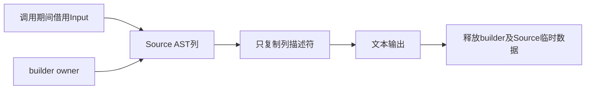

# State生成AST同域借用优化

## Intent：最终目标

在不撤回Source State自举、不减少校验的前提下，消除生成AST导入时的多余深复制，
降低真实Store生成及宿主LLVM编译成本，继续处理完整冷构建固定差值。

## Data：可用证据

冻结当前P2宿主IR共68491477 B。行头校验15实例共218351 B，可共享部分理论最多
约42 KB，仅0.062%，不足以支持完整重建试验，停止该候选。更大的state.module.render
单定义约1083313 B：Source在scratch生成AST，随后深复制到builder，打印后两者释放。

可证伪假设：Source直接使用builder.allocator，导入用appendBorrowed；在整个同步
render期间Input及builder都存活，省去全部复制工作及对应失败清理展开。保持公开
返回文本仍由allocator拥有，不让Source列描述符或借用逃逸。

## Edges：边界与限制

仅修改State AST接入，不改RX/ZX生成算法、字段/范围/OOM校验、Store持久语义或
构建分区/并发/优化模式。Source临时数据与目标共享arena可能延长部分草稿寿命，
需要直接测State生成的分配与内存，不能只看IR缩小。Native AST接入仍为过渡。

不新增持久测试；复用Store和库既有用例，忽略目录诊断覆盖空/只读/独立对象和
io/process/execute组合。先验证同输入字节及生命周期，再比较IR、实际受影响路径
和完整构建；基线不随本阶段重置。

## Answer：交付与成功标准

成功要求检查与输出一致、没有跨owner逃逸，IR/代码及分配成本改善，现有Store行为
回归通过，完整冷构建及固定累计差值记录后统一提交推送，工作区干净。

## 生命周期核对与局部证据

Input的Object.module_name由调用方持有，整个同步render内有效。executeValue的
Source产物现由builder.allocator拥有，导入只复制列描述符；selectDeclarations只
选取根行头，不保存Input/Output栈描述符。printer最终文本由caller allocator拥有，
builder arena在return后释放；没有payload或来源描述符逃逸。

Source中间列现在也存活到打印结束，这是真实的成本边界。忽略目录的20组同步
诊断覆盖0/1/4/16对象、独立及共享、只读及可写、io/process组合和storage入口：
生成文本总计92665 B，前后Wyhash摘要均b09aeac55622fa01；所有调用释放后底层
allocated_bytes等于freed_bytes。该摘要不冒充独立的逐字节全产物对照。

| 底层计数          |   原实现 | 同域借用 |     差值 |
| ----------------- | -------: | -------: | -------: |
| 累计分配请求B     | 21766683 | 18802147 | −2964536 |
| 分配次数          |      362 |      193 |     −169 |
| 单次最大活跃请求B |  2136668 |  2138077 |    +1409 |

计数使用std.testing.FailingAllocator和透明peak代理，统计的是arena的底层chunk请求，
不是Source逻辑alloc次数，也不是RSS。活跃峰多1409 B，保留正差；不因总分配减少
便宣称打印工作集一定下降。首轮进程启动含系统首次执行开销，不将其墙钟用于收益。

固定P2宿主响应文件、相同Source生成输入，LLVM IR68491477→67950057 B，净减
541420 B；state.module.render自身1083313→576079 B，净减507234 B。总定义
3505→3503。必须看全IR，不能只统计一个函数或某个因内联移动而变化的函数族。

三组宿主编译交替对照均改善，使用独立local cache及同一global cache：

| 指标中位数    |     原实现 |   同域借用 |      差值 |
| ------------- | ---------: | ---------: | --------: |
| 实际秒        |      31.50 |      31.00 |     −0.50 |
| CPU秒         |      33.04 |      32.57 |     −0.47 |
| time单体RSS B | 2364637184 | 2350022656 | −14614528 |
| 宿主归档B     |    6530000 |    6487512 |    −42488 |

逐对CPU差−0.32/−0.48/−0.35秒，实际差−0.34/−0.50/−0.36秒。这里是独立宿主
编译峰，不能直接加减完整构建RSS；before快照路径与after源码路径不同，归档字节
差仅作辅助证据，主要结论同时依据IR、分配计数及实际编译对照。

既有test-rx-store-runtime为55/55步骤、39/39检查通过；包含物理Store隔离、
应用内存State、独立请求、只读、失败恢复、分配失败和IO边界。未新增持久测试。
源码仅改state/module.zig：Source执行allocator及导入模式，字段/范围/未知列/OOM
校验继续使用原实现，没有修改Source算法或放宽验证。

## 自我复核与后续边界

Source State的RX编排和ZX算法保持，Native接入仍为过渡，不能据此宣称完整自举。
本次消除一类payload复制及错误清理展开，不代表所有权分析或全部AST路径已零复制。
其他import_module.append调用保持原有owning语义，未自动放宽为借用。

完整构建继续以固定129.74秒/216.03 CPU秒/2075033600 B单体/2247294976 B树峰
验收，不将本轮独立宿主节省0.50秒机械换算为完整收益或重置累计基线。
原始IR和日志分别在忽略目录header-validation、state-borrowed及partition-reference。

## 完整冷构建收口

全新local/global缓存、空stage0、P2、12核、固定Zig archive，43/43步骤通过。
main/ordered/collections/growth共7545/23/64/360=7992个文件字节一致，不含输入指纹。
本轮未改Source算法，Store行为由上面的专属39项回归及20组生成诊断覆盖。

| 指标      |     上阶段 |       当前 | 固定完整基线 |   累计差值 |
| --------- | ---------: | ---------: | -----------: | ---------: |
| 实际秒    |     130.94 |     129.79 |       129.74 |      +0.05 |
| CPU秒     |     198.30 |     198.51 |       216.03 |     −17.52 |
| time单体B | 2145714176 | 2133442560 |   2075033600 |  +58408960 |
| 采样树峰B | 2156298240 | 2143338496 |   2247294976 | −103956480 |

time CPU189.95 user+8.56 sys；0.2秒采样墙钟129.801秒、单体采样峰2122891264 B。
实际少1.15秒，单体少12271616 B、树峰少12959744 B。完整CPU正差0.21秒保留，
不把独立宿主CPU减少0.47秒机械等同整轮CPU；受影响宿主三组对照均改善，固定
完整累计CPU仍少17.52秒，单轮完整差值含其他阶段波动，不能只挑一个指标报告。

完整实际耗时相对固定基线+0.05秒，落入用户0.1秒容差；单体峰仍高约55.7 MiB，
树峰低约99.1 MiB，两个口径分别追踪，不能宣称所有累计内存项均已恢复。保持原
固定基线继续自举；不把容差变成每一阶段可重置的预算。

完整证据位于`partition-reference/cold-state-borrowed/`，与隔离host的约2.35 GB峰
分开报告。最终交付为Source AST同域借用接入、行为/成本验证及本IDEA记录。
