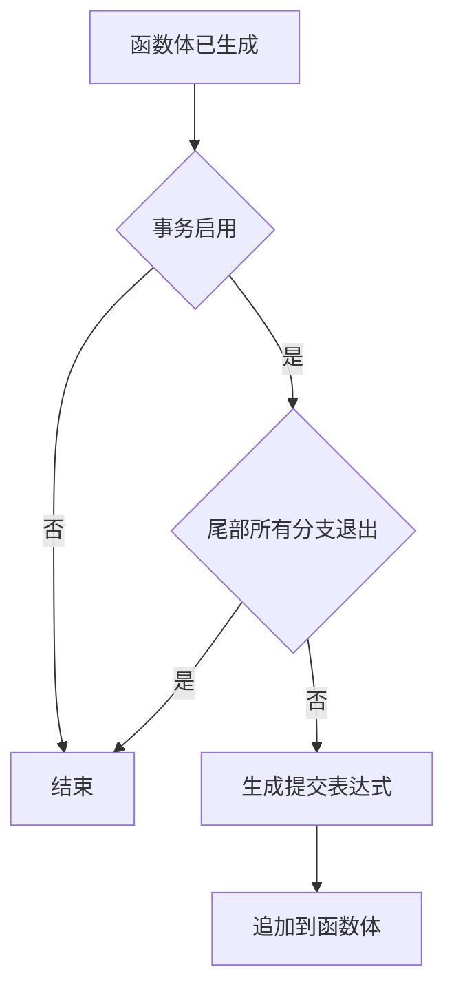
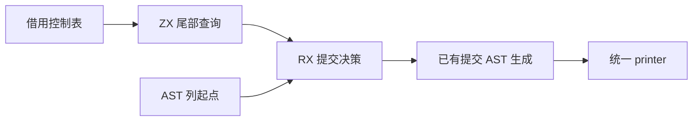

# Store 隐式提交生成自举

## Intent 目标

让 Store 事务函数隐式退出时的提交决策与生成由 RX/ZX 完成。仅在存在事务状态且函数体可自然退出时追加提交。

## Data 证据

Source 目前仍在 `Lower.function` 中用 Zig 的 `ir.terminates` 决定是否生成隐式提交。事务谓词与提交表达式生成已有 ZX 实现。核心已有全表退出事实计算，适合需要每个块事实的调用方。此处只询问一个块，原算法检查末语句并短路递归。

## Edges 边界

沿用原算法的空块、返回、二分支及穷尽分派规则，借用现有控制表，无临时列表、全表扫描或底层复制。保留显式返回自身的提交路径与 seed 实现。

## Answer 验收

用相同输入比对前后生成文件，运行现有 Store 和编译器自举回归，核对三阶段与冷构建成本。成功后统一提交推送。

## 实现与阶段对照

- RX 先判断事务是否启用，再检查函数尾部是否一定返回，最后在可能自然退出时调用既有提交 AST 生成。ZX 查询只看每个访问块的末语句，二分支与穷尽分派保持原来的短路顺序。
- 宿主借用控制表并传入 AST 列起点，生成结果追加到既有 AST 和函数体。生成的递归函数携带控制表指针与块编号，无控制表复制、列表分配或全表扫描。初始 seed 继续执行原查询，显式返回继续使用既有提交路径。
- ReleaseSmall、12 核和 16 分区。第一阶段由上一个 Source stage 3 生成，第二、三阶段由前一阶段生成，分别通过 22/22 步。前后 Source 工具用同一份 359 入口清单生成 8,673 个文件，增长组生成 410 个文件，均逐字节相同。文件比较排除生成器身份摘要 `.zxc-inputs`。
- 同一主组使用独立、预热的函数缓存交替测量，三轮中位数墙钟 1.46 → 1.47 秒，CPU 5.09 → 5.10 秒，单体峰值 823,590,912 → 823,296,000 字节。
- 现有 `test-stores` 与 `test-rx-store-runtime` 使用本阶段 stage 3 生成的分析与生成器，62/62 步、275/275 项通过。初始 seed 构建的正式 CLI 运行 Source 分析与生成，另通过 8 项应用生命周期 Store 回归。

## 冷构建

使用 Zig 0.17.0、ReleaseSmall、本地归档、12 核和默认四分区。初始生成器由 Zig 构建并使用 seed 分析与生成，安装的 CLI 使用 Source。首轮 70/70 步通过，实际主组有 8,632 个文件与上阶段相同。其余变化限于新增和撤下的入口文件、相关类型、分区导出和生成清单。

首轮墙钟 116.42 秒，CPU 209.22 秒，树峰 2,349,924,352 字节，单体 MaxRSS 2,085,912,576 字节。相对上一阶段墙钟增加 1.73 秒，CPU 增加 1.36 秒。约 0.91 秒出现在 Zig 构建驱动启动到仓库配置进程之间，两轮构建驱动二进制的 SHA-256 相同。主组生成器的采样区间均为 2.36 秒，三个重分区分别增加 0.01、0.01、0.22 秒。保留首轮样本并隔离复测。

复测墙钟 116.37 秒，CPU 211.02 秒，树峰 2,296,283,136 字节。同期重测上一提交得到 115.08 秒墙钟、210.23 秒 CPU 和 2,367,275,008 字节树峰。以同期基线比较，两轮 CPU 差异均在 1 秒内，墙钟仍增加约 1.3 秒。因而继续优化常见路径，函数 IR 没有 Store 时直接略过事务输入和 AST 适配。实际 Store 函数继续进入 RX，由 RX 决定事务启用和提交。

优化后 70/70 步通过，主组 8,645 个产物与优化前逐字节相同，仅排除生成器身份摘要 `.zxc-inputs`。

用本阶段 stage 2 重新构建最终 stage 3，22/22 步通过。同输入重跑主组 8,673 个和增长组 410 个文件均一致。三轮交替测量的墙钟中位数均为 1.46 秒，CPU 5.07 → 5.09 秒，单体峰值 823,263,232 → 823,476,224 字节。最终 CLI 的 8 项应用生命周期回归通过。

| 指标                |      固定基线 |      上一阶段 |    同期旧提交 |        本阶段 | 相对固定基线 |
| ------------------- | ------------: | ------------: | ------------: | ------------: | -----------: |
| 墙钟（秒）          |        129.74 |        114.69 |        115.08 |        114.95 |       -14.79 |
| CPU（秒）           |        216.03 |        207.86 |        210.23 |        208.16 |        -7.87 |
| 进程树峰值（字节）  | 2,247,294,976 | 2,405,908,480 | 2,367,275,008 | 2,270,576,640 |  +23,281,664 |
| 单体 MaxRSS（字节） | 2,075,033,600 | 2,089,353,216 | 2,102,935,552 | 2,083,962,880 |   +8,929,280 |

## 自我复核

迁移的范围是 Store 事务函数自然退出时的提交，底层 AST 导入与其他函数体生成仍经既有宿主接口。初始 seed 保留原实现。现有回归核对事务、资源失败和应用生命周期，产物对照覆盖标准自举输入。整树峰值仍比固定基线高约 23 MB，样本间的进程重叠差异需要继续跟踪。

原始日志和样本在忽略目录 `.zig-cache/cold-build-analysis/ownership-research/store-fallthrough/` 与 `partition-reference/cold-store-fallthrough-final/`。
