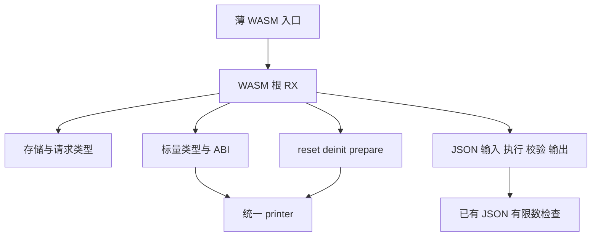

# WASM 宿主生成自举

## Intent

将 freestanding WASM 宿主的存储、请求生命周期、JSON 执行和标量 ABI 完整迁入 RX/ZX，复用既有校验与结构化 AST，保持应用 ABI 与成本模型。

## Data

- 上阶段 58675c90：冷构建 118.87 秒墙钟、216.74 秒 CPU、树峰 2,101,428,224 字节。
- 固定冷基线 129.74 秒墙钟、216.03 秒 CPU、树峰 2,247,294,976 字节，生成器固定基线 4.69 秒 CPU、1.27 秒墙钟。
- 正式剩余 WASM 生成规则为 host/wasm 的 8 个 Zig 文件，约 433 行；既有 test-wasm-protocol 覆盖 scalar/JSON/Store 生命周期与 WASI，但 WASI 子组属于 CLI host。
- 唯一只读审计代理核对了复用点、声明布局和执行顺序；没有并发修改或构建。

## Edges

不添加运行库、新语法或源代码片段节点。补齐的是已有 AST 列的构造便利接口：选择 arms、可变切片、返回表达式、变量/编译期声明。统一 printer 接收已有 arms 和根声明范围。

stateless Request.deinit 的嵌套声明放在声明表前缀，顶层 first/count 只覆盖后缀。Scalar 的编译期导出引用语句范围，不混淆声明范围。comptime_parameter 只用于 isScalar/Scalar 的 T 参数，其他调用默认 false。

JSON 校验保留 emit 分支内执行；alloc 保留 executing guard → reset → u64 容量检查 → prepare → 至少一字节分配 → slice → ready。初始化失败先 state.deinit 再 arena.reset；标量路径不套用 JSON ready 协议。

## Answer

交付完整 WASM RX 编排、原子 ZX 构造、薄 ABI/统一 printer 入口及独立 seed。验收生成文本、已有行为、三阶段与同输入产物，以及实际影响的生成器、冷构建和内存。统一验收全部未提交变更后提交推送，不把局部接线称作交付。

## 执行记录

正在实现；尚未通过整项验收。既有测试尚未明确覆盖初始化失败、实际 OOM 和 executing=2 重入，需要以输出等价和可复核分支核对补足，不能声称测试已覆盖。

### 首次贯通

Root RX 已串接存储、分配、JSON ABI、结果访问、生命周期、JSON 校验和标量 ABI；Node Task 参数元数据复用已有 comptime_parameter 字段，未添加新语言语法。额外 AST 列和嵌套声明范围接入统一 printer；原生 WASM 算法进入 seed 目录。

40 组完整模块（20 个输出类型，各 stateful=false/true）已与原生 seed 逐字节一致。首次打印错误的原因是构造辅助状态没有携带新增 optional_type 列，表达式头却仍存在；已经恢复该列并验证。临时逐声明打印探针已删除，探针中的额外渲染分配不作为性能证据。

整项行为回归、三阶段与性能验收尚未完成，不提交中间接线。

### 移除探针后的对照

40 组完整模块再次逐字节一致，Source 累计分配 16,178,316 字节，原生 seed 为 18,858,112 字节；临时逐声明额外打印已去除。第一阶段 Source 工具 21/21 成功，正在进行第二阶段与既有 WASM/Node 行为回归。Node 参数元数据改变只增加可省略的 comptime_parameter，默认 false；N-API 公开包装为其参数数组补充显式 Parameter 类型，保留原有形状与生成结果。

### 行为与阶段

Source 三阶段均 21/21。既有 WASM 与 Node 联合回归已通过，包括标量、JSON、Store 生命周期、WASI，以及 N-API/Worker 行为；测试用 CLI 编译进程已正常结束，不与性能测量并发。当前开始相同当前 manifest 的生成器交替对照，入口身份必须同时匹配 wasm_host，不能只按历史可能重复的入口数量选择。

### 阶段与生成器验收

联合回归 49/49 步、14/14 Zig 检查通过；WASM 489 项包含 13 项 RX State 生命周期和 6 项 WASI 命令，WASI 不外推为 freestanding 覆盖。Node 仍为 561 协议、64 绑定、33 TS 声明，异步协议/所有权/State/Worker/失败检查 18/42/11/12/8 项。

Source 三阶段各 21/21；stage2/stage3 同一当前 manifest（359 个入口且包含 wasm_host）的 8,669 个输出文件全部一致。新旧 Source stage3 工具同输入、Source 分析/生成，预热一次后交替三次：CPU 中位数 5.14→5.13 秒、墙钟 1.47→1.48 秒、RSS 822,673,408→822,427,648 字节，全部输出文件一致。

相对固定生成器基线 4.69 秒 CPU/1.27 秒墙钟，当前累计 +0.44/+0.21 秒；随着入口和功能增长继续跟踪，不把单轮差异当作重置预算。完整冷构建正在独占测量，实际 WASM 构建待随后隔离运行。

### 完整冷构建与增长警戒

默认四分区、12 核、ReleaseSmall、相同归档、独立本地/全局缓存，43/43 成功。time 墙钟 **119.28 秒**、CPU **217.93 秒**（208.01+9.92）、time 单进程峰值 **2,071,035,904 字节**，采样树峰 **2,219,704,320 字节**、采样单进程峰值 **2,063,433,728 字节**。

相对上阶段：墙钟 +0.41 秒、CPU +1.19 秒、树峰 +118,276,096 字节（约 +5.63%）。相对固定基线：墙钟 -10.46 秒、CPU +1.90 秒（约 +0.88%）、树峰 -27,590,656 字节（约 -1.23%），time 单进程峰值 -3,997,696 字节。CPU 按用户允许的“小幅增长但墙钟未实质增加”权衡记录；累计已经增加 1.90 秒，接近 3 秒警戒，不能继续把每次小增量作为新预算。树峰独立评估，当前只略低于固定基线，后续阶段不得忽略增长趋势。

树峰在 84.00 秒处由三个 LLVM build-obj 进程约 683/705/806 MB 重叠形成，最终链接单进程峰值反而降低。没有通过改优化级别、减少全局核心数、固定延时或撤回迁移使结果通过。

本次冷构建工具本体从 Native 初始 seed 构建，再由它生成并静态链接 Source 实现；正式 CLI 启用 Source 分析/生成。独立 Source 三阶段工具本体由前一 Source 阶段生成，性能对照不混同这两条来源。

### 实际受影响构建

上一阶段与当前冷构建安装的 CLI，使用相同外部 Zig、ReleaseSmall、相同源码及 freestanding 目标；各预热一次后交替三次。预热共享后端缓存顺序不同，不据预热数据作冷构建对比；后端已热的构建仍执行宿主 AST 生成。

| 场景      | CPU 秒（前→后） | 墙钟秒（前→后） |  time RSS 字节（前→后） |
| --------- | --------------: | --------------: | ----------------------: |
| u32 标量  |       0.34→0.34 |       0.27→0.27 | 115,982,336→115,933,184 |
| 对象 JSON |       0.34→0.35 |       0.28→0.28 | 118,816,768→118,751,232 |
| RX Store  |       0.35→0.35 |       0.28→0.28 | 116,277,248→117,047,296 |

没有重置固定 CPU/内存基线；Store 场景 RSS +770,048 字节约 +0.66% 也保留，不声称每条细分路径内存均下降。原始证据位于忽略目录 `.zig-cache/cold-build-analysis/ownership-research/wasm-host/`、`partition-reference/cold-wasm-host-final/` 和 `.zig-cache/wasm-host-*.log`。

## 自我核对

- 全部生成通过结构化 AST 与统一 printer；没有 Source 片段节点、专用原生回调或运行库。完整模块文本等价覆盖了测试未直接执行的失败分支，但没有将其冒充动态 OOM/初始化失败测试。
- root RX 编排存储、分配、JSON、生命周期和标量 ABI；各阶段 ZX 保持单项构造职责。超过 240 行的构造按输入转换、ABI 绑定和支持谓词拆分，没有删必要空行压缩排版。
- 原有 context/block 的接口保留；新 block_scope 接受已经构造好的语句范围。Selection、guard、try_value、comptime 参数和 printer 根范围是通用 AST 支持，不增加语言语法。
- 手写入口保留同步 ABI 借用、错误归一化及统一打印，旧算法完整隔离 seed 目录；全编译器通用 AST/ABI 适配仍是后续自举边界，不能据本阶段宣称整体目标完成。
- 本阶段树峰和 CPU 较上阶段增长虽未超过固定基线警戒，已明确记录；后续没有新的性能预算，必须优先跟踪和定位累计增长。

最终安装 CLI 直接通过 489 WASM 和全部既有 Node/Worker 检查，未为该复核重新构建 CLI。本次 72 个 RX/ZX 文件完成 lint，所有新 ZX 均不超过 240 行；原生与文档格式、diff 已核对。统一提交推送后核对工作区与上游，不将本阶段完成扩展为整个编译器已完成自举。
