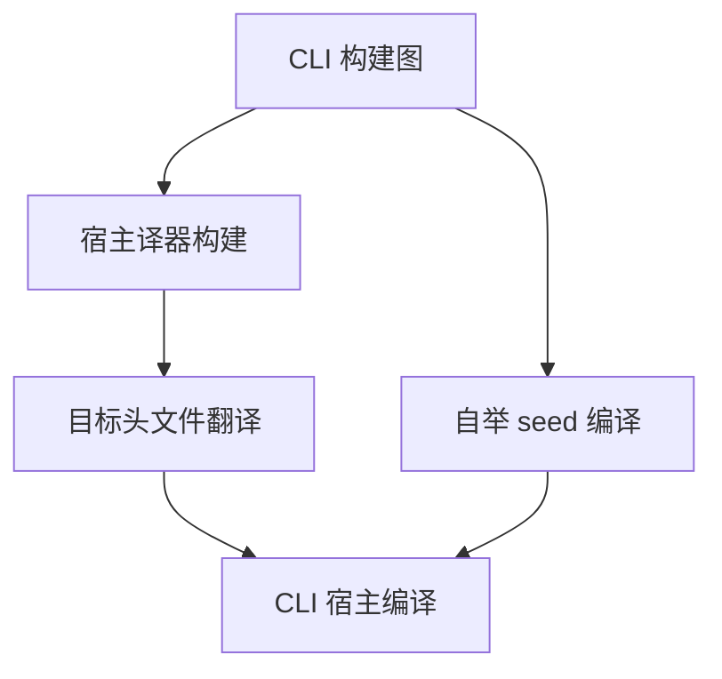
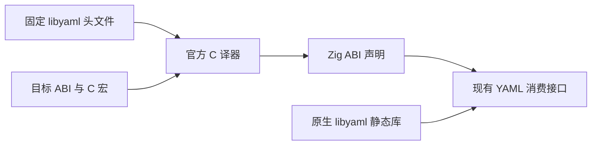

# libyaml 翻译器冷构建优化

## Intent 目标

降低自举冷构建中 libyaml 绑定翻译与 seed 编译重叠时的进程树峰值，保留 libyaml ABI 和构建并发。

## Data 证据

上阶段固定输入的复测为 115.39 秒墙钟、214.36 秒 CPU、2,410,676,224 字节树峰；树峰处 seed 和 Zig 翻译驱动分别占约 1.54 GB 和 0.85 GB。独立全冷翻译峰值 903,888,896 字节；清空翻译结果缓存、复用译器时，翻译约 0.08 秒，峰值 34,668,544 字节，输出 SHA-256 相同。

Zig 0.17.0 的 `jitCmdInner` 默认以 ReleaseFast 首次构建译器，从 `ZIG_GLOBAL_CACHE_DIR` 定位其缓存；命令行 `--global-cache-dir` 和 `-fno-llvm` 分别属于外层缓存和目标参数。官方独立译器支持单独配置宿主优化级别。[Zig 驱动源码](https://codeberg.org/ziglang/zig/src/tag/0.17.0/src/main.zig) · [Zig 0.17 发行说明](https://ziglang.org/download/0.17.0/release-notes.html)

## Edges 边界

保留固定 libyaml 源码及宏、目标 ABI、静态库、现有配置诊断和许可证安装。固定 Zig 0.17 对应的官方译器发布版本。分别验证译器自身编译、真实构建关键路径与目标绑定。

## Answer 验收

确认目标声明与已消费 ABI，运行现有 manifest 相关回归，并与最近阶段和固定基线比较同配置的端到端时间、CPU、单体峰值与进程树峰值。确认构建及依赖获取可复现后提交推送。

## 实现与验收

- 使用 Zig 0.17 兼容的官方 translate-c 2.0.2，按发布提交和 Zig 包哈希固定。宿主译器显式采用 ReleaseSmall，目标翻译仍使用请求的 target 和优化模式，保留 Windows 的 `_FORTIFY_SOURCE=0`。译器只参与构建。
- 同一 Zig 0.17.0、ReleaseSmall、本地工具链归档、12 个核心和默认四分区，完整冷构建 70/70 步。初始生成器由 Zig 构建并执行 seed 分析与生成，安装的 CLI 执行 Source 分析与生成。复跑 70/70 步，翻译与译器构建均命中缓存。
- 两轮 seed 的 `__text` 段与入口清单分别一致，主组 8,641 个产物逐字节相同。独立输出目录下的 `.zxc-inputs` 随生成器可执行文件摘要变化，比较时仅排除此身份文件。
- 宿主默认目标和六个发布目标逐项对照 libyaml 绑定，每个目标 291 或 292 条公开声明与匿名布局一致。独立译器省略 Zig 字段默认初始化；现有 libyaml 消费方直接交给 C 函数初始化对象。安装的 macOS arm64 CLI 通过现有 manifest inspect、workspace、graph、import、init 共 2,021 项回归。六目标对照验证了声明，尚未执行其他平台的原生程序。

| 指标                |      固定基线 |      上一阶段 |        本阶段 | 相对固定基线 |
| ------------------- | ------------: | ------------: | ------------: | -----------: |
| 墙钟（秒）          |        129.74 |        115.39 |        114.69 |       -15.05 |
| CPU（秒）           |        216.03 |        214.36 |        207.86 |        -8.17 |
| 进程树峰值（字节）  | 2,247,294,976 | 2,410,676,224 | 2,405,908,480 | +158,613,504 |
| 单体 MaxRSS（字节） | 2,075,033,600 | 2,090,205,184 | 2,089,353,216 |  +14,319,616 |

同采样口径下，译器构建峰值 850,984,960 → 713,850,880 字节，结束时间从第 56.96 秒提前到第 49.29 秒。整树峰值从 seed 与译器重叠转移到三个 LLVM 分区同时编译，较上一阶段仅下降 4,767,744 字节。对固定基线仍高 158,613,504 字节。

## 自我复核

这次消除了翻译驱动的 ReleaseFast 首次构建成本，完整构建 CPU 减少 6.50 秒。树峰迁移后仍需按 LLVM 分区各自的占用曲线定位。冷构建计时来自同机器同配置的单次运行，墙钟差异小于 1 秒。

原始日志和比对记录在忽略目录 `.zig-cache/cold-build-analysis/ownership-research/yaml-translation/` 与 `partition-reference/cold-yaml-translator/`。
