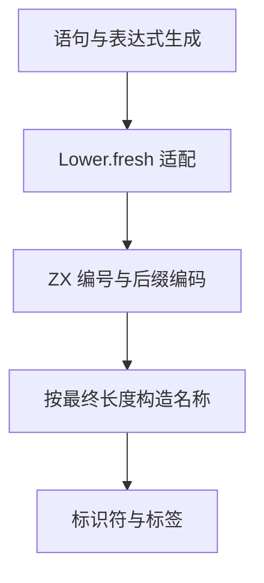

# 临时标识符命名自举

## Intent

将正式生成器中 `Lower.fresh` 的临时标识符命名迁入 ZX。维持前缀、下划线、递增十进制编号的顺序，保留局部变量和控制流标签的既有生成结果。

本记录按 IDEA 框架核对目标、证据、边界与交付标准。

## Data

- `Lower.fresh` 原来直接更新 `serial` 并通过 `std.fmt.allocPrint` 构造名称。对象构造、循环状态、谓词和对象更新仍通过此入口生成临时名称。
- `ast/fresh.zx` 已为 ZX 生成阶段提供序号与名称接口。它的调用方传入已经包含分隔符的前缀，复用 `printer/text/integer.zx` 写入十进制数字。
- 初版使用 `bytes.fromText` 借用前缀并追加下划线和数字。生成 Zig 显示每个名称走动态列表的 `zxReserve`，分配包含 16 字节容量头部，并按二次幂预留空间。编号跨过容量边界时还会再分配。
- 使用上一阶段 `52bd32e0` 的 Source stage 3 对照相同输入。完整冷构建沿用固定遍历种子、四分区和固定累计基线。

## Edges

- 名称编码是单个原子操作，注册为 ZX 生成入口。原有 RX 编排及已有带分隔符前缀的 ZX 调用方保留现有接口。
- 宿主继续保存 `Lower.serial`，接收新序号和定长的后缀字节表示。它通过 Zig 标准库按最终长度分配名称，并将借用前缀和后缀写入该内存。函数生成 arena 负责名称的存储生命周期。初始 seed 保留原有格式化实现。
- 验证现有临时标识符拼写、序号顺序、生成文件一致性、循环及对象构造回归。性能对照区分 Source 生成与 seed 驱动的完整冷构建。

## Answer

### 实施与验证

初版三个阶段自编译成功，主组 8,713 个文件和增长组 410 个文件逐字节一致。全量 Source 生成交替三轮取中位数，CPU 8.75 → 8.74 秒，墙钟 2.01 → 2.02 秒，单体峰值 871,071,744 → 893,730,816 字节。新版本三轮峰值范围约 870～907 MB。除采样波动外，动态列表容量头部是生成代码中可确认的新增成本。

改为 ZX 计算标量后缀。逐个从编号末尾取出十进制数字，每次将后缀左移一个字节并写入该数字，最后写入下划线。按小端解释时，字节顺序为下划线和正序数字。`u64` 最多有 20 个十进制数字，连分隔符最多 21 字节，三个 `u64` 的定长存储可以容纳全部有效编号。生成入口使用空固定分配器，宿主只分配最终名称。

最终实现的三个阶段均为 ReleaseSmall、12 核、16 分区，每阶段 22/22 步通过。第一阶段由上一阶段的 Source stage 3 生成，后两阶段依次由本阶段的 stage 1 和 stage 2 生成。使用同一份 365 入口清单比较上一阶段和本阶段 Source stage 3，主组 8,713 个文件逐字节一致。本阶段 stage 2、stage 3 的同输入产物也完全一致，增长组的 410 个文件在三个工具之间一致。仅排除生成器身份文件 `.zxc-inputs`。

| Source stage 3 交替三轮中位数 | 墙钟秒      | CPU 秒      | 单体峰值 RSS 字节         |
| ----------------------------- | ----------- | ----------- | ------------------------- |
| 缓存命中，前 → 后             | 1.49 → 1.49 | 5.14 → 5.13 | 826,572,800 → 826,032,128 |
| 空函数缓存，前 → 后           | 2.00 → 2.01 | 8.74 → 8.75 | 908,541,952 → 918,110,208 |

空缓存每轮实际生成 4,027 个函数。最终生成 Zig 的后缀入口不调用分配或列表扩容，宿主只调用一次精确分配的 `std.mem.concat`。空缓存进程峰值中位数仍高约 9.57 MB，两侧单轮范围分别约 896～913 MB、879～921 MB。进程峰值包括并发分析及其他阶段，不能据此将峰值差归到后缀分配。

测量记录在 `.zig-cache/cold-build-analysis/ownership-research/fresh-name/` 与 `fresh-name-exact/`。

### 完整冷构建

Zig 0.17.0、ReleaseSmall、本地工具链归档、12 核、四分区、固定遍历种子 `0x3b41c83f`。隔离本地与全局缓存，关闭常驻生成器，进程树每 200 毫秒采样。初始生成器由 Zig seed 构建，构建期间使用 seed 分析和生成，安装后的 CLI 使用 Source。

| 对照             | 墙钟秒  | CPU 秒 | 进程树峰值字节 | 单体最大 RSS 字节 |
| ---------------- | ------- | ------ | -------------- | ----------------- |
| 固定基线         | 129.740 | 216.03 | 2,247,294,976  | 2,075,033,600     |
| 上一阶段相同种子 | 116.288 | 205.92 | 2,391,457,792  | 2,095,841,280     |
| 动态列表初版     | 115.614 | 203.17 | 2,286,993,408  | 2,082,603,008     |
| 定长后缀最终实现 | 115.796 | 205.00 | 2,294,513,664  | 2,100,248,576     |

最终构建 70/70 步通过。相对上一阶段，墙钟减少 0.492 秒、CPU 减少 0.92 秒、进程树峰值减少约 97 MB，单体最大 RSS 增加约 4.4 MB。相对固定基线，墙钟减少 13.944 秒、CPU 减少 11.03 秒，进程树峰值仍高约 47 MB。树峰出现在三个 LLVM 分区并行编译期间。初版和最终版本的构建与采样分别在 `partition-reference/cold-fresh-name/` 和 `partition-reference/cold-fresh-name-exact/`。

### 回归

使用本阶段 Source stage 3 构建并运行 `test-object-construction`、`test-nested-buffer` 和 `test-predicate-allocation`，217/217 步、103/103 项通过。新增 ZX 源码通过格式化和 lint 检查。

### 自我复核

ZX 负责序号推进和字节编码，宿主在最终名称分配成功后保存序号。分配失败沿用生成器的错误出口。序号的长期状态仍由 `Lower` 持有，定长字节到 AST 文本切片的适配在生成状态模型迁移后收口。
