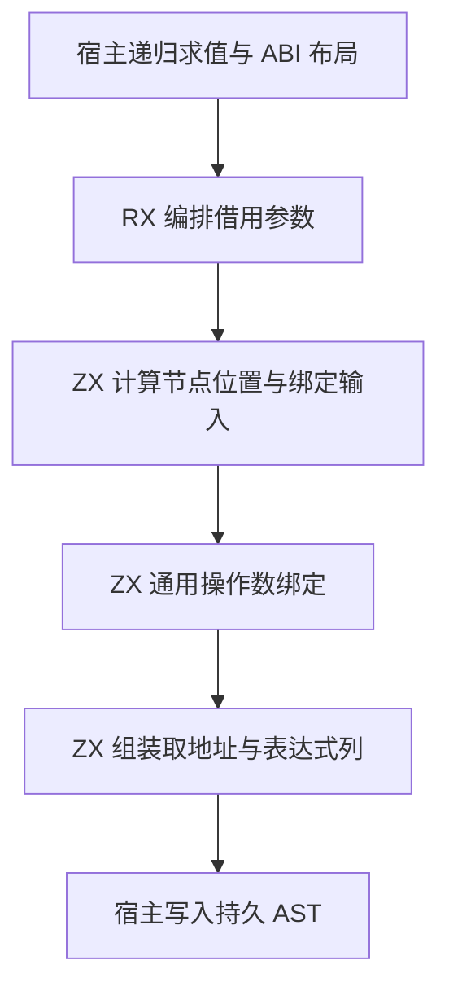
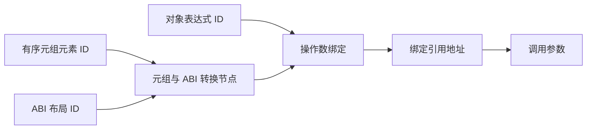

# 借用参数打包自举

## Intent

把借用参数的元组构造、ABI 转换、绑定和取地址交给 RX/ZX。让借用对象与栈上临时对象复用同一条绑定和取地址路径。按 IDEA 框架记录实现和验收。

## Data

- 借用元组原先在 Zig 构造元组节点，再调用生成的转换和绑定，最后在 Zig 构造取地址节点。
- 借用对象原先在对象构造后经通用绑定，再在 Zig 取地址。栈上对象经另一套通用调用生成入口完成同一绑定和取地址。
- 元素表达式 ID 在递归求值时已写入持久切片，可直接作为元组节点载荷。ABI 转换节点只需另存类型和元组两个 ID。

## Edges

- 宿主保留元素递归求值和 ABI 布局查找。已经求值的对象表达式直接进入绑定。元组先保留元组节点和 ABI 转换节点的 ID，再绑定转换结果。
- RX 复用通用操作数绑定规则，保持名称编号、声明顺序和借用生命周期。ZX 生成列一次写入 AST，不复制元组的元素 ID 列。
- 转换节点的两个参数和操作数名称进入持久 AST 存储。其它生成列只在导入期间使用。初始 seed 保留原有构造顺序。
- 对照同一入口清单的生成产物，运行既有借用、元组和返回值回归，比较 Source 生成及完整冷构建。

## Answer

### 实施与验证

普通借用对象、栈上对象和借用元组共用一个生成入口。调用生成的通用状态机移除了独立的栈上对象分支。元组 AST 的载荷继续借用宿主求值阶段的持久 ID 列，转换节点的两个参数在导入时保存一次。

三个自编译阶段均使用 ReleaseSmall、12 核、16 分区，每阶段 22/22 步通过。上一阶段 Source stage 3 生成第一阶段，之后依次使用本阶段 stage 1 和 stage 2。

使用相同的 368 入口主组和包含新入口的 43 入口增长组。上一阶段 Source stage 3 与本阶段 stage 2、stage 3 的 8,734 个主组文件和 416 个增长组文件逐字节一致。仅排除生成器身份文件 `.zxc-inputs`。

| Source stage 3 交替三轮中位数 | 墙钟秒      | CPU 秒      | 单体峰值 RSS 字节         |
| ----------------------------- | ----------- | ----------- | ------------------------- |
| 缓存命中，前 → 后             | 1.50 → 1.49 | 5.16 → 5.14 | 827,899,904 → 827,834,368 |
| 空函数缓存，前 → 后           | 2.05 → 2.00 | 8.75 → 8.73 | 879,919,104 → 879,558,656 |

空缓存每轮生成 4,038 个主组函数。日志与统计在 `.zig-cache/cold-build-analysis/ownership-research/borrowed-argument/`。

### 完整冷构建

Zig 0.17.0、ReleaseSmall、12 核、四分区、本地 Zig 归档，固定遍历种子 `0x3b41c83f`。关闭常驻生成器，使用独立空缓存，每 200 毫秒采样进程树。构建期间的工具由 Zig seed 构建，使用 seed 分析与生成。安装后的 CLI 使用 Source。

首次完整冷构建因磁盘空间耗尽中断。保留失败日志，清理已验收阶段的可重建测量缓存后重新构建。重测 70/70 步通过。

| 对照                 | 墙钟秒  | CPU 秒 | 进程树峰值字节 | 单体最大 RSS 字节 |
| -------------------- | ------- | ------ | -------------- | ----------------- |
| 固定基线             | 129.740 | 216.03 | 2,247,294,976  | 2,075,033,600     |
| 上一阶段同工作区样本 | 118.294 | 205.98 | 2,304,868,352  | 2,110,062,592     |
| 本阶段同工作区重测   | 115.802 | 205.59 | 2,213,593,088  | 2,109,440,000     |

比上一阶段同工作区样本少 2.492 秒墙钟、0.39 秒 CPU，进程树峰值减少 91.3 MB，单体最大 RSS 减少约 0.6 MB。与固定基线相比，墙钟少 13.938 秒、CPU 少 10.44 秒，进程树峰值低 33.7 MB，单体最大 RSS 高 34.4 MB。

主生成提前约 2 秒开始，墙钟变化主要出现在本阶段改动的生成路径之前。四个主组 LLVM 分区对象均逐字节一致，进程树峰值发生在分区构建重叠期间。完整测量在 `partition-reference/cold-borrowed-argument-final/`。

### 回归

使用本阶段 Source stage 3 运行 `test-native-value-boundary`、`test-value-return` 和 `test-tuple-bindings`。186/186 步、164/164 项通过。修改的 RX、ZX 通过格式和 lint 检查，修改的 Zig 通过 `zig fmt --check`。

### 自我复核

已核对对象引用和元组 ABI 转换沿用之前的 ID、名称与声明顺序。宿主继续处理递归求值、ABI 类型布局以及 AST 持久存储。前后安装版 CLI 对借用对象和逃逸元组用例生成的 524 行、711 行 Zig 源码逐字节一致。
