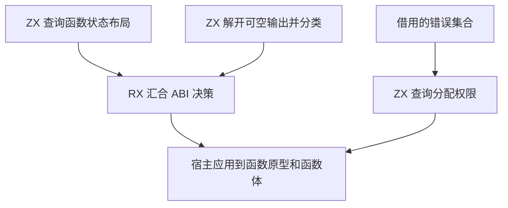
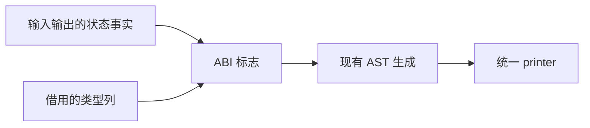

# 函数值 ABI 与分配权限自举

## Intent 目标

将函数值 ABI 的状态布局、输入绑定、输出表示选择，以及函数错误集合允许分配的判断迁入 RX/ZX。

## Data 证据

目前 `Lower.valueMode` 在 Zig 中组合状态事实并解开可空输出，`Lower.function` 在 Zig 中查询 OutOfMemory。调用适配器已有相同的状态布局判断和分配错误查询。上阶段完整冷构建为 115.18 秒、209.28 CPU 秒和 2,299,543,552 字节树峰。

## Edges 边界

只借用类型标签、可空子类型列及已有状态事实。保留嵌套状态、公开视图、原生引用、原型与函数体的 ABI 语义。Zig 宿主管理当前生成状态的进入和恢复。

## Answer 验收

验证三阶段自编译、值调用与原生边界行为及同输入生成结果。实测受影响的生成性能与完整冷构建，并记录固定基线的累计变化。

## 实现与阶段对照

- RX 调用共享状态布局查询、可空输出解包和返回表示选择。调用适配器复用同一状态布局查询。计划输出三个布尔标志，Zig 宿主据此进入和恢复生成状态、绑定输入并生成函数。ZX 分配权限沿用适配器对已知错误集合的判断，并保留未知错误集合允许分配的语义。
- 用上一阶段 Source stage 3 构建第一阶段，后两阶段由前一阶段构建。ReleaseSmall、12 核、16 分区，三轮均通过 22/22 步。相同 363 入口的主组 8,703 个文件及增长组 410 个文件逐字节一致，比较排除生成器身份摘要 `.zxc-inputs`。
- 初版主组交替各三轮。函数缓存命中时墙钟中位数 1.47 → 1.48 秒，CPU 均为 5.11 秒。函数缓存为空时每轮实际重新生成 4,023 个函数，墙钟 2.01 → 2.00 秒、CPU 均为 8.75 秒、单体峰值 905,265,152 → 877,658,112 字节。

## 冷构建

Zig 0.17.0、ReleaseSmall、本地归档、12 核及默认四分区。初始生成器由 Zig 构建，执行 seed 分析和生成；安装的 CLI 使用 Source。首轮 70/70 步，墙钟 117.11 秒、CPU 211.20 秒、树峰 2,268,168,192 字节。构建驱动在仓库配置前增加约 0.73 秒，主组生成器累计 CPU 从 6.35 增加到 6.76 秒，LLVM 分区和最终宿主库编译时间接近。合并可空输出解包与输出表示判断，减少一个生成函数及中间对象。保留共享的状态布局查询和 RX 的编排。

合并后重复三阶段自编译，每阶段 22/22 步。相同 363 入口的主组 8,701 个文件与增长组 410 个文件均逐字节一致。函数缓存命中时，墙钟中位数均 1.48 秒，CPU 均 5.12 秒。每轮全量重新生成 4,022 个函数时，墙钟 2.01 → 1.99 秒、CPU 8.78 → 8.73 秒、单体峰值 901,169,152 → 890,077,184 字节。使用本阶段 stage 3 构建原生值边界、原生引用运行和循环列布局三个既有回归，共 146/146 步、159/159 项通过。

合并后的完整冷构建为 117.53 秒、210.80 CPU 秒、2,252,570,624 字节树峰。采样发现分区启动前有约 2.16 秒差异，分区和宿主库编译时长接近。Zig 默认以随机种子打乱依赖遍历顺序。上一提交普通复测为 116.38 秒、208.71 CPU 秒；以迁移版实际使用的遍历种子复测为 116.15 秒、210.42 CPU 秒。按相同遍历种子比较，墙钟仍多 1.38 秒。

目录工具的两种依赖优化模式均约 1.24 秒，保持原配置。分区协调工具交替隔离编译两轮，ReleaseFast 的墙钟为 4.55、4.47 秒，ReleaseSmall 为 1.04、1.03 秒；CPU 从 4.60、4.53 秒降到 1.10、1.08 秒。用真实构建的缓存状态和对象验证，两种构建均保留对象时间戳及内容，缓存查询各约 0.01 CPU 秒。采用 ReleaseSmall 构建该协调工具。

最终冷构建 70/70 步通过。与协调工具优化前比较，主组 8,673 个文件与四个实际分区对象逐字节一致，主组比较仅排除生成器身份摘要。热构建 70/70 步，四个对象的时间戳稳定。下表保留历史样本，并列出遍历种子一致的对照。

| 指标                |      固定基线 |  上一阶段历史 |  同种子旧提交 |        本阶段 | 相对固定基线 |
| ------------------- | ------------: | ------------: | ------------: | ------------: | -----------: |
| 墙钟（秒）          |        129.74 |        115.18 |        116.15 |        115.33 |       -14.41 |
| CPU（秒）           |        216.03 |        209.28 |        210.42 |        205.11 |       -10.92 |
| 进程树峰值（字节）  | 2,247,294,976 | 2,299,543,552 | 2,272,165,888 | 2,361,049,088 | +113,754,112 |
| 单体 MaxRSS（字节） | 2,075,033,600 | 2,100,789,248 | 2,093,105,152 | 2,096,414,720 |  +21,381,120 |

同遍历种子时，墙钟减少 0.81 秒、CPU 减少 5.31 秒。相对上一阶段历史样本，墙钟增加 0.15 秒、CPU 减少 4.17 秒。最终树峰出现在三个 LLVM 分区重叠时，较同种子旧提交高约 89 MB。协调工具优化前后的分区对象相同，树峰样本仍相差约 108 MB。

## 自我复核

值 ABI 和分配权限的策略已迁移，生成状态进入与恢复仍经宿主，初始 seed 保留原有规则。全量 Source 生成单体峰下降约 11 MB。整轮树峰增加仍记录在固定基线中，需继续定位 LLVM 分区重叠的内存波动。ReleaseSmall 协调工具的端到端与对象对照来自 macOS arm64。

原始日志在忽略目录 `.zig-cache/cold-build-analysis/ownership-research/function-value-mode/` 与 `partition-reference/cold-function-value-mode-partition-small/`。
