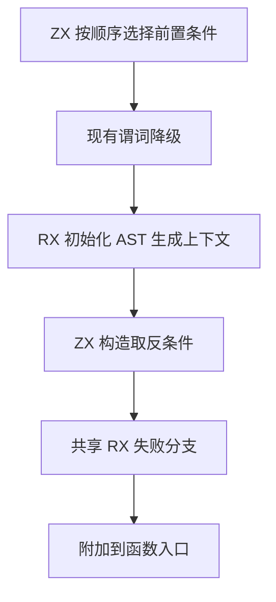
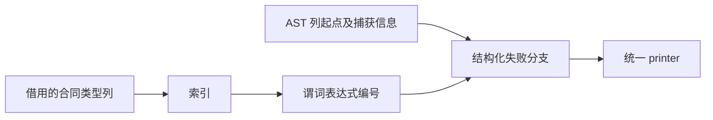

# 函数前置条件生成自举

## Intent 目标

将函数前置条件的有序筛选与失败分支生成迁入 RX/ZX，维持现有求值顺序和失败行为。

## Data 证据

正式生成器在 Zig 中扫描合同表、选择 `requires` 并构造逻辑取反。通用失败分支和表达式 AST 已有 ZX 实现。当前冷构建为 114.95 秒、208.16 CPU 秒、2,270,576,640 字节树峰。

## Edges 边界

直接借用合同类型列，逐次返回下一个索引。没有合同时跳过查询，不建立临时索引表。通用谓词降级及其表达式缓存、AST 生命周期沿用宿主接口。前置条件失败仍使用原有错误集合和捕获行为。

## Answer 验收

完成同输入 Source 阶段自编译、已有合同回归和实际冷构建复核，比较生成文件、墙钟、CPU 与峰值，通过后提交推送。

## 实现与阶段对照

- ZX 从借用的合同类型列中查找下一个 `Requires`，保留出现顺序。生成的查询无堆分配或输入复制。宿主逐项调用现有谓词降级，继续维护缓存、引用及作用域，之后由 RX 调用 ZX 生成取反条件和共享失败分支。
- 从上一阶段 Source stage 3 开始，ReleaseSmall、12 核和 16 分区，连续三轮自编译均通过 22/22 步。前后 Source 工具对同一 361 入口生成的 8,687 个文件逐字节一致，增长组 410 个文件一致，比较排除生成器身份摘要 `.zxc-inputs`。
- 主组使用独立、预热的函数缓存交替测三轮，墙钟中位数 1.47 → 1.46 秒，CPU 5.11 → 5.10 秒，单体峰值 823,918,592 → 824,344,576 字节。
- 本阶段 stage 3 生成的分析与生成器通过 `test-contracts` 和 `test-verification-resources` 的 9 项现有回归。安装的 Source CLI 通过 Z3 验证的 20 个既有场景。复用已有的有界递增样例，实际生成 Zig 与上一阶段逐字节相同，运行输入 254 得到 255，输入 255 触发 `PreconditionFailed`。

## 冷构建

Zig 0.17.0、ReleaseSmall、本地归档、12 核和默认四分区。初始生成器由 Zig 构建并执行 seed 分析与生成，安装的 CLI 使用 Source。首轮 70/70 步通过，墙钟 115.95 秒，CPU 210.56 秒，树峰 2,316,271,616 字节。隔离复测得到 116.75 秒、211.12 CPU 秒和 2,318,286,848 字节树峰。

初版重排了普通失败分支的输入和 RX 模块，扩大了生成差异。最终版恢复原输入和 RX，前置条件直接复用已有上下文初始化、失败 AST 和分支发布。最终版 70/70 步通过，冷构建主组有 8,633 个产物与上一阶段一致，新增 12 个，变动 12 个。变化位于新增调用、依赖索引、类型与分区入口。最终 CLI 重新对照有界递增样例，生成文本、成功值和失败错误一致。

最终版再次从上一阶段 Source stage 3 连续自编译三轮，每轮 22/22 步。相同 361 入口的主组 8,685 个文件及增长组 410 个文件均逐字节一致。交替测量主组的墙钟中位数均为 1.47 秒，CPU 5.11 → 5.10 秒，单体峰值 824,655,872 → 824,279,040 字节。

| 指标                |      固定基线 |      上一阶段 |    同期旧提交 |        本阶段 | 相对固定基线 |
| ------------------- | ------------: | ------------: | ------------: | ------------: | -----------: |
| 墙钟（秒）          |        129.74 |        114.95 |        115.49 |        115.18 |       -14.56 |
| CPU（秒）           |        216.03 |        208.16 |        210.16 |        209.28 |        -6.75 |
| 进程树峰值（字节）  | 2,247,294,976 | 2,270,576,640 | 2,247,163,904 | 2,299,543,552 |  +52,248,576 |
| 单体 MaxRSS（字节） | 2,075,033,600 | 2,083,962,880 | 2,095,759,360 | 2,100,789,248 |  +25,755,648 |

与历史样本比较，墙钟增加 0.23 秒、CPU 增加 1.12 秒。用同一采样器、同一配置同期复测上一提交后，墙钟减少 0.31 秒、CPU 减少 0.88 秒。采样显示主组生成器 CPU 6.62 → 6.35 秒，最终宿主库编译 CPU 33.18 → 33.17 秒。树峰出现在三个 LLVM 分区重叠时，较同期基线增加约 52 MB，单体 MaxRSS 增加约 5 MB。

## 自我复核

已迁移前置条件筛选和失败分支构造。通用谓词降级及其 AST 导入仍经过宿主，初始 seed 保留原逻辑。冷构建按采样记录进程树峰值，CPU 以端到端计时为准，分阶段数值用于定位。

原始日志在忽略目录 `.zig-cache/cold-build-analysis/ownership-research/function-precondition/` 与 `partition-reference/cold-function-precondition-final/`。
