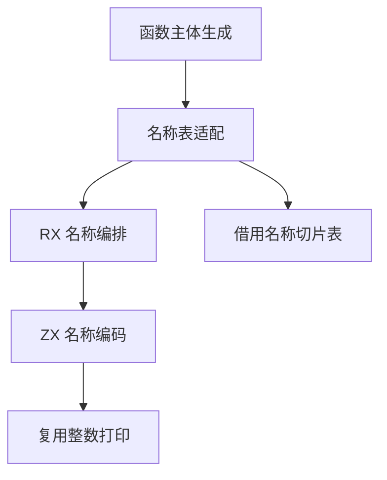

# 函数局部符号命名自举

## Intent

将正式生成器为函数局部符号选择名称的职责迁入 RX/ZX，保持第零项为 `in`，后续项为 `value_N`。共享名称的字节存储，保持现有可更新的名称描述符表和词法作用域恢复行为。

本记录采用 IDEA 框架，覆盖目标、证据、边界与交付标准。

## Data

- `zx/lower.zig` 在每次生成函数主体前遍历全部符号，每项单独使用 `std.fmt.allocPrint`。
- `self.names` 的描述符会被 loop、回调和局部作用域临时替换，不能改为全局不可变表。
- 已有列表追加、concatText 与整数打印支持构造连续字节存储，数字字符与基数复用现有实现。
- 比较工具采用上一阶段 Source stage 3，保留相同输入、Zig 版本、优化配置及阶段身份。性能固定基线沿用上一阶段记录。

## Edges

- 初始 seed 保留格式化实现，Source 后端使用新实现。
- 名称编码属于单一内聚集合算法，RX 使用单原子函数模块，ZX 在一次循环中追加各个名称与分隔字节。
- 宿主适配器仅将零结尾的连续名称转换为已有表的借用切片，名称字节的存储由函数生成 arena 保持。
- 维持已有符号计数来自 IR 的约束，不新增专用运行库或动态分派。
- 不新增测试用例。运行相关既有回归，检查三个阶段生成结果和实际 Source 开销。编译驱动及端到端冷构建独立记录。

## Answer

### 实施与验证

初版通过精确容量预分配。生成 Zig 显示原生 `bytes.repeat` 的返回值为 plain，首次局部写入需要复制该原生缓冲区。改用空列表起步、concatText 追加前缀、复用整数打印追加编号，避免预分配缓冲区的初始复制。原生函数的可转移返回契约仍是通用能力缺口，本阶段使用已有 ZX 构造能力。

三个阶段自编译每阶段 22/22 步通过，均为 ReleaseSmall、12 核、16 个生成分区。第一阶段由上一阶段的 Source stage 3 生成，后两阶段分别由本阶段 stage 1 和 stage 2 生成。

使用同一份包含 364 个入口的 manifest 对照上一阶段和本阶段 Source stage 3，主组 8,708 个文件逐字节一致。本阶段 stage 2 与 stage 3 的同输入产物也完全一致。增长组分别使用三个工具生成，410 个文件逐字节一致。仅排除生成工具身份相关的 `.zxc-inputs`。

交替三轮取中位数。缓存命中时墙钟 1.47 → 1.48 秒，CPU 均为 5.11 秒，单体峰值 825,655,296 → 825,245,696 字节。每轮使用独立空函数缓存，实际全量生成 4,025 个函数文件，墙钟 2.00 → 2.01 秒，CPU 8.72 → 8.73 秒，单体峰值 890,290,176 → 878,460,928 字节。生成结果仍逐字节一致。

测量和产物比较保存在 `.zig-cache/cold-build-analysis/ownership-research/function-symbol-names/` 的 `verify.log`、`compare-metrics.json` 和 `fresh-metrics.json`。

### 完整冷构建

Zig 0.17.0、ReleaseSmall、本地工具链归档、12 核、默认四个分区及固定 Zig 遍历种子 `0x3b41c83f`。隔离本地与全局缓存，关闭常驻生成器，进程树每 200 毫秒采样。初始工具由 Zig seed 构建，构建期间采用 seed 分析和生成；安装后的 CLI 使用 Source。

| 对照             | 墙钟秒  | CPU 秒 | 进程树峰值字节 | 单体最大 RSS 字节 |
| ---------------- | ------- | ------ | -------------- | ----------------- |
| 固定基线         | 129.740 | 216.03 | 2,247,294,976  | 2,075,033,600     |
| 上一阶段相同种子 | 115.334 | 205.11 | 2,361,049,088  | 2,096,414,720     |
| 本阶段           | 116.288 | 205.92 | 2,391,457,792  | 2,095,841,280     |

本阶段 70/70 步通过。阶段墙钟增加 0.954 秒、CPU 增加 0.81 秒；相对固定基线，墙钟减少 13.452 秒、CPU 减少 10.11 秒。进程树峰值增加 30,408,704 字节，相对固定基线增加 144,162,816 字节，继续记录累计变化。峰值出现在约第 80.84 秒的三个 LLVM 分区编译重叠期间，单体最大 RSS 减少约 0.57 MB。该阶段的 Source 生成峰值下降不能代替完整构建树峰值的改善。

完整命令、进程采样和构建日志保存在 `partition-reference/cold-function-symbol-names/`。

### 回归

使用本阶段 Source stage 3 构建并运行 `test-loop-columns`、`test-nested-collections` 和 `test-switch-scope`。160/160 步、153/153 项通过，覆盖循环列布局、集合回调的作用域恢复和 Switch 局部绑定。新增 ZX/RX 源码通过格式化及 lint 检查。

### 自我复核

局部符号命名规则迁移后，名称表适配、`Lower.fresh` 的临时名称序号及生成器其余状态仍由宿主管理，完整生成器自举继续进行。连续存储新增分隔字节，通过已有列表增长机制避免每个名称的独立分配。增长所需的存储搬迁属于新数据构造，返回及描述符适配借用相同字节。
