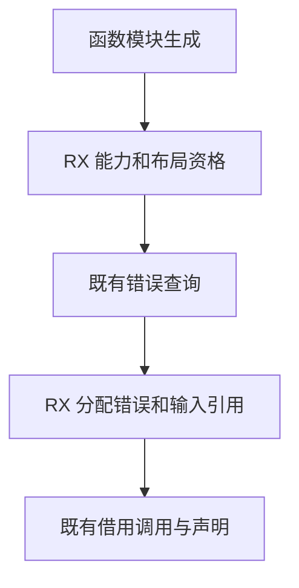

# 函数调用适配选择自举

## Intent 目标

将函数模块生成时选择指针调用适配、确认返回分配错误及定位输入引用的逻辑迁入 RX/ZX。沿用可借用时的同一函数调用方式。

## Data 证据

现有 `functions/adapter.zig` 在支持 value 调用、能力与表示允许、已知错误集包含 OutOfMemory 时寻找第一个输入引用。找不到时保留普通函数生成。错误查询可能分配，必须继续在能力和布局检查之后执行。

前一阶段默认冷构建为 117.42 秒、218.74 CPU 秒、2,286,190,592 字节树峰。固定基线为 129.74 秒、216.03 CPU 秒、2,247,294,976 字节树峰。

## Edges 边界

Source 直接借用表达式种类、载荷索引、引用符号和错误名切片。输入引用扫描保持先到先选及提前退出。调用参数构造、作用域保存恢复、声明 AST 接口仍复用现有 Lower。初始 seed 保留原规则。

## Answer 验收

检查阶段一致性、正式生成的函数模块和既有运行行为。对照生成器与完整冷构建，保留固定基线和实际 Source/seed 路径说明。验收后统一提交并推送。

## 实现与阶段核对

- `eligible.rx` 先核对函数能力与模块状态，再读取既有布局查询结果。通过后才由调用方取得已知错误集。`argument.rx` 先核对分配错误，再从借用的表达式列选择首个输入引用。
- 两个入口归入已有增长组。第一阶段由上一阶段的 Source stage 3 构建，第二、三阶段由前一阶段的工具构建。三阶段各 22/22 步通过。使用相同清单比较上一阶段 Source 工具、当前 stage 2 与 stage 3，主组 8,669 个文件和增长组 395 个文件分别逐字节一致。产物包含指针 `call` 转发到同模块 `callValue` 的实际模块。
- 两套 Source 工具使用同一 359 入口及 16 分区配置，各预热一次再交替测三轮。墙钟中位数均为 1.47 秒，CPU 5.09 → 5.08 秒，单体峰值 RSS 823,640,064 → 823,328,768 字节。该对照使用已预热的函数文件缓存，固定生成基线仍为 1.27 秒墙钟和 4.69 CPU 秒。
- 搜索和资格规则接收借用切片及标量。生成调用闭包未出现分配调用，适配器使用零容量固定缓冲。表达式种类、载荷与引用列由同一个已验证 IR 表提供，原始扫描顺序保持不变。

## 冷构建核对

相同 Zig 0.17.0、ReleaseSmall、12 核、默认四分区、本地归档与新 local/global cache。初始生成器本体使用 seed 的分析与生成，安装的正式 CLI 使用 Source。首轮 47/47 步通过，实际冷构建主组 8,641 个文件与上一阶段逐字节一致。

首轮墙钟 118.76 秒、CPU 218.16 秒，树峰 2,241,347,584 字节，单体 MaxRSS 2,101,182,464 字节。墙钟比上一阶段增加 1.34 秒。200ms 进程采样中，构建驱动约晚 0.65 秒启动，seed 编译增加约 0.53 秒，分区对象 23.86 → 23.83 秒，最终宿主库 31.73 → 31.93 秒。保留首轮数据，使用同一配置复核墙钟差异。

首次复测在 LLVM 写入时耗尽磁盘空间，日志保留，失败结果不计入对照。释放早期实验的本地编译缓存后，复测 47/47 步通过，墙钟 118.73 秒、CPU 219.32 秒、树峰 2,350,858,240 字节。峰值仍由三个 LLVM 分区同时驻留产生。两次成功样本的墙钟均超过上一阶段 1 秒容差。

## 优化 seed 目录工具

初始生成器须等待 `standard-catalog` 生成标准接口目录。分区输入及两次采样中的分区耗时持平，目录工具编译位于实际关键路径，适合先隔离验证。提取真实 Zig 命令，复用同一全局缓存、分别使用新本地缓存，仅将工具根模块的 ReleaseFast 改为 ReleaseSmall。genz 依赖模块配置沿用原值。

| 目录工具指标         | ReleaseFast | ReleaseSmall |
| -------------------- | ----------: | -----------: |
| 编译墙钟（秒）       |        4.60 |         1.18 |
| 编译 CPU（秒）       |        4.78 |         1.37 |
| 编译单体峰值（字节） | 422,084,608 |  227,786,752 |
| 目录生成墙钟（秒）   |        0.49 |         0.48 |

相同实际清单的目录文本逐字节相同。目录生成的短时间样本用来核对可运行性，计时包含进程启动。正式目录仍由现有 RX/ZX 宿主工具生成，适配选择迁移完整保留。

最终冷构建 47/47 步通过。真实 seed 目录及主组四分区的 8,641 个文件与上一阶段逐字节相同。

| 指标                |      固定基线 |      上一阶段 |          最终 | 相对固定基线 |
| ------------------- | ------------: | ------------: | ------------: | -----------: |
| 墙钟（秒）          |        129.74 |        117.42 |        115.32 |       -14.42 |
| CPU（秒）           |        216.03 |        218.74 |        215.58 |        -0.45 |
| 进程树峰值（字节）  | 2,247,294,976 | 2,286,190,592 | 2,311,077,888 |  +63,782,912 |
| 单体 MaxRSS（字节） | 2,075,033,600 | 2,089,418,752 | 2,113,093,632 |  +38,060,032 |

相对上一阶段，墙钟减少 2.10 秒，CPU 减少 3.16 秒。实测树峰增加 24,887,296 字节，单体峰增加 23,674,880 字节。树峰处仍由分区 0、1、2 同时编译产生，三者输入和归一化参数一致。两次优化前测量的相同分区输入已出现约 109.5 MB 树峰跨度。保留高样本并继续跟踪峰值。

## 行为验收与自我复核

- 用首次冷构建安装的正式 CLI 执行现有 `iterate_calls/cli_test.ts`，以同版外部 Zig 编译 ReleaseSafe。迁移和重新发布的两条编译库路径分别构建六种调用模式，共 64 次运行断言通过，覆盖返回别名、空列表和越界错误。
- 单独生成 40 入口增长组，确认 Source 接口和生成内容后再启动阶段构建。初稿的字符串列表 `includes` 超出现有接口，已换为借用字节视图的提前退出扫描。
- 这一阶段迁入适配资格和输入引用选择。Lower 仍负责缓存状态保存与恢复、调用参数生成和声明组装。自举总体仍按正式入口的传递依赖验收。

原始日志在忽略目录 `.zig-cache/cold-build-analysis/ownership-research/function-adapter/` 与 `partition-reference/cold-function-adapter-final/`。
