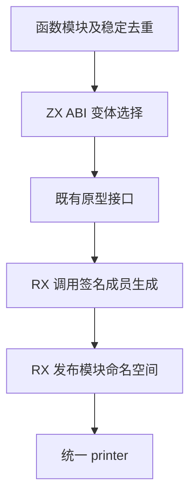
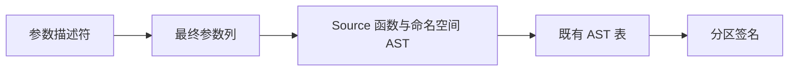

# 分区函数签名生成自举

## Intent 目标

将分区函数签名的 ABI 变体选择、声明及 AST 组装迁入 RX/ZX。签名保留参数类型和调用约定，保持与实现体独立。

## Data 证据

`genz.zx.modules.signatures` 目前由 Zig 为每个模块生成 `@TypeOf` 声明。现有函数原型生成已在 Source，签名命名空间包装、参数匿名化和 ABI 变体判断仍在手写逻辑中。

前一阶段冷构建为 115.32 秒、215.58 CPU 秒、2,311,077,888 字节树峰。固定基线为 129.74 秒、216.03 CPU 秒、2,247,294,976 字节树峰。

## Edges 边界

保留按路径 stem 去重和首次出现顺序，继续使用宿主的路径与哈希表。原型查询继续消费既有 Lower 接口。Source 借用名字并生成结构化 AST，参数描述符直接落入最终列，普通 Zig 输出由统一 printer 负责。初始 seed 保留旧实现。

## Answer 验收

比较 Source 三阶段和实际冷构建的签名及分区文件，运行已有分区、模块或原生边界回归，记录冷构建 CPU、墙钟和峰值。验收后统一提交推送。

## 实现与验收

- Source 选择普通指针变体、值变体或两者；RX 连接成员生成和外层命名空间发布。嵌套函数保留调用约定、返回类型和原型标志，匿名参数直接写入最终字段列。两种变体可共享不可达函数体占位。路径 stem、首次出现去重及既有原型接口留在宿主。
- 第一阶段由上一阶段 Source stage 3 构建，第二、三阶段由前一阶段工具构建，均为 22/22 步。相同 359 入口、16 分区主组的 8,669 个文件，以及增长组 410 个文件，上一阶段与本阶段 stage 2、stage 3 分别逐字节一致。主组生成器预热后各三轮交替，墙钟中位数均 1.46 秒，CPU 5.03 → 5.04 秒，单体峰值 823,050,240 → 822,542,336 字节。
- 默认分组生成留空独立的 `signatures.zig`。隔离工具通过正式的 `LibraryOptions.signatures` 选项明确请求签名，前后使用同一 Source 工具配置和相同 359 入口。生成的签名共 1,620,124 字节、3,647 个 `@TypeOf`，逐字节相同并通过 Zig 语法检查。
- 使用同一 Source 生成请求输出的 `types.zig`，由 Zig 逐项解析各命名空间的所有公开函数类型。首次配对了默认 seed 构建的类型文件，值布局符号不同。改用与签名同批生成的类型文件后，完整类型检查通过。
- 显式签名模式各预热一次，在独立函数缓存下交替三轮。两侧每次均复用 4,007 个函数产物并实际生成签名，墙钟中位数均 1.49 秒、CPU 均 5.11 秒，峰值 823,214,080 → 823,345,152 字节。早期共享缓存的对照因交替失效而废弃。
- 正式 CLI 的既有原生对象 ABI 与拆分生成缓存回归通过，覆盖缓存命中、声明重排、禁用缓存、损坏及错误键。

## 冷构建复核

同一 Zig 0.17.0、ReleaseSmall、本地归档、12 核和默认四分区，初始生成器本体和分析生成使用 seed，安装的 CLI 使用 Source。首轮 47/47 步通过，真实主组 8,641 个文件与上一阶段逐字节一致。墙钟 116.48 秒，CPU 214.75 秒，树峰 2,387,869,696 字节，单体 MaxRSS 2,090,729,472 字节。

首轮墙钟相对上一阶段增加 1.16 秒。采样显示构建驱动约晚 0.70 秒启动，初始生成器与最终宿主库的编译时长持平。树峰出现在 seed 编译与 libyaml `translate-c` 重叠的阶段，两个进程分别约为 1.52 GB 和 0.85 GB。显式签名生成未在此阶段执行。保留该样本并复测完整构建。

复测 47/47 步通过，数据如下。

| 指标                |      固定基线 |      上一阶段 |    本阶段复测 | 相对固定基线 |
| ------------------- | ------------: | ------------: | ------------: | -----------: |
| 墙钟（秒）          |        129.74 |        115.32 |        115.39 |       -14.35 |
| CPU（秒）           |        216.03 |        215.58 |        214.36 |        -1.67 |
| 进程树峰值（字节）  | 2,247,294,976 | 2,311,077,888 | 2,410,676,224 | +163,381,248 |
| 单体 MaxRSS（字节） | 2,075,033,600 | 2,113,093,632 | 2,090,205,184 |  +15,171,584 |

复测墙钟 +0.07 秒、CPU -1.22 秒、单体峰 -22,888,448 字节。树峰实测仍增加 99,598,336 字节，主要来自 seed 与 `translate-c` 的末段重叠。三个样本的 seed `__text` 段均为 1,480,420 字节且 SHA-256 相同，归一化 `translate-c` 命令一致。上一阶段翻译进程在 seed 结束前约 4.54 秒退出，复测中晚约 0.47 秒退出。保持并发与构建依赖，明确保留整树峰值差异。

## 自我复核

签名独立路径的证据来自显式选项产物、函数类型检查及同输入生成时间。默认冷构建用来核对接线及整树指标。源码迁移之外的路径去重、原型查询和 AST 列导入继续使用既有宿主接口。

原始日志保存在忽略目录 `.zig-cache/cold-build-analysis/ownership-research/signature-module/` 与 `partition-reference/cold-signature-module-confirm/`。
