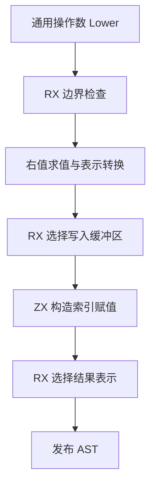

# 列表索引写入自举

## Intent 目标

将普通列表索引写入的边界检查、缓冲区选择、写入和结果存储标记迁入 RX/ZX。正式编译路径应继续复用已经生成的操作数和类型表达式。

## Data 证据

原实现在 `packages/genz/src/zx/list_update.zig`。目标和索引先求值，越界分支先于右值。延迟所有权路径先判断可写性，其他路径根据唯一性、状态布局及增长标记选择原地写、增长缓冲区或普通副本。写入后保持原有存储标记规则。专门缓冲循环的索引更新已有独立 Source 实现。

性能假设是一次 Source 更新发布能代替逐个生成缓冲区调用、绑定和选择表达式的往返，且同一输入的输出不变。固定冷构建基线为 129.74 秒、216.03 CPU 秒、树峰 2,247,294,976 字节。上一阶段为 118.96 秒、224.59 CPU 秒、树峰 2,349,121,536 字节。固定生成基线为 1.27 秒、4.69 CPU 秒。

## Edges 边界

通用子表达式求值、所有权裁剪和元素表示转换仍走既有 Lower 接口。Source 接收已生成的表达式 ID，通过既有 AST 构造器和 printer 发布。初始 seed 保留原算法。应用产物继续静态链接，保持越界捕获、短路和复制次数。

## Answer 验收

比较同一 Source 工具配置的自举产物和运行成本。运行已有函数元素写入、借用和错误顺序回归。按受影响路径测量冷构建与生成器，验收后统一提交推送。

## 实现与阶段核对

- `bounds.rx` 在右值求值前构造边界检查及失败出口。`buffer.rx` 选择原地写、增长缓冲区或普通副本，`build.rx` 接续写入和结果布局发布。
- `list_update.zig` 保留通用操作数 lowering、元素表示转换和 AST 导入。Source 的临时 AST 列在导入后释放，应用执行时的分支和分配顺序沿用原实现。
- Stage 1 由上一阶段 Source stage 3 构建，stage 2 和 stage 3 由前一阶段各自构建，均为 22/22 步。相同 361 入口、16 分区清单下，上一阶段 Source 工具与本阶段 stage 3，以及本阶段 stage 2 与 stage 3，各有 8,705 个文件逐字节一致。
- 两套 Source 工具各预热一次，再交替运行三轮。墙钟中位数均为 1.47 秒，CPU 均为 5.12 秒，峰值 RSS 中位数由 836,337,664 降至 824,295,424 字节。相对固定生成基线累计墙钟 +0.20 秒、CPU +0.43 秒。该结果使用已预热的函数文件缓存。

## 初版冷构建核对

使用 Zig 0.17.0、ReleaseSmall、默认四分区和 12 核并发。新建 Zig 全局和本地缓存，初始 seed 工具本体使用 Zig 实现的分析与生成，再由它生成正式 CLI 所链接的 Source 实现。下表墙钟、CPU、单体 MaxRSS 来自 `time -l`，树峰采用 200ms 采样。

| 指标                |      固定基线 |      上一阶段 |          首轮 |          复测 |
| ------------------- | ------------: | ------------: | ------------: | ------------: |
| 墙钟（秒）          |        129.74 |        118.96 |        120.08 |        118.63 |
| CPU（秒）           |        216.03 |        224.59 |        224.83 |        226.68 |
| 进程树峰值（字节）  | 2,247,294,976 | 2,349,121,536 | 2,267,660,288 | 2,272,935,936 |
| 单体 MaxRSS（字节） | 2,075,033,600 | 2,083,061,760 | 2,079,031,296 | 2,088,026,112 |

两轮均为 46/46 步。首轮墙钟差 +1.12 秒，复测 CPU 差 +2.09 秒。分区编译和最终宿主库编译的摘要分别仍为 24 秒和 31 秒，首轮初始 seed 编译的摘要从 19 秒变成 20 秒，复测回到 19 秒。与旧主组实物对照发现，两个入口在主组引入 36 个新 Zig 文件，使各分区共用的 `types.zig` 增加 27,215 字节。

## 隔离生成入口

将两个入口归入已有的集合增长组，延续独立生成和静态链接。主组恢复 359 入口，集合增长组 38 入口。三阶段仍各 22/22 步。以同一份对应清单运行上一阶段 Source 工具及当前 stage 2 和 stage 3，主组 8,669 个文件、集合增长组 385 个文件分别逐字节一致。

最终冷构建 46/46 步，正式主组四分区的 8,641 个文件与上一阶段实际冷构建逐字节相同。完整构建数据如下。

| 指标                |        最终值 | 相对上一阶段 | 相对固定基线 |
| ------------------- | ------------: | -----------: | -----------: |
| 墙钟（秒）          |        119.43 |        +0.47 |       -10.31 |
| CPU（秒）           |        226.66 |        +2.07 |       +10.63 |
| 进程树峰值（字节）  | 2,293,678,080 |  -55,443,456 |  +46,383,104 |
| 单体 MaxRSS（字节） | 2,089,156,608 |   +6,094,848 |  +14,123,008 |

墙钟落在 1 秒容差内，树峰相对上一阶段降低 55.44 MB。CPU 增量 2.07 秒，占上一阶段的 0.92%，超过通常的 1 秒阈值。本阶段按墙钟基本持平时允许小幅 CPU 增量的约定收口。固定基线的累计 CPU 差 +10.63 秒仍超过 3 秒警戒，后续继续定位。

## 运行回归与自我复核

- 使用两阶段正式 CLI 对同一现有 fixture 生成 Zig。6 套整数索引目录、9 个函数写入 fixture 与 12 个原生副作用 fixture 的 Zig 文件逐字节相同，原生 fixture 的 ABI 文件也逐字节相同。
- 在 ReleaseSafe 下复用现有执行器、测试根和目录数据，覆盖 8,440 项整数列表安全用例、176 项函数写入用例、432 项原生调用与错误顺序用例和 1,022 项隔离算术安全用例，共 10,070 项全部通过。
- 用最终安装的 CLI 发布 fallback fixture 为编译库，再由独立 workspace 消费并生成 Zig。该路线的现有 20 项回归全部通过，包括保留早期输出、分配失败和重复写入容量上界。
- 常规专项构建在本机 Zig 0.17.0 编译辅助工具时发生 SIGSEGV，换用新本地缓存后复现。替代验证走正式 CLI 源码编译、单个编译库消费 fixture 和现有运行器。常规专项构建仍需单独复核。
- 初版误用 AST 单节点输出类型声明两个候选生成器，致使 RX 无法取得后续上下文。将接口对齐候选结果后，用生成清单快速验证，再跑阶段构建。最终对比排除输入指纹，保留所有实际 Zig 文件与清单。

日志保存在忽略目录 `.zig-cache/cold-build-analysis/ownership-research/list-update/` 与 `partition-reference/cold-list-update-isolated/`。
