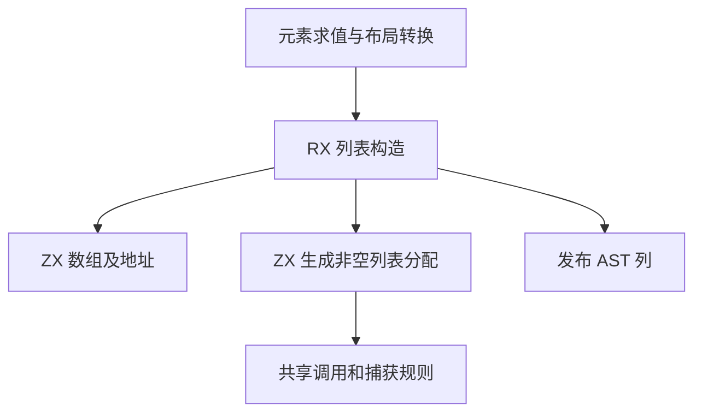
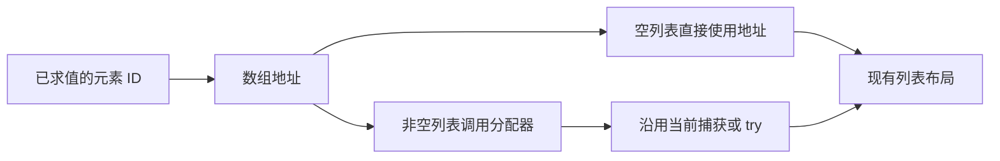

# 动态列表构造自举

## Intent

将列表字面量在元素求值后的动态构造迁入 RX/ZX。保留元素顺序、空列表的静态地址、非空列表的分配、错误捕获和最终布局。用 IDEA 框架记录阶段验收。

## Data

- `aggregate.zig` 原先在 Zig 中调用数组生成、构造分配器名称、生成字段访问并发起可失败调用，分别接入多段 AST。
- `analysis/aggregate/array.zx` 已能从元素 ID 列构造数组与取地址行。现有调用生成已定义普通调用、`try` 和捕获的 AST 形状。
- 元素 ID 列在求值后已存入生成 arena。RX 和 ZX 可以借用这段列，在发布 AST 时继续使用同一段数据。
- 用 `62f79f13` 的 Source stage 3 对照同一输入。完整冷构建保持固定遍历种子、12 核、四分区和累计基线。

## Edges

- RX 先构造数组地址，再根据元素数量决定是否生成分配。ZX 复用同一套调用节点规则，生成分配器访问、调用及错误捕获。
- 宿主暂时负责子表达式求值、表示转换、AST 列发布和分配标记保存。初始 seed 保留原先的构造路径。静态列表快速路径继续由现有入口处理。
- 已求值的元素列和捕获文本借用现有存储。新增调用的两个参数 ID 在发布时进入生成 arena，生命周期与原路径一致。短 AST 描述符使用固定容量的临时分配器。
- 验收覆盖空列表、非空列表、布局与错误路径，使用既有回归及同输入生成文件比较。

## Answer

### 实施与验证

三个自编译阶段均为 ReleaseSmall、12 核、16 分区，每阶段 22/22 步通过。第一阶段由上一阶段 Source stage 3 生成，后两阶段依次由本阶段 stage 1 和 stage 2 生成。

对照上一阶段和本阶段 Source stage 3，主组 365 个入口的 8,719 个文件逐字节一致。本阶段 stage 2 与 stage 3 的同输入产物也完全一致，增长组 410 个文件在三个工具之间一致。仅排除生成器身份文件 `.zxc-inputs`。

| Source stage 3 交替三轮中位数 | 墙钟秒      | CPU 秒      | 单体峰值 RSS 字节         |
| ----------------------------- | ----------- | ----------- | ------------------------- |
| 缓存命中，前 → 后             | 1.48 → 1.48 | 5.11 → 5.12 | 827,375,616 → 826,654,720 |
| 空函数缓存，前 → 后           | 2.02 → 2.03 | 8.74 → 8.75 | 879,656,960 → 888,733,696 |

空缓存每轮实际生成 4,030 个函数。空缓存峰值中位数增加约 9.1 MB，单轮范围在约 879～902 MB 与 879～894 MB。生成代码确认列表字面量的 `array_values` 持有原有元素切片，只为 AST 构造短列和描述符。测量日志在 `.zig-cache/cold-build-analysis/ownership-research/list-literal/`。

### 完整冷构建

Zig 0.17.0、ReleaseSmall、本地工具链归档、12 核、四分区，固定遍历种子 `0x3b41c83f`。隔离本地与全局缓存，关闭常驻生成器，每 200 毫秒采样进程树。初始生成器由 Zig seed 构建，构建期间使用 seed 分析与生成，安装后的 CLI 使用 Source。

| 对照             | 墙钟秒  | CPU 秒 | 进程树峰值字节 | 单体最大 RSS 字节 |
| ---------------- | ------- | ------ | -------------- | ----------------- |
| 固定基线         | 129.740 | 216.03 | 2,247,294,976  | 2,075,033,600     |
| 上一阶段相同种子 | 115.796 | 205.00 | 2,294,513,664  | 2,100,248,576     |
| 本阶段           | 115.511 | 205.06 | 2,253,488,128  | 2,093,318,144     |

完整冷构建 70/70 步通过。相对上一阶段，墙钟减少 0.285 秒、CPU 增加 0.06 秒、进程树峰值减少约 41 MB，单体最大 RSS 减少约 6.9 MB。相对固定基线，墙钟减少 14.229 秒、CPU 减少 10.97 秒，进程树峰值增加约 6.2 MB。峰值仍出现在三个 LLVM 分区同时编译期间。完整构建和进程采样在 `partition-reference/cold-list-literal/`。

### 回归

使用本阶段 Source stage 3 构建并运行 `test-array-literal`、`test-typed-try-runtime` 和 `test-owned-collections`，383/383 步、11,335/11,335 项通过。新增 ZX/RX 源码通过格式化和 lint 检查。

### 自我复核

本阶段覆盖列表字面量的动态 AST 构造。元素求值和 AST 存储仍经宿主，后续须随着生成状态模型迁移一并收口。
