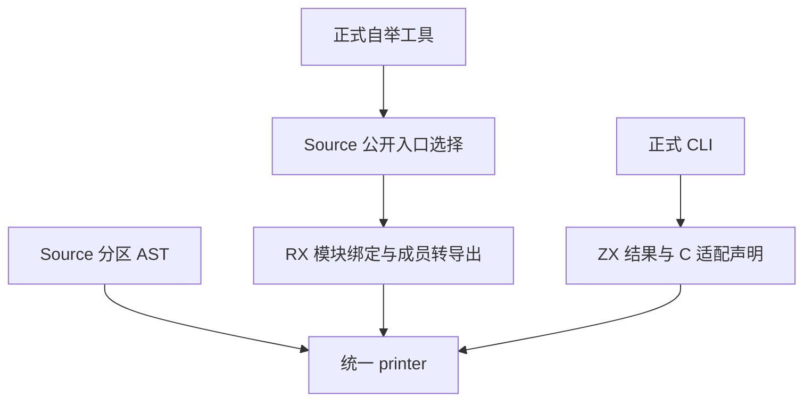

# 宿主绑定声明自举

## Intent：最终目标

让正式 CLI 的结果开关、C 适配声明，以及自举工具的模块转导出与公开入口选择由 RX/ZX 生成。分区产物直接消费已有 Source AST，减少自举时的中间节点转换。

## Data：可用证据

- 上一阶段为 `2b420be2`，正式宿主资源元数据已走 Source。
- `shared_output.zig` 为各公开模块生成兼容转导出；CLI 通过同一 genz 宿主接口生成结果常量和 C 适配模块。
- 分区根、导出和 stub 原已在 Source 组装 AST；调用方随后导入、物化并再次交给 printer。可检验的假设是直接借用已有 AST 列可去掉该中间工作，并保持所有文本逐字节一致。
- 固定冷构建基线：墙钟 129.74 秒、CPU 216.03 秒、树峰 2,247,294,976 字节。上一阶段为 118.98 秒、225.46 CPU 秒、树峰 2,215,100,416 字节。固定生成基线 1.27 墙钟秒、4.69 CPU 秒。

## Edges：边界与限制

保留公共输入输出和错误行为、导出顺序、标识符转义、初始 seed 和显式原生 printer 对照路径。RX 编排选择入口与构造声明的实际步骤；ZX 对列表做内聚的集合构造。只生成结构化 AST，不拼装 Zig 语句。沿用既有回归与忽略目录内的诊断探针，不新增正式测试用例。

## Answer：交付与成功标准

真实调用切换到 Source；初始 seed 独立可运行。核对不同入口标志与转义输入、三阶段与旧工具生成的全部产物；对比同输入 Source 生成路径和默认冷构建，同时记录累计 CPU 与内存趋势。全部变更验收后统一提交和推送，检查工作区及远端同步。

## 实施与阶段核对

- `reexports/bootstrap.rx` 先确定公开入口，再由 `build.rx` 编排导入绑定、成员转导出。普通转导出接口仍接受调用方提供的模块、成员及名称；结果和 C 适配为各自单一原子声明。
- 分区 root、exports、stub 的 Source AST 直接投影给统一 printer；缺少的语句或字段列统一映射为空。旧的 Node 导入与物化仅在显式原生 printer 路径保留。
- 自举转导出使用独立工作区的短生命周期 arena，最终文本仍由请求分配器持有。避免返回文本写入父 arena 后挡住临时块回收。
- 探针 13 组输出逐字节相同，覆盖八种公开入口组合、结果真/假、C 适配、空转导出及关键字/Unicode/引号转义。共用 Source printer 时，累计分配由 408,195 降到 355,683 字节，两侧均完整释放。这不是整进程 RSS。
- 初版 stage1、stage2、stage3 各 22/22 步通过。相同当前 363 入口、16 分区，上一阶段 Source stage3 与本阶段 Source stage3 的 8,697 个输出均逐字节一致，stage2 与 stage3 同样一致。
- 1 次预热后交替 3 轮，中位数 CPU 5.16 → 5.14 秒，墙钟 1.48 → 1.47 秒，RSS 823,558,144 → 823,443,456 字节。相对固定生成基线累计 CPU +0.45 秒、墙钟 +0.20 秒。新增入口和 Source 工具本体均明确区分；该对照不用于推断初始 seed 工具的成本。

## 自我复核

首次局部编译揭示两个原子声明的错误集只有 `OutOfMemory`；泛型适配不应直接按更宽的枚举匹配窄错误集。已收敛到共用错误映射，再运行探针和最终阶段。全树等价包含分区根、导出、stub 和转导出，不能用少量声明样本替代。原生 fallback、I/O 与公开 ABI 投影仍明确列为边界。

## 冷构建复核

首轮 46/46 步通过：time 墙钟 120.15 秒、CPU 215.46 + 10.80 = 226.26 秒、单体 MaxRSS 2,083,340,288 字节；200ms 采样树峰 2,271,477,760 字节。相对上一阶段墙钟 +1.17 秒，树峰 +56,377,344 字节，暂不据此验收。

树峰发生于 84.81 秒，对应分区 0～2 重叠。对照上一阶段实际冷构建输出，这三个分区的所有 Zig 文件逐字节相同；8 个新增函数全部落在分区 3，另有共用 `types.zig` 增加 14,464 字节。分区 3 单体采样峰从 575 MB 降到 545 MB，且早于树峰结束。这排除了大分区函数重分配与新增小分区直接重叠，尚不能仅凭一次采样断言树峰差是波动。以同配置第二轮隔离冷测检验该不确定点。

第二轮仍用主组 363 入口：46/46 步通过，墙钟 119.56 秒、CPU 215.14 + 10.55 = 225.69 秒，单体 MaxRSS 2,071,330,816 字节；采样树峰 2,326,396,928 字节。墙钟已回到阶段容差内，树峰仍高，不把它当作一次偶然值忽略。

## 隔离宿主声明

把四个新声明入口放入已经存在的未分区 host 生成组。复用该组的生成产物与目标平台标准库模块：元数据可执行文件仍用本机配置，正式编译器的绑定按目标配置静态链接。主组恢复 359 入口，新小组不需要新增生成步骤或运行库。这个边界隔离了共用 `types.zig`，使主分区的全部输入可以恢复到上一阶段的形态；并发不变。

- 隔离后 stage1、stage2、stage3 各 22/22 步通过。主组 8,669 个文件与上一阶段及当前阶段工具输出完全一致；host 组使用同一当前 7 入口清单，上一阶段 Source 工具与当前 stage2、stage3 的 108 个文件逐字节相同。
- 相同当前 359 入口、16 分区，隔离交替对比的中位数 CPU 5.14 → 5.14 秒、墙钟 1.47 → 1.47 秒、RSS 823,115,776 → 822,607,872 字节。固定生成基线累计 CPU +0.45 秒、墙钟 +0.20 秒。
- 初版完整冷构建的已安装 CLI 通过既有进程入口 46 项检查，以及 C 头文件缺失、恢复与输出保持回归。隔离后仍核对生产调用和目标类型连接。

## 最终验收与树峰归因

默认冷构建继续采用 Zig 0.17.0、12 核并发、4 个本机 LLVM 分区、相同本地 Zig 归档与新 local/global cache。引导工具本体与分析/生成走初始 seed；安装后的正式 CLI 走当前 Source。上文隔离生成对照的两个工具本体和分析/生成均为 Source。

| 指标                     |      固定基线 |      上一阶段 |        本阶段 | 相对固定基线 |
| ------------------------ | ------------: | ------------: | ------------: | -----------: |
| time 墙钟（秒）          |        129.74 |        118.98 |        118.96 |       -10.78 |
| CPU（秒）                |        216.03 |        225.46 |        224.59 |        +8.56 |
| 200ms 树峰（字节）       | 2,247,294,976 | 2,215,100,416 | 2,349,121,536 | +101,826,560 |
| time 单体 MaxRSS（字节） | 2,075,033,600 | 2,094,612,480 | 2,083,061,760 |   +8,028,160 |

46/46 步通过。CPU 为 213.90 user + 10.69 sys，阶段减少 0.87 秒，墙钟减少 0.02 秒；固定 CPU 累计差仍超过 3 秒警戒，不重置基线。单体 MaxRSS 比上一阶段下降约 11.55 MB。树峰实测比上一阶段高约 134.02 MB，不声称本次冷构建内存峰值下降。

实际冷构建主组的 8,641 个文件（排除输入指纹）全部 SHA-256 一致，包含共用类型和签名、全部分区入口及函数。冷测树峰时没有新增 host 工具进程，只有相同的三个分区编译及低开销父进程。用同一个旧分区驱动、相同归一化参数、新缓存，隔离重放旧输入 → 当前输入 → 同一旧输入：

| 输入                | 墙钟（秒） | CPU（秒） |  树峰（字节） |
| ------------------- | ---------: | --------: | ------------: |
| 旧输入，第 1 次     |      22.97 |     76.07 | 2,337,456,128 |
| 当前输入            |      22.89 |     75.84 | 2,367,111,168 |
| 同一旧输入，第 2 次 |      23.04 |     76.19 | 2,488,025,088 |

同一旧输入的树峰跨度约 150.57 MB，覆盖本轮完整冷构建差值；当前输入的树峰落在旧输入实测范围内。结合峰值处完全相同的分区源与参数，未发现迁移引入分区额外编译工作。接受本阶段，保留全部高样本及固定基线；这不证明绝对树峰已降，也不把相同输入的有限采样当作更一般的内存上界。

隔离后用最终安装的 CLI 验证了同一程序路径的 JSON → 丢弃 → JSON 输出切换，以及真实 C 头文件缺失、恢复和输出保持回归。新增 11 个 RX/ZX 文件格式与 lint 均通过。

详细日志在忽略目录 `.zig-cache/bindings-*.log`、`.zig-cache/cold-build-analysis/ownership-research/host-bindings/` 和 `partition-reference/cold-host-bindings-isolated/`。已淘汰试验的原始计时、采样、输入与哈希摘要保留，临时编译缓存可回收。

本阶段完成绑定规则迁移和分区直连打印。Seed、平台 I/O 与通用 ABI 适配仍在明确的边界内；后续继续迁移其余编译器自有状态与算法。本阶段不构成整个自举完成证明。
