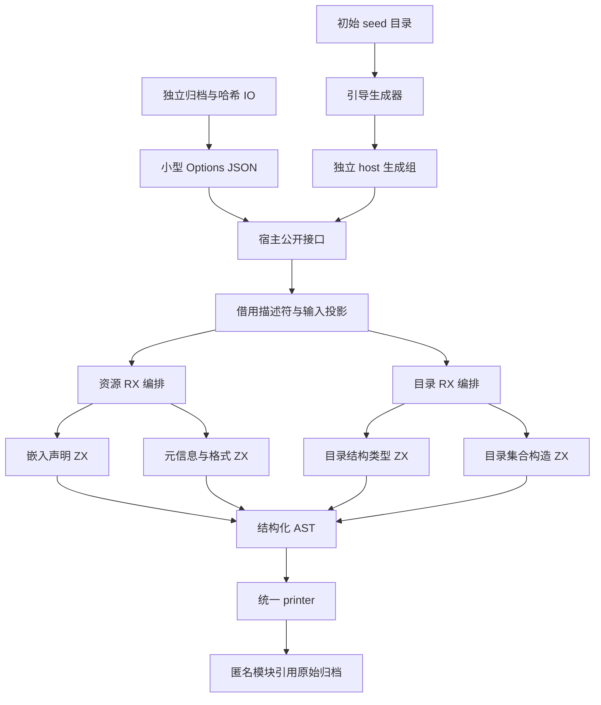

# 宿主资源元数据自举

## Intent：最终目标

将嵌入资源声明与原生模块目录的 AST 生成职责迁入 RX/ZX，保留统一 printer、外部接口和普通静态 Zig 输出。完成这两项职责，不将整个编译器自举宣称完成。

## Data：可用证据

- 原实现为 `packages/genz/src/host/resources.zig` 和 `catalog.zig`，分别生成资源常量与模块目录。
- 前阶段为 `51970da9`。Source 工具本体是 WASM 阶段 stage3；生成实现由当前源码决定。最终三阶段 Source 工具本体与该工具 SHA-256 完全相同（e9432bf76d3c5f7a91e5f4ce1c185b3db817d842c82fa61bd9bff70d7121f526），本阶段宿主职责通过独立 host 工具构建并执行。
- 固定冷构建基线：墙钟 129.74 秒、CPU 216.03 秒、树峰值 2,247,294,976 字节。
- 前阶段冷构建：119.28 秒、217.93 CPU 秒、树峰值 2,219,704,320 字节。CPU 累计增加 1.90 秒，树峰值距固定基线仅约 27.6 MB；须继续关注累计增长。

## Edges：边界与限制

保留资源声明顺序、字符串转义、`@embedFile` 与显式文本的区别、命名空间顺序和空目录行为。原生侧只保留 seed 回退、借用输入描述符、错误映射和 printer 调用；不复制底层字符串，不增加专用语义桥。

使用既有通用 AST 构造原语；目录类型的 struct 字段范围通过普通表达式列表示。ZX 循环只承担目录集合构造，资源阶段顺序和目录生成步骤在 RX 表达。不新增正式测试用例，采用忽略目录内诊断与既有回归。

## Answer：交付与成功标准

1. 两个公开入口均调用当前 RX/ZX 实现，初始 seed 走独立旧实现。
2. Native/Source 元数据输出逐字节一致，并核对 Source 自编译阶段产物。
3. 运行受影响的现有构建检查；同输入隔离测量生成与默认冷构建，记录固定基线累计变化。
4. 全部变更统一提交推送，确认工作区干净且无未推送提交。

## 执行与复核

- 20 个 RX/ZX 文件格式与 lint 通过，所有 ZX 均低于 240 行。
- 忽略目录内探针覆盖 4 个不同长度目录及 zip/xz 两组资源声明，含空文本、嵌入文件、多级命名空间、Unicode 与转义。6 组 Native/Source 文本逐字节相同；两侧临时分配全部释放。此探针对 Native AST 路径与 Source AST 路径共用 Source printer，以隔离 AST 构造差异。探针累计分配 Native 216,620 字节、Source 247,330 字节，此小样本不是完整构建 RSS。
- 调用关系核查发现原打包与目录工具固定使用 seed。已添加独立未分区 `host` 生成组，共享两项生成入口与 printer；主编译器入口集合恢复 359 项，不把宿主工具混入目标平台的分区对象。
- Source 元数据模块固定 `b.graph.host`，正式 standard-catalog 与 bundle-zig 复用；初始引导的 compiler.create(parser=null) 保留 seed 目录。依赖为 seed 目录 → 初始生成器 → host Source 生成 → 正式目录/资源工具，无环。
- 接通正式目录后 stage1、stage2、stage3 均 22/22 步通过。真实标准目录的 18 项、12,072 字节输出也在两种 AST 路径中逐字节一致；其余收口验证与计时进行中。

### 自我复核

首轮局部检查只证明算法输出相同，不能证明生产路径已迁移。因此补查真实调用与构建选项，发现并消除了正式宿主工具仍走 seed 的缺口。首次尝试的模块级数组常量超出当前闭合标量常量能力，已复用标量常量与局部数组，不新增语法或专用桥。

### Source 生成路径测量

同一当前 359 入口输入、16 分区、每工具 1 次预热后交替 3 轮：上一阶段 Source stage3 → 当前 Source stage3，CPU 中位数 5.08 → 5.09 秒，墙钟 1.47 → 1.47 秒，RSS 822,755,328 → 822,673,408 字节；8,669 个输出文件逐字节相同。相对固定生成基线累计为 CPU +0.40 秒、墙钟 +0.20 秒。独立 host 生成组及其实际后端成本由完整冷构建另行计入，不能由主入口组数字推断。

### 首轮冷构建与根因

全新 local/global cache，默认 4 个本机 LLVM 分区、12 核并发、本地固定 Zig 归档，初始 seed 工具本体且当前 Source 分析/生成入口：45/45 步通过。time 墙钟 120.02 秒、CPU 221.26 + 10.73 = 231.99 秒、单进程 MaxRSS 2,083,930,112 字节；200ms 采样树峰值 2,765,619,200 字节（70.12 秒）。

该结果未验收：相对固定基线 CPU +15.96 秒、树峰值 +518,324,224 字节。峰值中，四个 LLVM 分区、RX 测试和 Source bundle 工具并发；bundle 编译约 478MB，完整编译峰值 553MB。Source 目录工具与 bundle 各自编译同一 Source printer/AST 函数闭包，目录工具约 7 秒、bundle 约 9 秒。迁移保留，消除重复后端工作。

可证伪假设：host 三入口生成的 74 个函数改为一个共享的静态对象，两个宿主工具只链接它，能够减少重复 LLVM 编译及其重叠 RSS。复用现有通用分区生成与 ABI 连接机制，不引入新语义桥、不降低核心并发，也不通过固定延迟规避峰值。初始非共享形式与共享形式的目录文本必须相同。

### 共享对象试验与进一步定位

共享对象版冷构建 47/47 步通过：墙钟 119.48 秒、CPU 220.17 + 11.00 = 231.17 秒，树峰 2,647,785,472 字节，单进程 MaxRSS 2,070,429,696 字节。树峰仍未达标，不将此版验收。

进程时间线否定了“去掉重复函数编译就足够”的假设：共享对象在 61.39～63.49 秒完成，70.06 秒树峰时已退出。真正新增峰值来源是 bundle LLVM 编译被 Source 依赖从旧版 34.56～42.46 秒推迟到 63.73～71.46 秒，与四个分区和 RX 测试重叠。

最终调整构建职责：单个 `host-metadata` 可执行文件复用同一组 Source 入口，分别消费目录 JSON 和资源 Options JSON；pack 只负责归档、哈希与 IO。pack 的编译因此不再等待 Source 生成。Source 工具的输入输出是显式构建文件，不引入运行时解释层；资源 Options 小 JSON 确实有序列化和读写成本，不将其称为零复制。应用数组、字符串及归档内容不因该边界复制。

资源产物通过 Zig 的匿名模块直接引用原归档文件，避免合并生成目录时复制 Zig archive。该方式按官方 [生成资源指导](https://ziglang.org/intro/build-system/#producing-assets-for-embedfile) 使用；本机 Zig 0.17.0 的最小只编译探针已确认带原资源名的 `@embedFile` 可以解析匿名模块。资源源码文本保持既有文件名，不拼接源码。

共享对象试验没有继续保留：最终只有一个 Source 元数据可执行文件，不再有两个 Source 入口进程重复编译同一函数的前提，恢复普通未分区静态调用更简单。

最终接线的首次完整构建在配置阶段暴露 `addSystemCommand` 空参数断言，未执行功能构建；该次失败不计入性能。已改用 Zig 0.17.0 的 `addRunFile`。最终三阶段均 22/22 步通过；三个工具本体及先前工具 SHA-256 一致，因此复用已取得的主生成与阶段产物等价证据，不重复相同测量。

### 最终验收

固定同一 Zig 0.17.0、12 核并发、默认 4 个本机 LLVM 分区、本地相同 Zig 归档、全新 local/global cache，正式目录与资源工具均执行当前 host Source 闭包；初始引导仍是 seed。本阶段没有修改正式应用生成路径，也没有关闭所有权检查。

| 指标                     |      固定基线 |      上一阶段 |        本阶段 |          相对固定基线 |
| ------------------------ | ------------: | ------------: | ------------: | --------------------: |
| time 墙钟（秒）          |        129.74 |        119.28 |        118.98 |                -10.76 |
| CPU（秒）                |        216.03 |        217.93 |        225.46 |       +9.43（+4.37%） |
| 200ms 采样树峰值（字节） | 2,247,294,976 | 2,219,704,320 | 2,215,100,416 | -32,194,560（-1.43%） |
| time 单体 MaxRSS（字节） | 2,075,033,600 | 2,071,035,904 | 2,094,612,480 | +19,578,880（+0.94%） |

46/46 构建步骤通过。CPU 为 214.78 user + 10.68 sys，阶段增加 7.53 秒（+3.46%）；累计已超过 3 秒警戒，继续保留固定基线。新增 Source 元数据工具的独立 LLVM 编译约 3 秒，Source host 推导/生成与一次额外元数据运行也均计入整轮；现有步骤的时间变化不能仅凭粗粒度日志精确归因到某个 CPU 调用。遵守已确认的 CPU/墙钟权衡规则：墙钟没有实质增加，树峰回落且低于固定基线，本阶段接受该小幅 CPU 成本，不把它重置为新预算。后续迁移继续警惕累计趋势。

单体 RSS 小幅增加，不能声称所有内存指标下降。最终树峰出现在 83.81 秒，主要为三个 LLVM 分区约 791/731/666 MB 的重叠；延后的 bundle 编译已不在峰值内。构建调度恢复了职责独立性，不降低核数，不添加人为等待或固定延迟。

- 本轮实际生成的标准目录与上一阶段所有目录文件 SHA-256 均为 `2b83c25a0062d6cd3c426b52857f65aa004a2fc7a20afedf666bf1257fb47364`；资源 Zig 声明均为 `aa9b001a408b4dea17bd7a1b2e71c9b93e35341e455cd828210dba2c745020c5`。比较真实构建输出，而非手工替代清单。
- 最终三阶段各 22/22 步，工具本体字节一致；主组 8,669 个文件及 host 组 83 个文件阶段一致证据复用。先前与最终 Source 工具本体字节一致，避免重复相同计时和生成检查。
- 最终冷构建安装的 CLI 执行既有 WASM 协议回归，489 项通过，包含 13 项 RX State 生命周期及 6 项 WASI。覆盖新资源模块加载与真实目标后端编译；不据此声称独立的 Node/跨平台行为全部重新验证。
- 无修改热构建 46/46 步通过，time 墙钟 0.53 秒、CPU 0.45 + 1.18 = 1.63 秒、MaxRSS 38,322,176 字节；没有固定可比热构建基线，故不声称其前后收益。
- 20 个新增 RX/ZX 文件 lint 通过，最长 ZX 112 行；没有新增正式测试文件。

### 证据位置与剩余边界

详细日志均保留在忽略目录 `.zig-cache/cold-build-analysis/ownership-research/host-metadata/`、`partition-reference/cold-host-metadata-final-fixed/` 与 `.zig-cache/metadata-*.log`。正文给出的结果和失败原因可用于后续交接，原始日志不提交。

本阶段完成资源与目录 AST 生成、真实构建消费、seed 回退及性能收口。输入投影、原生 JSON/文件 IO、错误映射和平台构建边界仍为 Zig；它们没有承载新的声明生成规则。更广的编译器状态/适配器、host 根层 reexports/result/cAdapter 等职责继续待迁移；整个自举目标尚未完成。跨平台宿主执行链按 `b.graph.host` 与目标资源身份分离，但本阶段只在本机实测，不宣称全平台验证。
