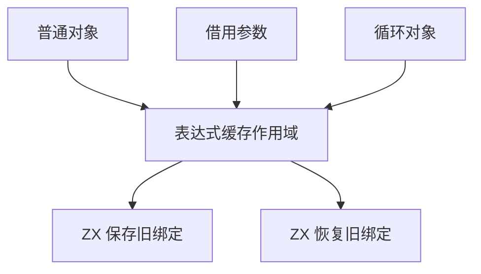
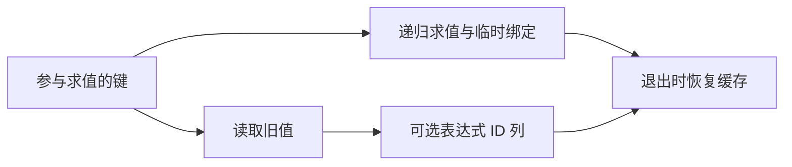

# 对象临时绑定作用域自举

## Intent

将对象生成时临时表达式绑定的保存与恢复迁入 ZX。普通对象、按值调用的借用参数和循环聚合共用一套实现，保留每个对象对外围缓存绑定的隔离。按 IDEA 框架核对实现和性能。

## Data

- 三条路径原先都在 Zig 循环中逐项查询并保存表达式缓存，之后在 `defer` 中逐项恢复。
- `core/integer/map` 已提供有序调用的查询、插入和移除。缓存列可借用，快照只保存参与本次求值的键对应的可选表达式 ID。
- 已存在的键恢复时可就地替换。旧路径经过通用 `put`，即使仅替换既有值也可能达到扩容阈值。恢复已不存在的旧键仍使用通用插入。
- 对照工具使用 `f9c0b200` 的 Source stage 3。完整冷构建沿用固定遍历种子、四分区、12 核和累计基线。

## Edges

- 快照在求值任何操作数之前建立。恢复从当前缓存按原键顺序处理，作用域进入和退出仍由 Zig 宿主管理。初始 seed 保留原先的语义。
- 保存内容只用于同一个缓存的作用域恢复，期间缓存容量只增不减。退出时容量为零表示快照时没有旧值，直接保留空表可避免失败清理时分配。
- 普通对象和借用参数的短快照使用 256 字节栈缓冲，超出时沿用生成 arena。循环聚合复用已有的临时分配器。快照与键列在恢复期间保持有效。
- 元素求值、读取计数、AST 发布仍经现有宿主接口。保存和恢复各是一个原子集合算法。

## Answer

### 实施与验证

三个阶段均为 ReleaseSmall、12 核、16 分区，每阶段 22/22 步通过。第一阶段由上一阶段 Source stage 3 生成，后两阶段依次由本阶段 stage 1 和 stage 2 生成。

同输入对照上一阶段与本阶段 Source stage 3，主组 8,719 个文件逐字节一致，本阶段 stage 2 和 stage 3 的主组也完全一致。增长组 410 个文件和包含新增入口的集合组 70 个文件在三个工具间一致。仅排除生成器身份文件 `.zxc-inputs`。

| Source stage 3 交替三轮中位数 | 墙钟秒      | CPU 秒      | 单体峰值 RSS 字节         |
| ----------------------------- | ----------- | ----------- | ------------------------- |
| 缓存命中，前 → 后             | 1.48 → 1.48 | 5.12 → 5.12 | 826,195,968 → 827,162,624 |
| 空函数缓存，前 → 后           | 1.99 → 1.98 | 8.73 → 8.74 | 900,186,112 → 899,792,896 |

空缓存每轮生成 4,030 个函数。快照的生成代码按键数量为返回列预留容量，直接读取原缓存。恢复在正常独占传递下写入目标槽，保留共享缓冲的写时复制检查。生成、对照和计时记录在 `.zig-cache/cold-build-analysis/ownership-research/object-cache-scope/`。

### 完整冷构建

Zig 0.17.0、ReleaseSmall、本地工具链归档、12 核、四分区，固定遍历种子 `0x3b41c83f`。隔离本地与全局缓存，关闭常驻生成器，每 200 毫秒采样进程树。初始生成器由 Zig seed 构建，构建期间使用 seed 分析与生成，安装后的 CLI 使用 Source。

| 对照             | 墙钟秒  | CPU 秒 | 进程树峰值字节 | 单体最大 RSS 字节 |
| ---------------- | ------- | ------ | -------------- | ----------------- |
| 固定基线         | 129.740 | 216.03 | 2,247,294,976  | 2,075,033,600     |
| 上一阶段相同种子 | 115.511 | 205.06 | 2,253,488,128  | 2,093,318,144     |
| 本阶段           | 115.092 | 204.84 | 2,224,013,312  | 2,098,053,120     |

完整冷构建 70/70 步通过。相对上一阶段，墙钟减少 0.420 秒、CPU 减少 0.22 秒、进程树峰值减少约 29.5 MB，单体最大 RSS 增加约 4.7 MB。相对固定基线，墙钟减少 14.648 秒、CPU 减少 11.19 秒、进程树峰值样本减少约 23.3 MB。峰值仍出现在三个 LLVM 分区同时编译期间。四个分区对象与上一阶段逐字节一致，峰值差值不足以归因到缓存迁移。完整构建和进程采样在 `partition-reference/cold-object-cache-scope/`。

### 回归

使用本阶段 Source stage 3 构建并运行 `test-object-construction`、`test-native-value-boundary` 和 `test-loop-columns`，203/203 步、212/212 项通过。新增 ZX 源码通过格式化和 lint 检查。

### 自我复核

阶段边界为对象临时绑定的保存与恢复。缓存描述符和递归求值仍由宿主持有。恢复的键和值按进入作用域时的索引配对，保留重复键和失败后已完成绑定的清理语义。
