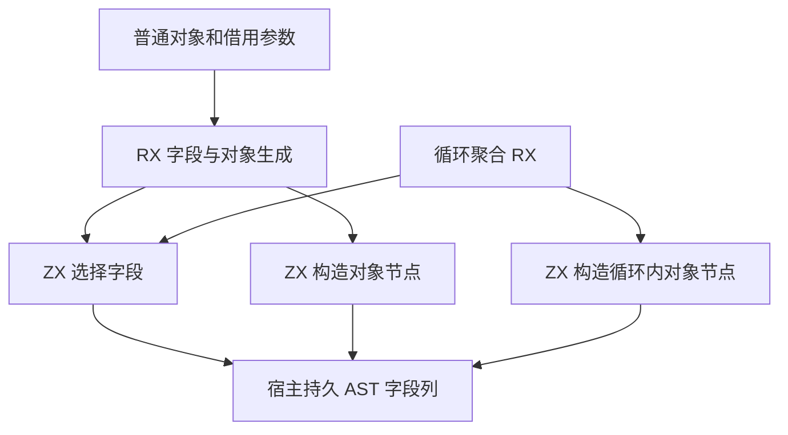
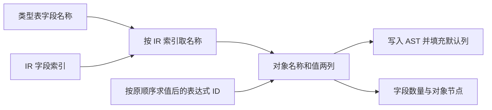

# 对象字段组装自举

## Intent

将普通对象、借用调用参数和循环聚合的字段组装迁入同一个 ZX 实现。保留字段顺序、求值顺序、投影及 ABI 布局选择。本文按 IDEA 框架记录实现和验收。

## Data

- IR 已按字段顺序保存索引和值，类型表持有稳定的字段名称字节。普通对象和借用参数原先逐项建立持久 `node.Field` 数组，再写入 AST 字段列。
- 循环聚合原先在 ZX 中逐项建立四列。对象字面量的字段均无默认值，也无需 comptime 参数标记。
- Source 生成对照使用上一阶段 `b29d6fb2` 的 stage 3。完整冷构建沿用同一工作区、遍历种子及固定累计基线。

## Edges

- 宿主仍递归求值，并在创建对象前完成原有的操作数丢弃与类型布局选择。借用投影所需的字段名仍在求值时读取。
- ZX 依照 IR 索引选择字段名，保留已有值列。名称字节由类型表持有，临时名称描述符与表达式 ID 仅存活到 AST 导入结束。
- AST 导入用既有字段存储，直接填充默认值和 comptime 列。初始 seed 继续使用原生对象生成路径。

## Answer

### 实施与验证

普通对象和借用参数的 RX 依次调用字段选择和对象节点生成。循环聚合的对象阶段复用字段选择。字段选择的 `map` 编译为按输入长度预留容量的循环，写入名称切片描述符，值列沿用宿主提供的切片。普通对象入口使用生成的 `executeValue`，省去指针返回入口分配的三个输出描述对象。

三个自编译阶段均为 ReleaseSmall、12 核、16 分区，每阶段 22/22 步通过。上一阶段 Source stage 3 生成第一阶段，本阶段 stage 1、stage 2 依次生成后续工具。

使用同一份 369 入口清单，前后版本及本阶段 stage 2、stage 3 的 8,744 个主组产物逐字节一致。增长组的 410 个产物在上一阶段 stage 3、本阶段 stage 2 和 stage 3 之间一致。对比排除生成器身份文件 `.zxc-inputs`。

| Source stage 3 交替三轮中位数 | 墙钟秒      | CPU 秒      | 单体峰值 RSS 字节         |
| ----------------------------- | ----------- | ----------- | ------------------------- |
| 缓存命中，前 → 后             | 1.49 → 1.50 | 5.15 → 5.14 | 826,064,896 → 826,736,640 |
| 空函数缓存，前 → 后           | 2.01 → 2.00 | 8.77 → 8.75 | 879,837,184 → 878,772,224 |

空缓存每轮实际生成 4,041 个函数。日志和统计在 `.zig-cache/cold-build-analysis/ownership-research/object-fields/`。

### 完整冷构建

Zig 0.17.0、ReleaseSmall、本地工具链归档、12 核、四分区、固定遍历种子 `0x3b41c83f`。使用独立本地与全局缓存，关闭常驻生成器，每 200 毫秒采样进程树。初始生成器由 Zig seed 构建，构建期间使用 seed 分析与生成，安装后的 CLI 使用 Source。

| 对照                 | 墙钟秒  | CPU 秒 | 进程树峰值字节 | 单体最大 RSS 字节 |
| -------------------- | ------- | ------ | -------------- | ----------------- |
| 固定基线             | 129.740 | 216.03 | 2,247,294,976  | 2,075,033,600     |
| 上一阶段同工作区样本 | 116.468 | 206.41 | 2,415,919,104  | 2,091,778,048     |
| 本阶段               | 116.692 | 207.08 | 2,266,906,624  | 2,106,966,016     |

冷构建 70/70 步通过。相比上一阶段同工作区样本，墙钟增加 0.224 秒，CPU 增加 0.67 秒，进程树峰值减少 149.0 MB，单体峰值增加 15.2 MB。相比固定基线，墙钟减少 13.048 秒，CPU 减少 8.95 秒，进程树峰值增加 19.6 MB，单体峰值增加 31.9 MB。

树峰值仍发生在 LLVM 分区编译重叠时，分区 0、1、2 的对象与上次逐字节一致，分区 3 的对象增加 2,152 字节。进程树峰值差异包含后端并行重叠变化。构建日志和采样在 `partition-reference/cold-object-fields/`。

前后冷构建安装的 CLI 对嵌套缓冲对象用例生成的 812 行 Zig 源码逐字节一致。

### 回归

使用本阶段 Source stage 3 运行 `test-object-construction`、`test-native-value-boundary` 和 `test-loop-columns`。203/203 步、212/212 项通过。修改的 RX、ZX 通过格式和 lint 检查，修改的 Zig 通过 `zig fmt --check`。

### 自我复核

本阶段覆盖对象字面量的字段选择与对象节点生成。宿主仍负责递归表达式求值、字段借用转换和 AST 持久存储。复核了 IR 索引、已求值 ID 与 AST 字段的对应顺序。名称字节在宿主工作区长期存活，临时存储在 AST 写入完成且作用域缓存恢复后释放。
