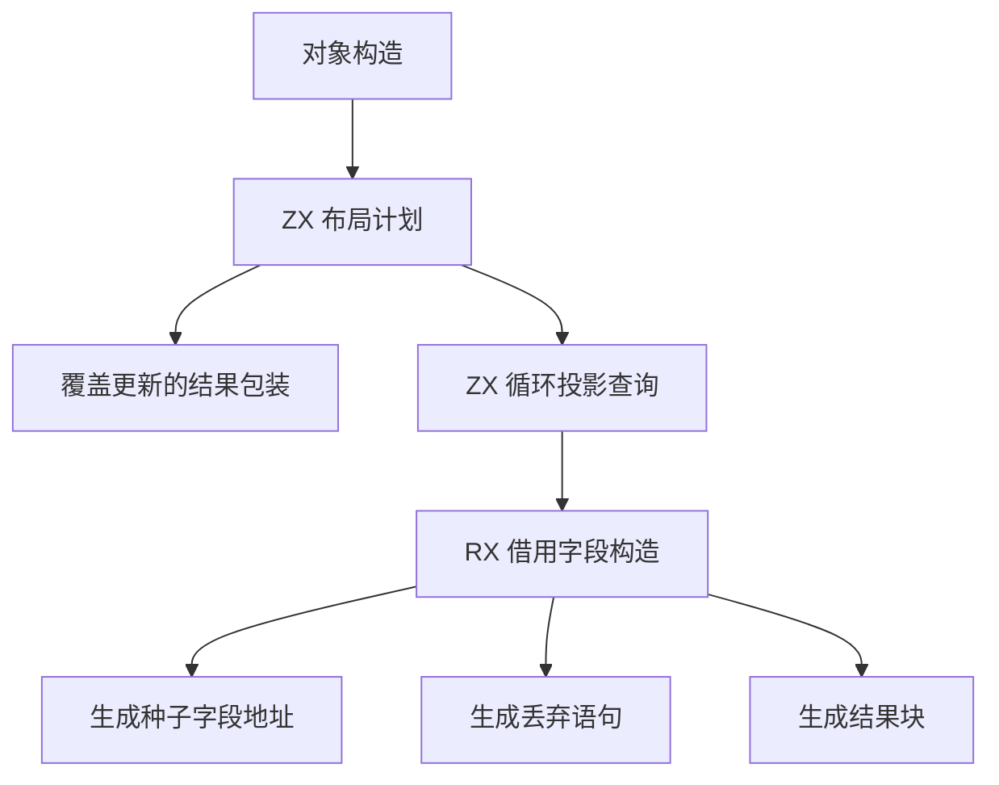
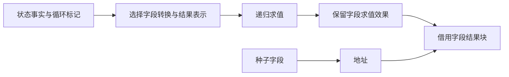

# 对象布局与借用字段自举

## Intent

将普通对象生成中的表示选择及循环借用字段的 AST 构造迁入 RX/ZX。保持覆盖更新、直接布局、状态字段转换、种子字段借用和最终包装的现有规则。按 IDEA 框架记录验收。

## Data

- `aggregate.zig` 原先在 Zig 中按更新结果、调用方布局要求、状态表示和循环投影决定是否包装对象，并逐字段选择表示。
- 循环布局已提供表达式和字段的借用标记。布局计划只需要表达式标记视图和状态事实，种子、布局及字段借用表继续使用同一对象。
- 旧借用字段路径先求值并丢弃字段表达式，再取种子字段的地址并生成结果块。现有 ZX `discard` 和 `binding/finish` 可以复用。
- 以 `06d08a8b` 的 Source stage 3 对照同一输入。完整冷构建沿用固定遍历种子、四分区、12 核和累计基线。

## Edges

- 布局计划是一次原子 ZX 查询，区分覆盖更新与新对象，并查阅循环投影标记。计划仅返回三个布尔量，借用现有标记表。
- 借用字段的 RX 编排连接取址、丢弃语句和结果块。Zig 宿主继续递归求值，随后发布生成的 AST 列。临时 AST 列使用固定缓冲，字段名借用类型表，块标签进入生成 arena。
- 状态切换随递归求值的作用域恢复，所以同一个对象可复用一次字段转换决策。初始 seed 保留原有选择与生成方式。
- 验收生成文件一致性，运行对象构造及循环布局的既有回归，对照 Source 生成与完整冷构建。

## Answer

### 实施与验证

初版把覆盖更新选择和循环标记查询接成 RX 调用链。三个自编译阶段、主组和增长组产物对照以及 227 项相关回归均通过。完整冷构建墙钟 116.287 秒、CPU 206.02 秒，分别比上一阶段增加约 1.195 秒、1.18 秒。采样中约 0.56 秒差异出现在仓库配置之前，LLVM 分区累计 CPU 增加约 0.41 秒。初版构建与进程采样在 `partition-reference/cold-object-layout/`。

将布局选择与标记查询收口到一个原子 ZX 函数，去掉中间调用及其描述符。借用字段的取址、丢弃及结果块继续由 RX 编排。地址与后继节点共用一次宽度检查。

最终实现以 ReleaseSmall、12 核和 16 分区进行三阶段自编译，每阶段 22/22 步通过。第一阶段由上一阶段 Source stage 3 生成，后两阶段依次由本阶段 stage 1 和 stage 2 生成。使用同一份 367 入口清单，上一阶段和本阶段 Source stage 3 生成的 8,730 个主组文件逐字节一致。本阶段 stage 2 和 stage 3 的主组也完全一致，增长组 410 个文件在三个工具间一致。仅排除生成器身份文件 `.zxc-inputs`。

| Source stage 3 交替三轮中位数 | 墙钟秒      | CPU 秒      | 单体峰值 RSS 字节         |
| ----------------------------- | ----------- | ----------- | ------------------------- |
| 缓存命中，前 → 后             | 1.50 → 1.50 | 5.16 → 5.13 | 827,490,304 → 827,097,088 |
| 空函数缓存，前 → 后           | 2.03 → 2.03 | 8.78 → 8.79 | 875,577,344 → 875,331,584 |

空缓存每轮实际生成 4,035 个函数。布局计划以零容量分配器运行，借用字段的计划数据保留对原类型字段名的借用。最终的生成与计时记录在 `.zig-cache/cold-build-analysis/ownership-research/object-layout-compact/`。

### 完整冷构建

Zig 0.17.0、ReleaseSmall、本地工具链归档、12 核、四分区和固定遍历种子 `0x3b41c83f`。每次使用独立本地与全局缓存，关闭常驻生成器，进程树每 200 毫秒采样。初始生成器由 Zig seed 构建，构建期间采用 seed 分析与生成，安装后的 CLI 使用 Source。

| 样本                 | 墙钟秒  | CPU 秒 | 进程树峰值字节 | 单体最大 RSS 字节 |
| -------------------- | ------- | ------ | -------------- | ----------------- |
| 固定基线             | 129.740 | 216.03 | 2,247,294,976  | 2,075,033,600     |
| 上一阶段历史样本     | 115.092 | 204.84 | 2,224,013,312  | 2,098,053,120     |
| 原工作区的最终实现   | 116.800 | 206.75 | 2,354,544,640  | 2,108,637,184     |
| 同目录对照的上一阶段 | 116.163 | 207.77 | 2,305,064,960  | 2,093,891,584     |
| 同目录对照的最终实现 | 116.103 | 207.85 | 2,300,788,736  | 2,095,366,144     |

原工作区样本超出上一阶段历史样本的 1 秒阶段容差。采样中约 0.90 秒发生在仓库配置之前。两次分区协调器的可执行文件逐字节一致，其编译的 CPU 样本仍相差约 1.01 秒。上一阶段同一提交的两个冷样本也相差约 1.07 秒墙钟与 2.93 秒 CPU。

以提交 `06d08a8b` 的归档建立临时源目录，完成基线冷构建后，在同一目录应用最终实现，使用新的空缓存构建。配对样本均为 70/70 步通过，墙钟减少 0.060 秒，CPU 增加 0.08 秒，进程树峰值减少约 4.3 MB，单体最大 RSS 增加约 1.5 MB。阶段成本以该配对对照验收，保留历史样本与固定累计基线。完整日志分别在 `partition-reference/cold-object-layout-compact/`、`cold-object-layout-baseline/` 和 `cold-object-layout-candidate/`。

### 回归

使用最终实现的 Source stage 3 构建并运行 `test-object-construction`、`test-nested-buffer` 和 `test-loop-columns`，232/232 步、227/227 项通过。新增 ZX/RX 源码通过格式化和 lint 检查。使用完整冷构建安装的前后两版 CLI 生成既有嵌套缓冲对象用例，812 行 Zig 源码逐字节一致。

### 自我复核

阶段边界为对象表示策略及借用字段的 AST 构造。表达式递归求值、缓存作用域和 AST 存储仍经宿主。字段求值先于种子取址，块标签的编号和作用域沿用现有结果块生成。
