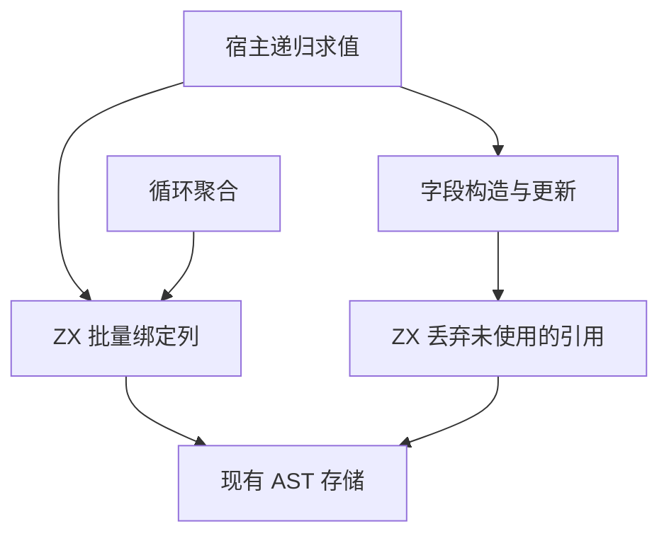
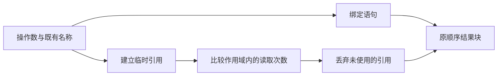

# 对象操作数绑定与丢弃自举

## Intent

将普通对象的操作数绑定语句以及普通对象和借用参数的未使用值处理迁入 ZX。普通对象与循环聚合复用绑定语句生成。保留求值顺序、覆盖字段的副作用、名称编号及作用域语义。按 IDEA 框架记录验收。

## Data

- 旧普通对象路径在递归求值后逐项构造绑定语句，并在字段求值后比较读取次数。丢弃未使用值时又创建一次同名标识符节点。
- 循环聚合已有 ZX 绑定列生成。三个对象路径的读取记录分别来自密集计数列或现有稀疏计数器。
- 绑定的名称字节、值和引用已经生成，可以将列直接交给 ZX 读取。密集计数采用与现有计数器一致的 `u64`。
- Source 对照使用 `a8bd9c41` 的 stage 3，完整冷构建使用同一原工作区、固定遍历种子和上一阶段原工作区样本，累计基线沿用 129.740 秒与 216.03 CPU 秒。

## Edges

- 宿主在递归求值时即时建立缓存引用，且保持名称在求值前取得。完成操作数求值后，ZX 批量生成常量绑定，再继续字段构造。
- 读取计数保持在原作用域。完成字段使用后，ZX 按原顺序生成丢弃语句，直接引用已绑定的表达式 ID。
- 操作数列放入作用域临时分配器，退出时先恢复缓存再释放临时存储。绑定和丢弃 AST 的临时列另用固定栈缓冲，绑定名称字节仍由生成 arena 持有。
- 循环对象的稀疏读取计数和丢弃路径沿用现有 ZX 实现。初始 seed 仍可生成绑定与丢弃语句。运行既有回归，核对 Source 生成与冷构建。

## Answer

### 实施与验证

三个自编译阶段均为 ReleaseSmall、12 核、16 分区，每阶段 22/22 步通过。第一阶段由上一阶段 Source stage 3 生成，后两阶段依次由本阶段 stage 1 和 stage 2 生成。

使用同一份 369 入口清单对照上一阶段和本阶段 Source stage 3，主组 8,740 个文件逐字节一致。本阶段 stage 2 和 stage 3 的同输入主组一致，增长组 410 个文件在三个工具之间一致。仅排除生成器身份文件 `.zxc-inputs`。

| Source stage 3 交替三轮中位数 | 墙钟秒      | CPU 秒      | 单体峰值 RSS 字节         |
| ----------------------------- | ----------- | ----------- | ------------------------- |
| 缓存命中，前 → 后             | 1.49 → 1.49 | 5.14 → 5.13 | 826,966,016 → 827,457,536 |
| 空函数缓存，前 → 后           | 2.00 → 2.02 | 8.73 → 8.78 | 879,804,416 → 887,898,112 |

空缓存每轮实际生成 4,039 个函数。空缓存峰值中位数增加约 8.1 MB，单轮范围分别约为 879～887 MB 和 886～895 MB。本轮验证使用 macOS arm64，读计数在该平台维持原有字宽。测量日志在 `.zig-cache/cold-build-analysis/ownership-research/object-operands/`。

### 完整冷构建

Zig 0.17.0、ReleaseSmall、本地工具链归档、12 核、四分区、固定遍历种子 `0x3b41c83f`。独立本地与全局缓存，关闭常驻生成器，进程树每 200 毫秒采样。初始生成器由 Zig seed 构建，构建期间使用 seed 分析与生成，安装后的 CLI 使用 Source。

| 对照                 | 墙钟秒  | CPU 秒 | 进程树峰值字节 | 单体最大 RSS 字节 |
| -------------------- | ------- | ------ | -------------- | ----------------- |
| 固定基线             | 129.740 | 216.03 | 2,247,294,976  | 2,075,033,600     |
| 上一阶段同工作区样本 | 116.800 | 206.75 | 2,354,544,640  | 2,108,637,184     |
| 本阶段               | 116.468 | 206.41 | 2,415,919,104  | 2,091,778,048     |

完整冷构建 70/70 步通过。相对上一阶段同工作区样本，墙钟减少 0.332 秒，CPU 减少 0.34 秒，进程树峰值增加约 61.4 MB，单体最大 RSS 减少约 16.9 MB。相对固定基线，墙钟减少 13.272 秒、CPU 减少 9.62 秒，进程树峰值增加约 168.6 MB。

两次树峰都出现在分区 0、1、2 的 LLVM 编译重叠期间。这三个分区的对象逐字节一致。变化集中在分区 3 的对象，共享类型文件增加 1,232 字节。峰值差异仍计入累计观察。日志在 `partition-reference/cold-object-operands/`。

使用完整冷构建安装的前后两版 CLI 生成同一个嵌套缓冲对象用例，812 行 Zig 源码逐字节一致。

### 回归

使用本阶段 Source stage 3 构建并运行 `test-object-construction`、`test-native-value-boundary` 和 `test-loop-columns`，203/203 步、212/212 项通过。修改的 ZX 源码通过格式化和 lint 检查。

### 自我复核

本阶段迁移绑定与丢弃语句的生成。临时引用仍在宿主递归求值过程中建立，AST 存储和读计数更新仍经宿主。普通对象和借用参数在快照与绑定列释放之前恢复缓存，输出 AST 只保留表达式 ID 和有稳定存储的名称字节。
