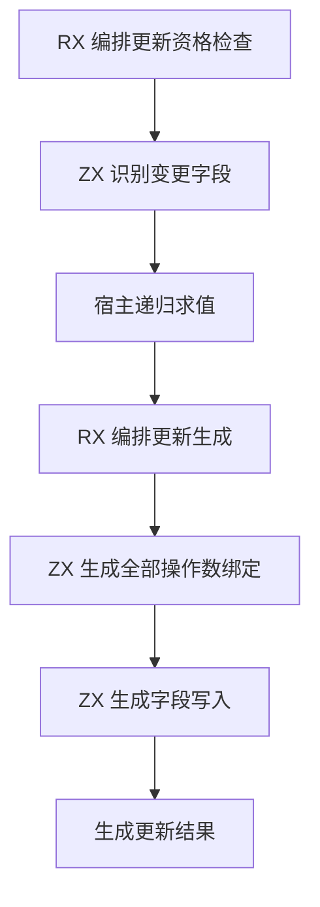
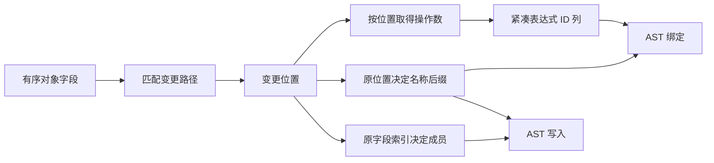

# 对象更新字段计划自举

## Intent

让对象更新匹配阶段直接给出变更字段位置，供操作数求值、绑定生成与字段写入共同使用。保留对象来源、资格检查、原求值顺序和生成代码的名称。本文按 IDEA 框架记录实现和验收。

## Data

- 匹配阶段原先记录首个变化及变化个数。多字段路径随后在宿主、绑定生成和写入生成各遍历一遍字段，并重复检查投影路径。
- IR 的字段位置和类型字段索引含义不同。位置决定原遍历顺序及生成名称后缀，字段索引决定写入成员。两者均来自原对象字段表。
- 未求值的作用域复用只接受单字段更新。匹配无结果或只有一个变更字段时无需分配位置列。

## Edges

- 匹配第二个变更字段时才创建位置列，沿用现有数组存储转移。未求值分支继续在发现第二个变更时退出。
- 宿主仍递归求值，将结果按位置列压缩到临时值列。RX 继续先生成全部绑定，再生成写入与来源清除。
- AST 节点只保留已有字段名称和表达式 ID。位置与值列在当前对象作用域结束时释放。初始 seed 使用现有更新实现。
- 使用同一清单对照 Source 产物，运行既有对象更新与所有权用例，记录 Source 和完整冷构建性能。

## Answer

### 实施与验证

匹配只在已求值且至少有两个变更字段时分配位置列。生成代码对位置列使用现有可转移数组的追加路径。单字段仍携带字段索引和原操作数 ID。宿主的持久作用域复用记录保持原大小，位置列只存在于当前对象的临时计划。

三个自编译阶段使用 ReleaseSmall、12 核、16 分区，每阶段 22/22 步通过。第一阶段由上一阶段 Source stage 3 生成，之后依次由本阶段 stage 1 和 stage 2 生成。

对照使用同一份 368 入口清单。上一阶段 Source stage 3 与本阶段 stage 2、stage 3 的 8,734 个主组产物逐字节一致，增长组的 410 个产物一致。仅排除生成器身份文件 `.zxc-inputs`。主组原始模块中有 987 个包含多字段更新生成的临时绑定。

| Source stage 3 交替三轮中位数 | 墙钟秒      | CPU 秒      | 单体峰值 RSS 字节         |
| ----------------------------- | ----------- | ----------- | ------------------------- |
| 缓存命中，前 → 后             | 1.48 → 1.49 | 5.10 → 5.14 | 826,671,104 → 827,064,320 |
| 空函数缓存，前 → 后           | 2.01 → 2.01 | 8.77 → 8.79 | 895,795,200 → 880,164,864 |

空缓存每轮实际生成 4,038 个函数。日志与统计在 `.zig-cache/cold-build-analysis/ownership-research/object-update-plan/`。

### 完整冷构建

Zig 0.17.0、ReleaseSmall、12 核、四分区、本地 Zig 归档和固定遍历种子 `0x3b41c83f`。关闭常驻生成器，使用独立空缓存，每 200 毫秒采样进程树。初始生成器由 Zig seed 构建，构建时运行 seed 分析与生成，安装后的 CLI 使用 Source。

| 对照                 | 墙钟秒  | CPU 秒 | 进程树峰值字节 | 单体最大 RSS 字节 |
| -------------------- | ------- | ------ | -------------- | ----------------- |
| 固定基线             | 129.740 | 216.03 | 2,247,294,976  | 2,075,033,600     |
| 上一阶段同工作区样本 | 116.692 | 207.08 | 2,266,906,624  | 2,106,966,016     |
| 本阶段同工作区样本   | 118.294 | 205.98 | 2,304,868,352  | 2,110,062,592     |

原工作区冷构建 70/70 步通过。墙钟比上一阶段多 1.602 秒，CPU 少 1.10 秒。主生成启动时间从 57.38 秒移到 58.86 秒，分区构建启动时间从 59.99 秒移到 61.54 秒，最终编译器库的构建时长从 31.90 秒到 31.98 秒。墙钟差异集中在主生成之前，因此补做同目录的成对对照。

原工作区样本相比固定基线少 11.446 秒墙钟、10.05 秒 CPU，进程树峰值增加 57.6 MB，单体峰值增加 35.0 MB。日志与采样在 `partition-reference/cold-object-update-plan/`。

从提交 `73055aac` 归档建立临时源目录，先构建基线，再在相同源目录应用本阶段源码差异，用另一份空缓存构建。两次均为 70/70 步通过。

| 同目录对照 | 墙钟秒  | CPU 秒 | 进程树峰值字节 | 单体最大 RSS 字节 |
| ---------- | ------- | ------ | -------------- | ----------------- |
| 基线       | 116.745 | 209.01 | 2,376,302,592  | 2,103,902,208     |
| 本阶段     | 116.573 | 208.46 | 2,302,836,736  | 2,101,788,672     |

同目录对照墙钟减少 0.172 秒，CPU 减少 0.55 秒，树峰值减少 73.5 MB，单体最大 RSS 减少 2.1 MB。分区 0、1 的对象逐字节一致，分区 2 增加 19,616 字节，分区 3 减少 23,568 字节。阶段验收使用这组对照，固定累计基线仍采用原工作区样本。日志和对象散列分别在 `object-update-plan/paired-a/` 与 `object-update-plan/paired-b/`。

### 回归

使用本阶段 Source stage 3 运行 `test-object-reduce`、`test-cached-ownership` 和 `test-multiple-append`，168/168 步、474/474 项通过。原工作区冷构建安装的前后 CLI 分别生成重排字段和对象展开两个用例，871 行、428 行 Zig 源码逐字节一致。

修改的 ZX 通过格式和 lint 检查，修改的 Zig 通过 `zig fmt --check`。

### 自我复核

已核对三处被删除的重复判定均依赖同一份 IR 和所有权标志。对象递归求值、布局引用和 AST 持久存储仍经宿主。旧 seed 的资格和代码生成仍保留。多字段临时计划按原字段序遍历，输出代码的名称后缀也使用原位置。值列仅包含实际变更字段。
