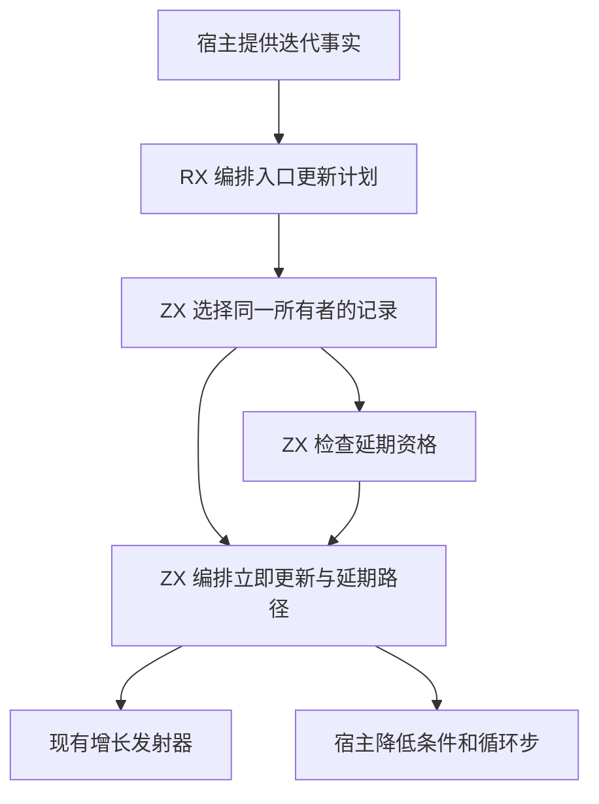
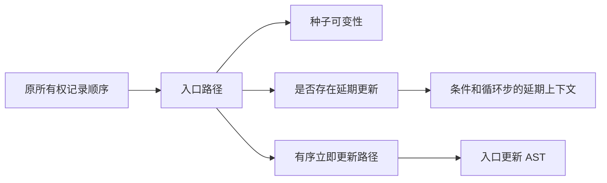

# 循环入口更新计划自举

## Intent

把循环入口的所有权更新选择和延期判定交给 RX/ZX。普通迭代、投影迭代和保留的标量规约节点共用有序计划，生成时沿用原来的增长调用和保护位置。本文按 IDEA 框架记录验收。

## Data

- 投影迭代原先遍历更新表判断种子是否需要可变，再遍历同一张表执行入口更新。
- 普通迭代的延期分析先由宿主选择路径并生成布尔列，之后宿主重新遍历更新表，通过位置将布尔列与路径对应。
- 更新记录按现有顺序保存所有者、路径和更新时机。路径元素由所有权计划持有，生成阶段只需借用切片。

## Edges

- RX 先选择同一所有者的入口记录，再按原有条件运行延期资格检查。ZX 保留记录顺序，返回是否有入口记录、是否存在延期路径和实际立即更新路径。
- 投影种子的可变性仍根据原始入口记录决定。普通迭代在降低条件和循环步时仍设置原有延期上下文。
- 内部缓冲路径由计划排除。外层迭代上下文的保护继续由现有增长发射器处理。
- 资格分析临时内存在计划返回时释放。跨后续求值只保存立即更新的路径描述符，路径元素继续借用原计划。初始 seed 保留原生生成语义。
- 生成入口的对象数组 ABI 使用行指针。宿主在分析临时区建立指针列，指向原更新记录。返回后只保留待发射路径的切片描述符。空记录直接结束。

## Answer

### 实施与验证

生成器按原记录顺序选择入口路径。延期分析沿用原有遍历与路径资格规则。未启用延期和内部缓冲时，直接沿用选出的路径列。普通迭代、投影迭代和标量规约发射共享入口计划。

三个自编译阶段均使用 ReleaseSmall、12 核、16 分区，每阶段 22/22 步通过。上一阶段 Source stage 3 生成第一阶段，本阶段 stage 1、stage 2 依次生成后续工具。

使用同一份 370 入口主组清单，比较上一阶段 Source stage 3、本阶段 stage 2 和 stage 3。8,757 个主组文件和 416 个增长组文件逐字节一致。仅排除生成器身份文件 `.zxc-inputs`。

主组原始生成产物中，有 35 个模块包含对迭代状态或种子的 `zxRenew` 调用。

| Source stage 3 交替三轮中位数 | 墙钟秒      | CPU 秒      | 单体峰值 RSS 字节         |
| ----------------------------- | ----------- | ----------- | ------------------------- |
| 缓存命中，前 → 后             | 1.51 → 1.50 | 5.20 → 5.17 | 827,752,448 → 827,719,680 |
| 空函数缓存，前 → 后           | 2.05 → 2.01 | 8.80 → 8.76 | 888,389,632 → 875,479,040 |

空函数缓存每轮实际生成 4,050 个主组函数。日志与统计在 `.zig-cache/cold-build-analysis/ownership-research/loop-renewals/`。

### 完整冷构建

Zig 0.17.0、ReleaseSmall、12 核、四分区、本地 Zig 归档，固定遍历种子 `0x3b41c83f`。关闭常驻生成器，使用独立空缓存，每 200 毫秒采样进程树。构建期间的工具由 Zig seed 构建，使用 seed 分析与生成。安装后的 CLI 使用 Source。

| 对照                 | 墙钟秒  | CPU 秒 | 进程树峰值字节 | 单体最大 RSS 字节 |
| -------------------- | ------- | ------ | -------------- | ----------------- |
| 固定基线             | 129.740 | 216.03 | 2,247,294,976  | 2,075,033,600     |
| 上一阶段同工作区样本 | 116.646 | 206.53 | 2,227,912,704  | 2,109,538,304     |
| 本阶段同工作区样本   | 116.639 | 206.41 | 2,253,520,896  | 2,113,159,168     |

冷构建 70/70 步通过。相对上一阶段，墙钟减少约 0.008 秒，CPU 减少 0.12 秒，树峰值增加 25.6 MB，单体最大 RSS 增加 3.6 MB。相对固定基线，墙钟少 13.101 秒，CPU 少 9.62 秒，树峰值高 6.2 MB，单体最大 RSS 高 38.1 MB。

LLVM 分区 0、1、2 对象逐字节一致，分区 3 增加 1,168 字节。两次树峰值都出现在 LLVM 分区编译重叠阶段，采样差异计入累计观察。日志与采样在 `partition-reference/cold-loop-renewals/`。

### 回归

使用本阶段 Source stage 3 运行 `test-loop-columns`、`test-reduce-runtime` 和 `test-multiple-append`，193/193 步、348/348 项通过。修改的 RX、ZX 通过格式和 lint 检查，修改的 Zig 通过 `zig fmt --check`。

### 自我复核

前后安装版 CLI 对条件规约和投影循环用例生成的 608 行、776 行 Zig 源码逐字节一致。已核对输入类型是原延期规则使用的迭代初始类型，规范 IR 要求它与迭代结果类型一致。宿主仍执行递归求值、作用域安装及现有增长发射调用。保留标量规约 IR 的迁移随三阶段编译验证，既有源码回归覆盖通用迭代路径。
