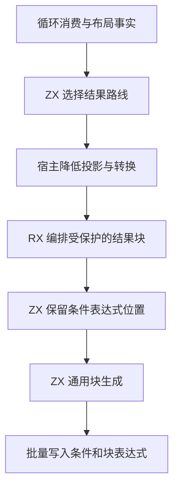
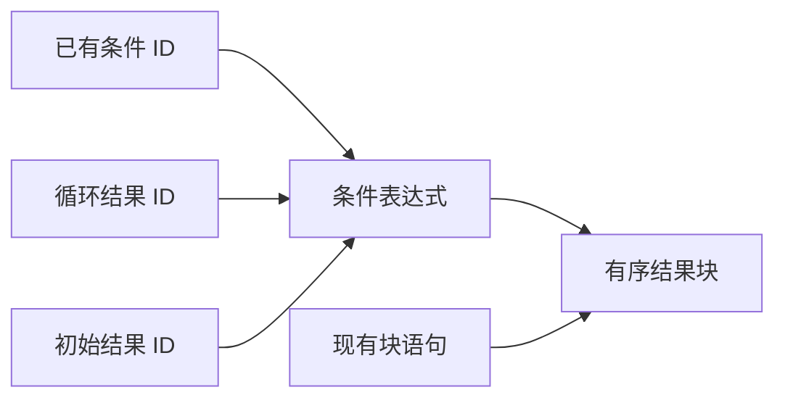

# 循环结果发布自举

## Intent

将循环结果路线的选择、初始值回退及结果块组装迁入 RX/ZX。普通循环、投影循环和带初始检查的缓冲循环共用受保护的结果块。本文按 IDEA 框架记录实施与验收。

## Data

- 宿主原先按消费模式、所有权布局及是否执行循环步来选择循环结果。转换、投影和构造已有各自的生成器入口。
- 普通循环、投影循环和缓冲循环原先分别在 Zig 中创建条件表达式，再调用通用结果块生成。
- 条件、两个分支以及原有语句已经存在于 AST。生成阶段可以直接使用其 ID，并复用通用块的标签与语句范围规则。

## Edges

- ZX 保留结果路线优先级。消费路径先于丢弃、值布局、引用和带回退的结果。宿主继续调用对应的投影和所有权转换操作。
- RX 保留条件表达式的 AST ID，再复用结果块生成，并将两类表达式按原顺序发布。分支条件和初始值回退保持惰性求值。
- 源码回归覆盖普通、投影、缓冲与空输入。按同清单对照生成产物并测量 Source 和完整冷构建。初始 seed 保留原有生成行为。

## Answer

### 实施与验证

ZX 决定使用消费投影、值布局、引用、丢弃或带初始值回退的路径。普通循环的状态变化检查、投影循环的入口检查和缓冲循环的初始检查共用生成入口。调用者沿用既有表达式 ID 和语句，生成器一次导入条件和块表达式。

三个自编译阶段均使用 ReleaseSmall、12 核、16 分区，每阶段 22/22 步通过。上一阶段 Source stage 3 生成第一阶段，本阶段 stage 1 与 stage 2 依次生成后续工具。

使用同一份 372 入口清单，上一阶段 Source stage 3、本阶段 stage 2 和 stage 3 的 8,771 个主组文件及 416 个增长组文件逐字节一致。仅排除生成器身份文件 `.zxc-inputs`。

| Source stage 3 交替三轮中位数 | 墙钟秒      | CPU 秒      | 单体峰值 RSS 字节         |
| ----------------------------- | ----------- | ----------- | ------------------------- |
| 缓存命中，前 → 后             | 1.50 → 1.50 | 5.14 → 5.13 | 838,418,432 → 838,942,720 |
| 空函数缓存，前 → 后           | 2.01 → 2.02 | 8.77 → 8.76 | 892,649,472 → 889,274,368 |

空函数缓存每轮实际生成 4,056 个主组函数。日志与统计在 `.zig-cache/cold-build-analysis/ownership-research/loop-result/`。

### 完整冷构建

Zig 0.17.0、ReleaseSmall、12 核、四分区、本地 Zig 归档，固定遍历种子 `0x3b41c83f`。关闭常驻生成器，使用独立空缓存，每 200 毫秒采样进程树。构建期间的工具由 Zig seed 构建，使用 seed 分析与生成。安装后的 CLI 使用 Source。

| 对照                 | 墙钟秒  | CPU 秒 | 进程树峰值字节 | 单体最大 RSS 字节 |
| -------------------- | ------- | ------ | -------------- | ----------------- |
| 固定基线             | 129.740 | 216.03 | 2,247,294,976  | 2,075,033,600     |
| 上一阶段同工作区样本 | 116.639 | 206.41 | 2,253,520,896  | 2,113,159,168     |
| 本阶段同工作区样本   | 117.141 | 207.57 | 2,266,152,960  | 2,111,455,232     |

原工作区冷构建 70/70 步通过。墙钟增加约 0.50 秒，CPU 增加 1.16 秒，树峰值增加 12.6 MB，单体最大 RSS 减少 1.7 MB。CPU 超过 1 秒阈值，因此补做同目录成对冷构建。原工作区样本相比固定基线少 12.599 秒墙钟和 8.46 秒 CPU，树峰值高 18.9 MB，单体最大 RSS 高 36.4 MB。日志与采样在 `partition-reference/cold-loop-result/`。

同目录对照以提交 `d8d996c7` 的构建源码归档为基线，候选沿用同一路径并使用另一份空缓存。首次候选归档漏掉新文件，源码加载失败。补齐并核对新增文件后仅重跑候选。有效的基线和候选均为 70/70 步通过。

| 同目录对照 | 墙钟秒  | CPU 秒 | 进程树峰值字节 | 单体最大 RSS 字节 |
| ---------- | ------- | ------ | -------------- | ----------------- |
| 基线       | 117.098 | 209.51 | 2,213,855,232  | 2,110,734,336     |
| 本阶段     | 116.603 | 208.13 | 2,284,191,744  | 2,120,646,656     |

同目录对照墙钟减少 0.495 秒，CPU 减少 1.38 秒，树峰值增加 70.3 MB，单体最大 RSS 增加 9.9 MB。LLVM 分区 0、1、2 的对象逐字节一致，分区 3 增加 1,720 字节。阶段计时验收使用这组同目录对照，累计趋势仍保留原工作区样本。日志和散列在 `loop-result/paired-a/` 与 `loop-result/paired-c/`。

### 回归

使用本阶段 Source stage 3 运行 `test-loop-columns`、`test-aggregate-loop` 和 `test-value-return`，237/237 步、342/342 项通过。前后安装版 CLI 对投影循环和链式值返回两个用例生成的 776 行、440 行 Zig 源码逐字节一致。

修改的 RX、ZX 通过格式和 lint 检查，修改的 Zig 通过 `zig fmt --check`。

### 自我复核

已核对结果路线的优先级，以及标签编号、条件 ID、语句范围和分支布局。宿主继续处理递归求值、所有权转换、投影调用及 AST 存储。既有回归覆盖空循环的初始值回退、投影与缓冲状态，以及引用和分配失败语义。
