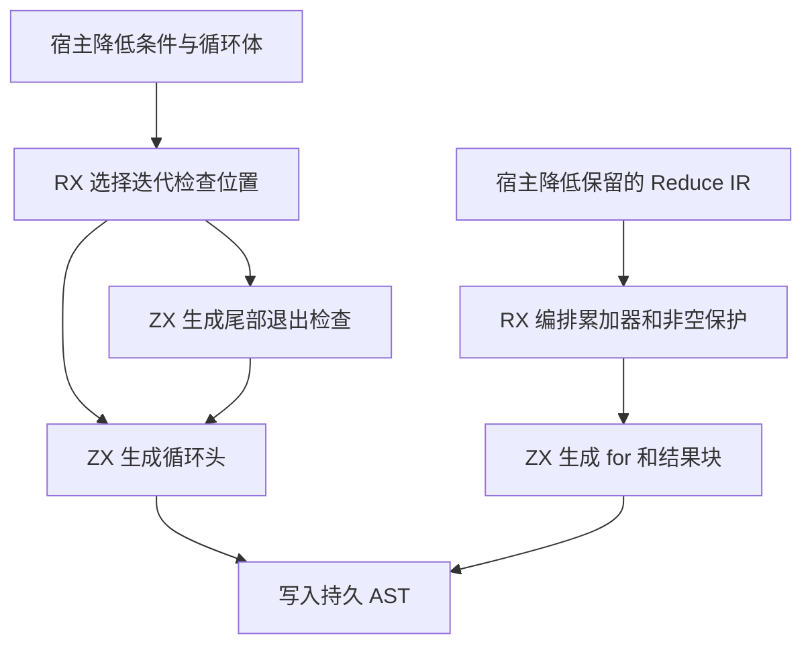

# 循环骨架生成自举

## Intent

将普通迭代、投影迭代的循环头和尾部退出检查迁入 RX/ZX，补齐保留标量 `Reduce` 节点的 IR 中的累加器、非空保护和循环生成。保留入口条件、运行时求值顺序、状态借用与已有的生成代码行为。本文按 IDEA 框架记录验收。

## Data

- 当前源码的集合 `reduce` 通常先降为通用迭代 IR。普通迭代和投影迭代都由宿主构造退出分支和 `while` 节点。
- 无前置动作的普通预检查迭代直接将条件放在循环头。后检查迭代、有更新准备或有初始保护的迭代，以及投影迭代，沿用原有的尾部检查和 `while (true)`。
- 已有 IR 模型仍接收标量 `Reduce` 节点，其发射器原在 Zig 建立累加器声明、非空保护、累加器写入、`for` 和结果块。

## Edges

- 宿主继续降低条件、循环步和所有权转换。RX 依照已有事实选择循环头或尾部退出检查；ZX 产生对应 AST 行。宿主按既有顺序写入循环体和退出行。
- 标量 `Reduce` 的累加器初始值、回调和更新准备由宿主求值。RX 选择是否生成非空保护，并组织累加器和最终循环。循环体保留先转换、再写回、最后元素捕获的原顺序。
- 新入口使用现有 AST 列和静态 Zig 后端。保留初始 seed 的生成语义。相关输出文本与已有 Source stage 对照，实测受影响路径和完整冷构建。

## Answer

### 实施与验证

普通与投影迭代共用 RX 入口。生成的循环头使用同一 AST 结构。尾部检查分支把已有循环语句与退出语句连续写入持久存储，条件节点和退出位置由 ZX 计算。标量 `Reduce` 发射在 RX 中选择非空保护，按原顺序组装累加器、循环和结果块。

三阶段均使用 ReleaseSmall、12 核、16 分区，每阶段 22/22 步通过。第一阶段由上一阶段 Source stage 3 生成，本阶段 stage 1 与 stage 2 依次生成后续工具。

用同一份 370 入口主组清单比较上一阶段 Source stage 3、本阶段 stage 2 和 stage 3。8,756 个主组文件和 416 个增长组文件逐字节一致。仅排除生成器身份文件 `.zxc-inputs`。

| Source stage 3 交替三轮中位数 | 墙钟秒      | CPU 秒      | 单体峰值 RSS 字节         |
| ----------------------------- | ----------- | ----------- | ------------------------- |
| 缓存命中，前 → 后             | 1.49 → 1.50 | 5.14 → 5.18 | 825,802,752 → 837,795,840 |
| 空函数缓存，前 → 后           | 2.00 → 2.02 | 8.75 → 8.82 | 880,934,912 → 903,626,752 |

空缓存每轮生成 4,048 个主组函数。空缓存样本的单体 RSS 中位数增加约 22.7 MB，前后三次样本分别约为 877～891 MB 和 888～914 MB。日志与统计在 `.zig-cache/cold-build-analysis/ownership-research/loop-frame/`。

### 完整冷构建

Zig 0.17.0、ReleaseSmall、12 核、四分区、本地 Zig 归档，固定遍历种子 `0x3b41c83f`。关闭常驻生成器，使用独立空缓存，每 200 毫秒采样进程树。构建期间的工具由 Zig seed 构建，使用 seed 分析与生成。安装后的 CLI 使用 Source。

| 对照                 | 墙钟秒  | CPU 秒 | 进程树峰值字节 | 单体最大 RSS 字节 |
| -------------------- | ------- | ------ | -------------- | ----------------- |
| 固定基线             | 129.740 | 216.03 | 2,247,294,976  | 2,075,033,600     |
| 上一阶段同工作区样本 | 115.802 | 205.59 | 2,213,593,088  | 2,109,440,000     |
| 本阶段同工作区样本   | 116.646 | 206.53 | 2,227,912,704  | 2,109,538,304     |

冷构建 70/70 步通过。墙钟增加 0.844 秒，CPU 增加 0.94 秒，均在当前 1 秒阈值内。树峰值增加 14.3 MB，单体最大 RSS 增加约 0.10 MB。相比固定基线，墙钟少 13.094 秒，CPU 少 9.50 秒，树峰值低 19.4 MB，单体最大 RSS 高 34.5 MB。

主生成晚约 0.76 秒开始，生成本身的采样时间为 2.41 → 2.15 秒。LLVM 分区 0、1 对象逐字节一致，分区 2 增加 3,920 字节，分区 3 增加 3,128 字节。两次树峰均出现在分区构建重叠期间。日志与采样在 `partition-reference/cold-loop-frame/`。

### 回归

使用本阶段 Source stage 3 运行 `test-loop-columns`、`test-reduce-traces` 和 `test-reduce-runtime`。首轮 223 项运行通过，`condition.zx` 的多行三元表达式在本阶段和上一阶段都被 lint 拒绝。将该表达式改为等价的 `match` 后，前后安装版 CLI 生成的 608 行 Zig 逐字节一致。重跑三个目标的 175/175 步全部通过，补跑的 13 项全部通过。

修改的 RX、ZX 通过格式和 lint 检查，修改的 Zig 通过 `zig fmt --check`。

### 自我复核

前后安装版 CLI 生成投影循环和集合规约两个既有用例，776 行、428 行 Zig 源码逐字节一致。生成源码包含循环头检查、尾部 `break` 和保留的状态写入。宿主继续处理条件及循环步求值、入口保护和 AST 持久存储。保留 `Reduce` 节点的 IR 路径经三阶段编译与语句布局复核，既有源码回归覆盖规范化后的迭代路径。
