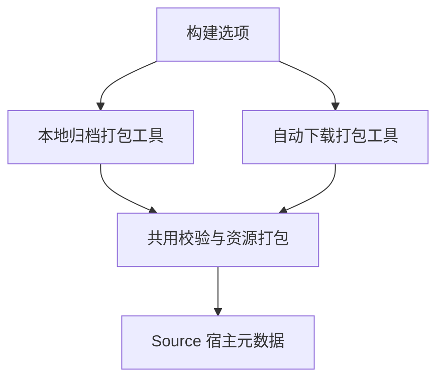

# 本地工具链归档构建优化

## Intent 目标

降低自举冷构建的累计 CPU 开销。由构建配置静态决定打包工具的归档来源，显式使用本地 Zig 归档时省去下载实现的后端编译。

## Data 证据

固定完整冷构建基线为 129.74 秒墙钟、216.03 CPU 秒、2,247,294,976 字节进程树峰。上一阶段为 119.43 秒、226.66 CPU 秒、2,293,678,080 字节。生成器已核对同输入产物，主组在上两阶段的实际四分区构建中逐字节相同。

历史增长较大的阶段包括 N-API 读写与宿主资源元数据。当前本地归档构建仍链接 HTTP/TLS 下载实现，`bundle-zig` 编译摘要为 8 秒。隔离重放真实编译命令，验证静态选择是否减少后端工作。

## Edges 边界

沿用 `-Dzig-archive`、归档 SHA-256 校验、失败删除、自动下载及重试。宿主元数据仍由 RX/ZX 生成。使用相同 Zig、归档、优化模式、目标及缓存条件。冷构建使用默认四分区和机器核心数。

## Answer 验收

对照打包工具编译成本与归档产物，核对错误路径与自动下载，并测完整冷构建。记录固定基线累计差值及尚待处理的成本，验收后统一提交推送。

## 结果

`-Dzig-archive` 非空时，构建将本地归档标志作为普通编译选项传给打包工具。Zig 在编译时选择流式文件输入。默认构建仍经现有下载、重试及校验流程。两种路径使用同一写入、哈希和错误清理逻辑。

从两次实际构建提取打包工具命令，隔离重放时沿用同一全局缓存、分别新建本地缓存，使用 Zig 0.17.0 和 ReleaseSmall。墙钟 5.83 → 1.10 秒，CPU 5.79 → 1.28 秒，单进程峰值 RSS 507,854,848 → 222,167,040 字节，打包工具文件 602,848 → 239,072 字节。

最终本地归档冷构建使用初始 seed 工具本体与 seed 分析和生成，安装后的正式 CLI 使用 Source。默认四个本机 LLVM 分区、12 核并发、同一 Zig 归档和全新缓存，47/47 步通过。进程树峰每 200ms 采样。

| 指标                |      固定基线 |      上一阶段 |          当前 | 当前相对固定基线 |
| ------------------- | ------------: | ------------: | ------------: | ---------------: |
| 墙钟（秒）          |        129.74 |        119.43 |        117.42 |           -12.32 |
| CPU（秒）           |        216.03 |        226.66 |        218.74 |            +2.71 |
| 进程树峰值（字节）  | 2,247,294,976 | 2,293,678,080 | 2,286,190,592 |      +38,895,616 |
| 单体 MaxRSS（字节） | 2,075,033,600 | 2,089,156,608 | 2,089,418,752 |      +14,385,152 |

CPU 相对上一阶段减少 7.92 秒，墙钟减少 2.01 秒。树峰减少 7,487,488 字节，单体峰增加 262,144 字节。

实际构建输出的 Zig 归档、标准库资源归档、包索引、资源 JSON 和 Source 生成的资源 Zig 模块全部逐字节一致。提供损坏或缺失的归档分别返回 `ZigArchiveChecksumMismatch` 和 `FileNotFound`，部分归档文件均已清理。

省略 `-Dzig-archive` 的 `zig build dist` 实际走下载分支，46/46 步通过，下载归档和打包输出与本地模式逐字节一致。使用本地模式安装的 CLI 复用工具链独立运行与并发解包回归，9 项全部通过。

## 自我复核

完整冷构建是单次配对结果，隔离的打包工具节省 4.51 CPU 秒。全程的 7.92 秒差值还包含其他步骤及调度差异。收益覆盖已提供归档的构建模式。默认下载仍需要编译网络依赖，固定冷构建的 CPU 和内存差值继续跟踪。

原始日志在忽略目录 `.zig-cache/cold-build-analysis/ownership-research/archive-specialization/` 和 `partition-reference/cold-archive-specialized/`。
