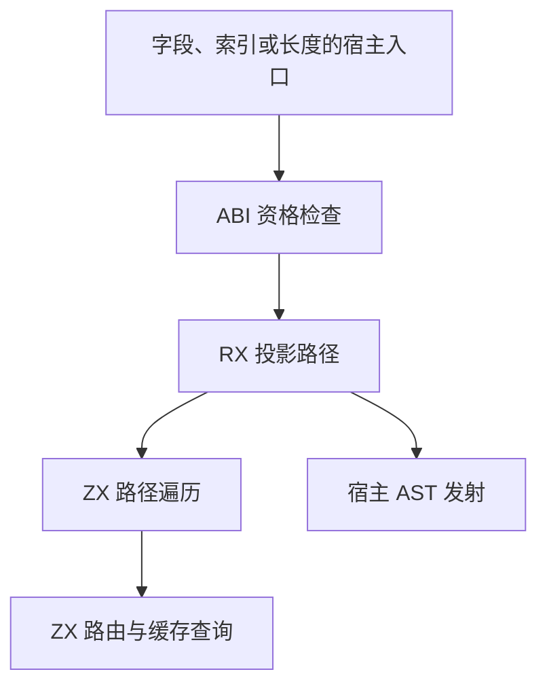

# ABI 投影路径自举

## Intent

将对象字段和嵌套列表访问的 ABI 投影路径迁入 RX 和 ZX。保持字段读取、索引求值顺序、缓存优先级和列表存储语义，避免在宿主逐层调用分析模块。

## Data

- 旧路径在递归下降时依次检查增长标记、类型表示和缓存。无内部表示的表达式可以作为原生 ABI 起点。对象索引在父路径不能保留 ABI 表示时可以从已管理列表读取。
- 原递归先查整条路径，再从起点向外发射字段和索引。如果找不到 ABI 起点，最靠近阻断点且能从已管理列表读取的索引接管其余路径。如果没有这样的索引，则改用调用方既有的普通求值。
- 对照使用相同的 Source 构建阶段、工具链、清单和缓存状态。普通字段访问未通过 ABI 资格检查时，仍直接走原有发射路径。

## Edges

- 计划只借用现有类型、表达式、增长标记与缓存列，保留投影节点 ID。无路径节点时不分配计划数组，短路径使用栈缓冲。缓存查询仅在存在可沿用的字段或索引路线时发生。
- RX 选择原生 ABI 起点或列表读取起点。ZX 遍历 IR 并记录字段、索引以及回退点。宿主按计划逆序发射，用原有结构化 AST 原语执行字段读取和索引求值。
- 递归表达式降低、索引错误边界和 AST 存储仍由现有宿主持有。后续需迁移这些依赖，才能移除计划执行适配器。旧递归实现保留给 Zig seed。

### 架构

### 数据流

## Answer

验收覆盖三阶段自编译、同输入产物比较、既有字段与列表访问回归、生成器成本和完整冷构建。完整自举仍需正式入口传递依赖审计。

### 自编译与生成器

以上一阶段的 Source stage 3 生成本阶段 stage 1，再连续生成 stage 2 和 stage 3，三轮均为 22/22 步。主组 8,848 个文件、增长组 416 个、顺序组 23 个、集合组 70 个、宿主组 108 个，三阶段逐字节相同。旧工具与本阶段 stage 3 使用同一份 380 入口清单生成的主组和增长组也逐字节相同。

前后工具本体均由 Source 自编译至 stage 3，运行时均使用 Source 分析与生成。三轮交替测量，空函数缓存每轮重新生成 4,093 个函数。

| 三轮中位数          | 墙钟秒      | CPU 秒      | 单体峰值 RSS 字节         |
| ------------------- | ----------- | ----------- | ------------------------- |
| 缓存命中，前 → 后   | 1.50 → 1.50 | 5.22 → 5.20 | 837,861,376 → 837,320,704 |
| 空函数缓存，前 → 后 | 2.01 → 2.02 | 8.81 → 8.84 | 888,324,096 → 888,193,024 |

空函数缓存的新工具峰值分布为 887.9–909.8 MB，旧工具为 887.9–906.8 MB。上一阶段报告的 30.0 MB 中位数差在当前同输入对照中未再出现。产物校验与计时在 `.zig-cache/cold-build-analysis/ownership-research/abi-projection-path/`。

### 完整冷构建

Zig 0.17.0、ReleaseSmall、12 核、四分区、固定遍历种子 `0x3b41c83f`、本地 Zig 归档。关闭常驻生成器，使用独立空缓存并每 200 毫秒采样进程树。构建中工具本体和分析、生成路径均来自 Zig seed。安装版 CLI 使用 Source。

| 对照                 | 墙钟秒  | CPU 秒 | 进程树峰值字节 | 单体最大 RSS 字节 |
| -------------------- | ------- | ------ | -------------- | ----------------- |
| 固定基线             | 129.740 | 216.03 | 2,247,294,976  | 2,075,033,600     |
| 上一阶段同工作区样本 | 116.923 | 206.26 | 2,254,209,024  | 2,099,888,128     |
| 本阶段样本           | 116.630 | 206.22 | 2,251,161,600  | 2,108,096,512     |

冷构建 70/70 步通过。相对上一阶段，墙钟减少 0.29 秒，CPU 减少 0.04 秒，树峰值减少 3.0 MB，单体最大 RSS 增加 8.2 MB。相对固定基线，墙钟少 13.11 秒，CPU 少 9.81 秒，树峰值高 3.9 MB，单体最大 RSS 高 33.1 MB。

树峰出现在 62.73 秒，LLVM 分区与 RX 测试编译重叠。分区 0、1、2 对象逐字节一致，分区 3 增加 2,032 字节。完整日志和校验记录在 `partition-reference/cold-abi-projection-path/`。

### 回归与自我复核

前后安装版 CLI 禁用缓存生成 12 个已有用例，覆盖多层聚合字段、列表索引、缓存所有权和借用字段。生成的 Zig 文件逐字节一致。RX、ZX 通过格式化与 lint，Zig 通过 `zig fmt --check`。

本阶段 Source stage 3 运行 `test-array-evaluation-order`、`test-aggregate-loop`、`test-loop-columns`、`test-nested-buffer`、`test-cached-ownership`、`test-value-return` 与 `test-native-value-boundary`，331/331 步、601/601 项通过。

已核对生成的 RX 起点选择与 ZX 路径增长。起点选择前只读取 IR 与缓存，栈缓冲保存必要的节点 ID。宿主先求值起点，再逆序使用路径节点，因此索引表达式、缓存读取和错误退出沿用原顺序。前后冷构建的单体峰值均出现在最后阶段的 `zig build-lib` 进程，RSS 的样本增加仍缺少归因。
