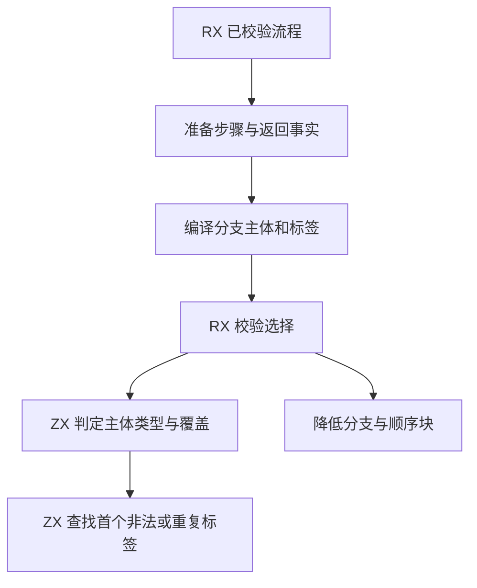
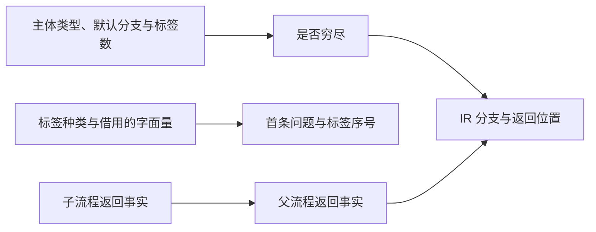

# RX 分支与返回路径自举

## Intent

将 RX 分支选择的类型、标签和覆盖规则迁入 RX/ZX。准备与降级在访问子流程时汇总返回事实，使长顺序流程与深层分支的控制检查随实际步骤数增长。

## Data

原准备阶段每追加一个步骤便重扫已完成的前缀。原降级阶段反复根据已生成的末尾分支递归判断返回。Switch 编译结束后另行检查标签，降级再从类型表计算覆盖。可复用已经生成的标签与每个子流程的返回事实。

## Edges

- 结构准备只根据显式默认分支判断终止。完成类型检查后，布尔和枚举覆盖也可使分支穷尽。
- 顺序 Task 的返回参与外层流程。Parallel Task 的返回只属于其自身。Task.out 与显式 Return 的冲突仍使用原属性位置。
- 标签按源码顺序检查，保留整数正零与负零相等的规则。字符串只借用字节。
- 短选择直接比对标签列。超过 12 项时使用两倍容量的开放寻址索引并保留源码顺序，命中后按标签值复核。索引只存标签序号，生成代码就地写槽。
- XML 属性提取、表达式编译、源码诊断映射及 IR 构造仍由 Zig 宿主负责。Native seed 保留自己的标签校验路径。

## Answer

Native 与固定 Source stage 3 生成的规则各通过 4,096 组对照。覆盖整数正负零、字符串、布尔、枚举、非法标签、默认分支、非穷尽路径及合法宽选择。每条路径有 384 组短分支以零容量分配器通过，3,557 组走临时索引，128 项以内最大临时用量 2,320 字节。

集中回归通过 106 个构建步骤、416 项 Zig 测试和 32 项 Task CLI 用例。覆盖 RX 推导、并行推导、XML 表达式诊断、混合库及磁盘项目构建。

两个安装版对照 40 个项目，生成 Zig 和诊断逐字节一致。宽 Switch 与长顺序流程按版本交替七轮，每轮无缓存生成两次，舍弃首轮。

| 项目             |        墙钟 / s |         CPU / s |
| ---------------- | --------------: | --------------: |
| 384 个整数标签   | 0.2365 → 0.1545 | 0.2357 → 0.1539 |
| 256 个字符串标签 | 0.1476 → 0.1109 | 0.1467 → 0.1100 |
| 384 个顺序 Task  | 0.6257 → 0.6276 | 0.6250 → 0.6266 |

短分支另以每轮 12 次无缓存生成交替执行九轮。舍弃首轮后，Task 中的 Switch CPU 中位数为 0.04182 → 0.04201 秒，穷尽布尔 Switch 为 0.03337 → 0.03357 秒。

### 冷构建

沿用 Zig 0.17.0、ReleaseSmall、12 核、四分区和构建种子 `0x3b41c83f`。关闭常驻生成，本地与全局缓存从空开始。Native seed 引导工具构建，安装版执行 Source 分析与生成。

| 指标                             | 固定历史基线 | 上一阶段 |  本阶段 |
| -------------------------------- | -----------: | -------: | ------: |
| 构建墙钟 / s（`time -l`）        |            — |   116.70 |  116.32 |
| 进程树采样墙钟 / s               |      129.740 |  116.820 | 116.387 |
| CPU / s                          |       216.03 |   209.51 |  208.99 |
| 进程树峰值 RSS / MB              |      2,247.3 |  2,353.6 | 2,329.2 |
| 单进程峰值 RSS / MB（`time -l`） |      2,075.0 |  2,117.7 | 2,098.3 |

冷构建通过 70 步。较上一阶段，墙钟减少 0.38 秒，CPU 减少 0.52 秒，树峰值减少 24.4 MB。较固定历史基线，采样墙钟减少 13.35 秒，CPU 减少 7.04 秒，树峰值增加 81.9 MB。CPU 较近期 206.33 秒样本高 2.66 秒。前三个分区对象逐字节一致，第四个增加 3,248 字节。

生成规则、回归及项目对照日志位于 `.zig-cache/cold-build-analysis/ownership-research/rx-control-flow/`。冷构建采样和对象哈希位于同级 `partition-reference/cold-rx-control-flow/`。
