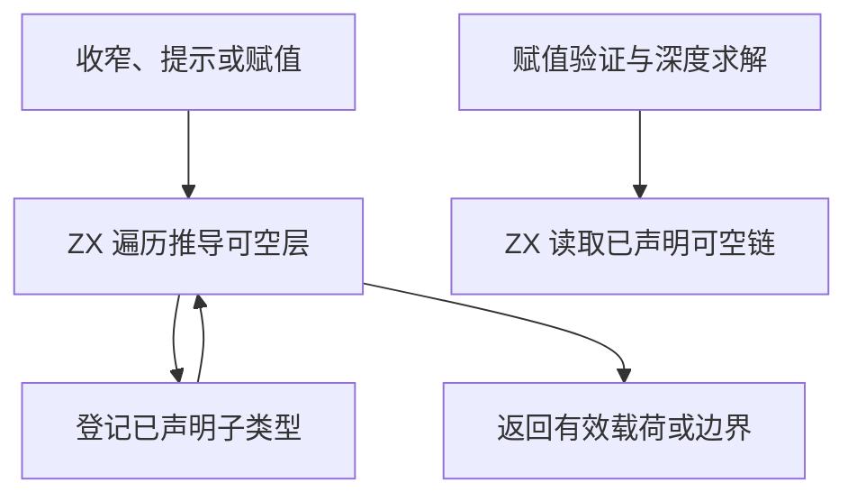

# RX 可空类型遍历自举

## Intent · 意图

迁移 RX 条件收窄、表达式提示、赋值有效载荷和终局可空校验，复用已有类型图和类型表。保持剥离层数、类型登记顺序、诊断和源位置。

## Data · 证据

原规则分别通过原生节点和类型联合读取可空层。条件收窄只读一层，表达式提示忽略未约束的开放节点，赋值有效载荷返回代表并限制 256 层。已声明的子类型需要在宿主登记，可能增长节点表。赋值验证和深度求解只读已声明类型列。

## Edges · 边界

ZX 借用节点形状、参数、父列及类型表的种类和子编号。遍历连续的推导层，遇已声明子类型时交还登记请求。宿主沿原顺序登记、更新借用，并在对应位置映射错误。初始 Native seed 保留 Zig 遍历。登记和类型统一的宿主实现仍属于后续迁移范围。

## Answer · 交付与验收

对照一层收窄、开放节点、声明与推导混合、256 层边界和声明链接受规则。验证原父列地址与分配行为，运行 RX 推导和库回归，再比较安装版输出及冷构建。

固定的 Source stage 3 和 Native seed 分别生成检查器。每套均通过 8,192 节点父链、256 层前后边界、48,000 次类型图遍历及 12,000 条声明链对照。零容量分配器下保留原父列地址与独占标记，逐项核对压缩结果、原节点和代表、登记边界、深度和接受判断。

RX 推导、并行推导、RX 文本、混合库与模块记录共通过 51 个构建步骤、375 项回归。

安装版对照 15 个项目，覆盖声明双层可空、对象字面量提示、赋值接受与拒绝、未约束输入、单层收窄和短路。12 份生成 Zig 与三份诊断逐字节一致。按版本交替八轮，每轮无缓存生成 12 次，舍弃首轮。48 个嵌套提示的 CPU 中位数为 0.6520 → 0.6495 秒，60 个重复收窄为 0.5169 → 0.5170 秒。

### 冷构建

沿用 Zig 0.17.0、ReleaseSmall、12 核、四分区、种子 `0x3b41c83f` 和关闭常驻生成的配置。显式本地及全局构建缓存从空开始，复用同一源码目录及源码缓存。构建由 Native seed 引导，安装版执行 Source 分析和生成。候选和上批均通过 70 步。

| 指标                             | 固定历史基线 | 上批隔离复测 |    本批 |
| -------------------------------- | -----------: | -----------: | ------: |
| 构建墙钟 / s（`time -l`）        |            — |       117.00 |  116.75 |
| 进程树采样墙钟 / s               |      129.740 |      117.062 | 116.791 |
| CPU / s                          |       216.03 |       208.16 |  208.08 |
| 进程树峰值 RSS / MB              |      2,247.3 |      2,350.5 | 2,275.0 |
| 单进程峰值 RSS / MB（`time -l`） |      2,075.0 |      2,117.3 | 2,128.8 |

较上批墙钟减少 0.25 秒，CPU 减少 0.08 秒，进程树峰值下降 75.6 MB，单进程峰值增加 11.6 MB。进程树峰值仍出现在四个分区和检查编译重叠期间，检查进程的采样占用由约 475 MB 变为 406 MB。前三个分区对象逐字节一致，第四个增加 1,784 字节。较固定历史基线采样墙钟减少 12.95 秒，CPU 减少 7.95 秒，进程树峰值增加 27.7 MB。CPU 较近期 206.33 秒样本增加 1.75 秒。日志位于 `.zig-cache/cold-build-analysis/ownership-research/rx-optional-walk/`，冷构建采样和分区哈希位于同级 `partition-reference/cold-rx-optional-walk/`。
