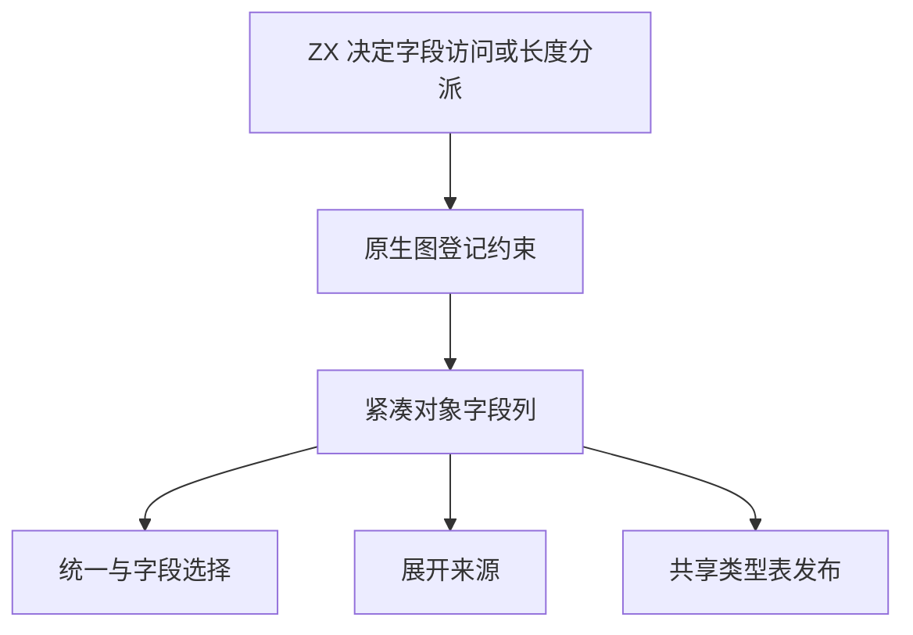

# RX 对象字段列与访问自举

## Intent · 意图

让 RX 类型图的字段查找、统一、展开、选择和类型发布直接借用同一份对象字段名称列，并将字段访问与 length 的分派规则迁入 ZX。

## Data · 证据

原类型图按字段交错保存名称与节点编号。生成的统一、展开和选择规则各自投影一份名称数组，类型发布也重新构造名称列。字段查找与 length 特判仍在宿主内。

## Edges · 边界

推导对象以紧凑列保存名称和节点编号，保留旧字段顺序及已借用前缀的生命周期。宿主登记节点、回填图形状和映射诊断。Source 发布借用名称列，初始 seed 在需要排序时取得可写名称缓冲。

## Answer · 交付与验收

对照对象约束、展开和选择、字段错误与 length 分派，核对临时分配及端到端性能。

### 规则与存储

字段名称和图节点编号各自连续存放，底层一次分配。扩展字段集时保留此前字段集的存储，已借出的名称列在当前图的生命周期内始终有效。Source 类型发布直接借用名称列，仅在临时分配器中填写解析后的类型编号。

256 字段的布局样本从 6,144 降至 5,120 字节，字段视图保持 16 字节。布局对照覆盖字段值、名称、复制后的前缀及扩展后的尾项。

固定 Source stage 3 生成字段分派入口，在零容量分配器下对照 27,090 组接收者和字段名，包含不同集合形状、length、非 ASCII 名称及随机字节串。集中回归 48/48 步和 270/270 项测试通过。

安装版对照 15 个字段访问和 length 项目，其中 10 个生成结果、5 个诊断逐字节一致。另 12 个对象统一、选择、重复字段和展开项目，以及三个库项目的 47 份产物均逐字节一致。

### 性能

沿用 Zig 0.17.0、ReleaseSmall、12 核、四分区和固定种子 `0x3b41c83f`，关闭常驻生成。显式本地和全局缓存目录为空，复用同一基准源码目录及其 Zig 源码缓存。构建由 Native seed 引导，安装版运行 Source 分析。70/70 步通过。

| 指标                   |      固定基线 |          上批 |          本批 |
| ---------------------- | ------------: | ------------: | ------------: |
| 墙钟 / s               |       129.740 |       115.789 |       115.311 |
| CPU / s                |        216.03 |        208.20 |        207.65 |
| 进程树采样峰值 RSS / B | 2,247,294,976 | 2,312,863,744 | 2,296,381,440 |
| 单进程系统峰值 RSS / B | 2,075,033,600 | 2,112,192,512 | 2,118,139,904 |

较上批墙钟减少 0.48 秒，CPU 减少 0.55 秒，进程树峰值减少 16.5 MB，单进程峰值增加 5.9 MB。CPU 较近期 206.33 秒样本增加 1.32 秒，较固定基线减少 8.38 秒。进程树峰值较固定基线高 49.1 MB。前三个分区对象逐字节一致，第四个增加 800 字节。

安装版禁用缓存，每轮连续生成 16 次 256 字段对象，墙钟中位数 1.1583 → 1.1541 秒，CPU 1.1534 → 1.1495 秒，生成源码一致。单次编译的系统峰值 RSS 中位数为 42,254,336 → 41,926,656 字节。

命令、日志和哈希位于 `.zig-cache/cold-build-analysis/ownership-research/rx-object-columns/` 和同级 `partition-reference/cold-rx-object-columns/`。
