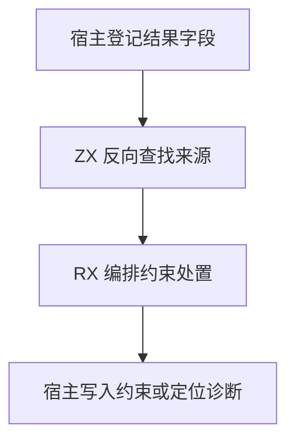

# RX 对象字段来源自举

## Intent · 意图

将 RX 对象构造的字段来源选择、歧义判定和约束处置迁入 RX/ZX。保持覆盖顺序、同根展开、错误位置及生成结果。

## Data · 证据

旧算法按名称集合的原有顺序登记结果字段，然后逐字段反向扫描对象部件。已知的字段结束扫描，仍开放的展开源可能提供候选。相同类型根的相邻开放候选合并。已知来源即使遇到歧义也会先登记其字段类型。

## Edges · 边界

每个对象只投影一次部件和来源。已知对象借用字段名，推导对象临时投影名称描述符。结果字段仍由宿主先登记，同根来源随即能够读取该字段。Zig 保留类型图写入、诊断位置和种子实现。

## Answer · 交付与验收

核对同根与不同根展开、覆盖、可选字段和缺失字段，比较诊断、生成产物及冷构建资源。

### 正确性与分配

Source 工具生成的逐字段决策在零字节分配器下通过 32,000 组对照。对照包括同根候选、跨根歧义、同根结果别名、重复名称以及终局诊断。部件的字段名、根与开放状态在对象内共用。推导中新增的字段只影响当前键，别名来源可以直接取宿主刚登记的结果字段。

四组集中回归的 48/48 构建步、270/270 项测试通过。安装版比较五个成功项目的生成 Zig 和四个失败项目的诊断，均逐字节一致。失败样本覆盖开放展开不能推断、多个展开源歧义、缺失必需字段及嵌套选择缺失键。

### 性能

沿用 Zig 0.17.0、ReleaseSmall、12 核、四分区、固定种子 `0x3b41c83f`、空 local/global 缓存和同一源码目录，关闭常驻生成。冷构建由 Native seed 引导，安装版运行 Source 分析。70/70 步通过。

| 指标                   |      固定基线 |          上批 |          本批 |      较上批 |
| ---------------------- | ------------: | ------------: | ------------: | ----------: |
| 墙钟 / s               |       129.740 |       117.018 |       116.538 |      −0.480 |
| CPU / s                |        216.03 |        209.00 |        207.31 |       −1.69 |
| 进程树采样峰值 RSS / B | 2,247,294,976 | 2,311,716,864 | 2,324,742,144 | +13,025,280 |
| 单进程系统峰值 RSS / B | 2,075,033,600 | 2,121,711,616 | 2,111,193,088 | −10,518,528 |

CPU 较近期 206.33 秒的样本增加 0.98 秒，较固定基线减少 8.72 秒。两轮树峰均出现在 LLVM 分区 0、1、2 同时编译时，这三个分区的对象逐字节相同。分区 3 对象增加 1,280 字节，采样树峰时已结束。树峰较固定基线高约 77.4 MB。

两份安装版均以 Source 分析编译双展开覆盖的 64 字段对象。每轮禁用缓存连续生成 16 次，墙钟中位数 0.1087 → 0.1085 秒，CPU 0.1098 → 0.1093 秒，生成源码一致。三个库项目的 47 份产物也逐字节一致。

命令、日志与哈希位于 `.zig-cache/cold-build-analysis/ownership-research/rx-object-construction/` 和同级 `partition-reference/cold-rx-object-construction/`。
