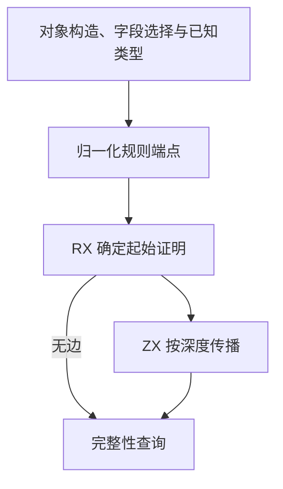
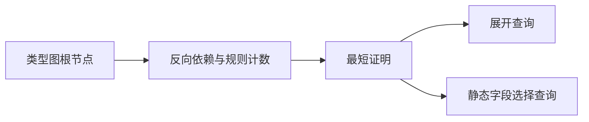

# RX 对象完整性推导自举

## Intent · 意图

将 RX 对象展开和静态字段选择的完整性推导迁入 RX/ZX。保留两种查询对选择结果的不同约定、递归边界和原来的诊断位置。

## Data · 证据

原实现为每次查询递归扫描全部构造与选择规则。已知类型在任何深度都成立。构造要求所有展开源成立，多个同根构造可以择一。展开查询直接承认选择结果，静态字段选择查询则要求它的来源成立。

## Edges · 边界

Zig 按现有统一结果归一化约束端点并投影反向索引。RX 先确定起始证明，图无依赖边时直接返回。ZX 沿反向边按最短证明深度传播，独立维护每条规则尚缺的展开来源。结果按类型合并版本复用，查询结束后释放临时存储。字段实际装配及原生类型表继续由既有宿主实现。

## Answer · 交付与验收

对照原递归算法验证循环、深度边界、别名及两种查询语义，集中覆盖 RX 推导与真实项目产物。按固定基线跟踪冷构建 CPU、墙钟和内存。

### 正确性与分配

同一根可以由多条规则证明。已知节点从深度 0 开始，空构造及展开查询的选择结果从深度 1 开始。每条规则在最后一个依赖入队后成立，按广度顺序得到最短证明。深度 256 的节点可以成立，其结果不能继续传播，与原递归边界一致。

Source 工具生成的 ReleaseSmall 求解器通过 16,004 组对照，参考按深度递推原规则，覆盖循环、重复边、多条替代规则和两种 256 层边界。32,768 个可达节点的宽图使用 2,010,238 字节求解 arena 容量，该值不含宿主投影。Source 和 Native seed 生成的传播代码均直接更新独占列，队列按容量增长。快照在任一类型根合并后重新建立，普通字段添加和约束登记不触发重建。

四组集中回归覆盖 RX 推导、RX 文本、混合库和模块记录，48/48 构建步、270/270 项 Zig 测试与两个混合库执行方向均通过。安装版对照的嵌套展开、`pick` 和 `omit` 生成 Zig 逐字节一致，未知字段错误的类别、位置和文本一致。

### 性能

沿用 Zig 0.17.0、ReleaseSmall、12 核、四分区、固定种子 `0x3b41c83f`、空 local/global 缓存和同一源码目录，关闭常驻生成。冷构建由 Native seed 引导，安装版运行 Source 分析。70/70 步通过。

| 指标                   |      固定基线 |          上批 |          本批 |      较上批 |
| ---------------------- | ------------: | ------------: | ------------: | ----------: |
| 墙钟 / s               |       129.740 |       117.388 |       116.669 |      −0.719 |
| CPU / s                |        216.03 |        207.59 |        207.50 |       −0.09 |
| 进程树采样峰值 RSS / B | 2,247,294,976 | 2,283,847,680 | 2,261,549,056 | −22,298,624 |
| 单进程系统峰值 RSS / B | 2,075,033,600 | 2,111,504,384 | 2,108,096,512 |  −3,407,872 |

CPU 较近期 206.33 秒的样本增加 1.17 秒，较固定基线减少 8.53 秒。进程树峰值较固定基线仍高约 14.3 MB。前三个分区对象逐字节一致，分区 3 增加 4,160 字节。

安装版禁用缓存发布源码闭包、原生依赖及 Store 三个库，47 份产物逐字节一致。每轮三项目的中位数墙钟 0.0694 → 0.0702 秒，CPU 0.0767 → 0.0765 秒。命令、日志与哈希记录在 `.zig-cache/cold-build-analysis/ownership-research/rx-object-closure/` 和同级 `partition-reference/cold-rx-object-closure/`。
