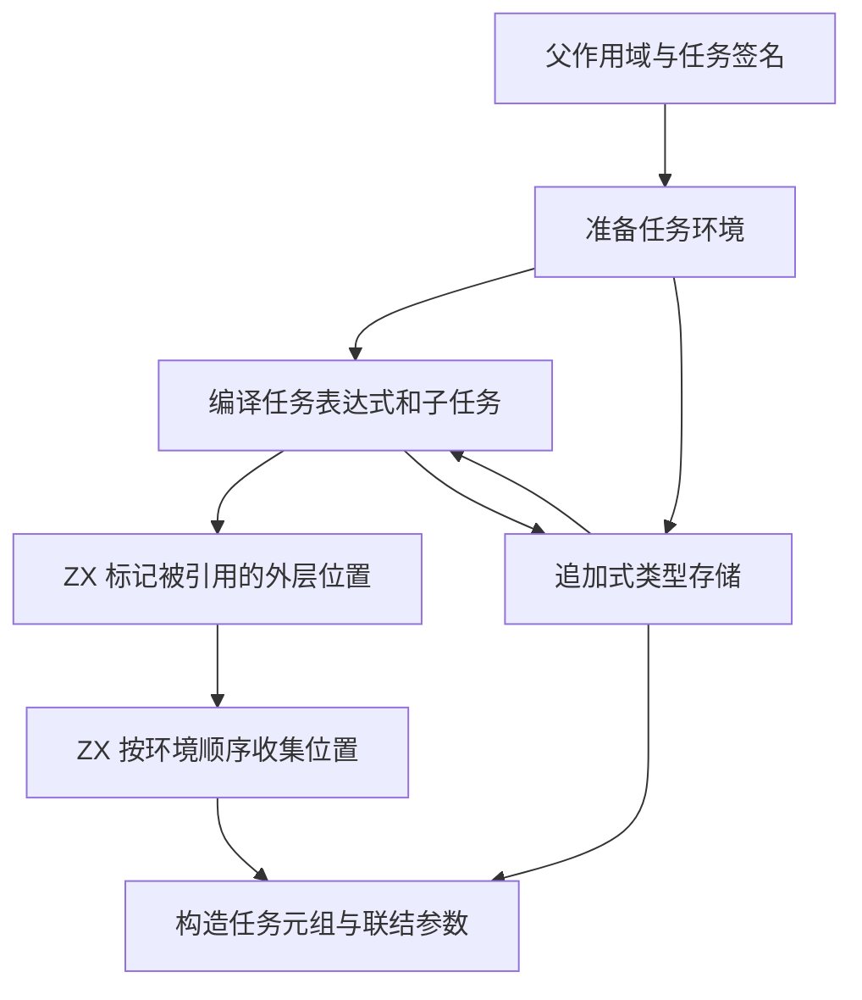
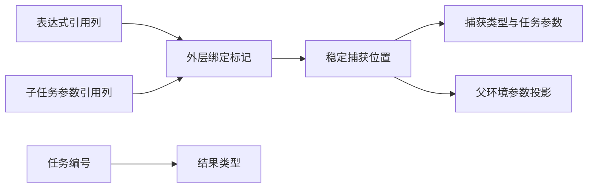

# RX 并行任务捕获自举

## Intent

将 Parallel Task 的捕获标记和位置收集迁入 ZX。复用表达式 IR 的引用列、任务签名的稳定编号和追加式类型存储，保持任务参数顺序、可空收窄及产物语义。

## Data

旧实现对每个外层绑定遍历任务流程、逐个搜索表达式投影和引用，再按名称重新定位选中的参数。任务编译前后多次复制已存在的类型表。表达式联结已经按环境顺序分配符号，引用列保存每个被读取的符号编号。

## Edges

- 联结表达式以符号 0 表示环境，按传入绑定顺序分配后续符号。任务只标记外层环境前缀，忽略自身局部绑定。
- 子任务生成的参数引用参与父任务的捕获。捕获顺序与父环境一致，保持原有可空类型解包和隔离规则。
- 捕获标记由 ZX 一次分配并持有独占存储。后续观察只读借入的引用列，就地写入标记。位置列按命中数一次分配。
- 类型存储由活动任务顺序接管并归还，追加类型的顺序沿用现有表达式编译与任务降级。
- Zig 宿主负责遍历、生命周期和 IR 装配，ZX 负责基于借用列的标记与位置收集。Native seed 保留等价规则。

## Answer

Native 与固定 Source stage 3 生成的规则各通过 4,096 组环境对照，覆盖 6,307,810 个引用和 390,849 个选中位置。标记阶段使用零容量分配器，逐次验证标记地址。初始化和位置收集的临时空间随各自输出长度线性增长，生成 Zig 中各有一次有界分配。

集中回归通过 86 个构建步骤、279 项 Zig 测试及 32 项 Task CLI 用例。覆盖捕获的所有权、Store 快照、并行和分支类型、混合库、真实磁盘项目和 watch 恢复。

两个安装版对照 37 个项目，生成 Zig 和诊断逐字节一致，包含跨层捕获、父绑定和局部绑定混用，以及可空收窄。两组宽环境均导入 96 个结构类型。稀疏组有 80 个绑定和 24 个任务，每个任务捕获两个位置。密集组有 36 个绑定和 12 个任务，每个任务捕获全部位置。

按版本交替七轮，舍弃首轮。宽环境每轮无缓存生成两次，普通并行和嵌套任务每轮生成 12 次。峰值 RSS 使用另外五轮单次执行的系统中位数。

| 项目             |        墙钟 / s |         CPU / s | 单进程峰值 RSS / MB |
| ---------------- | --------------: | --------------: | ------------------: |
| 稀疏捕获         | 0.4246 → 0.1477 | 0.4307 → 0.1539 |         54.2 → 51.6 |
| 密集捕获         | 0.2237 → 0.1920 | 0.2301 → 0.1982 |         37.7 → 36.9 |
| 普通并行对象输出 | 0.0605 → 0.0608 | 0.0610 → 0.0606 |                   — |
| 嵌套捕获         | 0.0480 → 0.0483 | 0.0503 → 0.0501 |                   — |

### 冷构建

沿用 Zig 0.17.0、ReleaseSmall、12 核、四分区和构建种子 `0x3b41c83f`。关闭常驻生成，本地与全局缓存从空开始。Native seed 引导工具构建，安装版执行 Source 分析与生成。

| 指标                             | 固定历史基线 | 上一阶段 |  本阶段 |
| -------------------------------- | -----------: | -------: | ------: |
| 构建墙钟 / s（`time -l`）        |            — |   116.32 |  116.04 |
| 进程树采样墙钟 / s               |      129.740 |  116.387 | 116.141 |
| CPU / s                          |       216.03 |   208.99 |  208.13 |
| 进程树峰值 RSS / MB              |      2,247.3 |  2,329.2 | 2,314.9 |
| 单进程峰值 RSS / MB（`time -l`） |      2,075.0 |  2,098.3 | 2,121.8 |

冷构建通过 70 步。较上一阶段，墙钟减少 0.28 秒，CPU 减少 0.86 秒，树峰值减少 14.3 MB，单进程峰值增加 23.6 MB。较固定历史基线，采样墙钟减少 13.60 秒，CPU 减少 7.90 秒，树峰值增加 67.6 MB。CPU 较近期 206.33 秒样本高 1.80 秒。前三个分区对象逐字节一致，第四个增加 2,312 字节。

生成规则、回归及项目对照日志位于 `.zig-cache/cold-build-analysis/ownership-research/rx-task-captures/`。冷构建采样和对象哈希位于同级 `partition-reference/cold-rx-task-captures/`。
