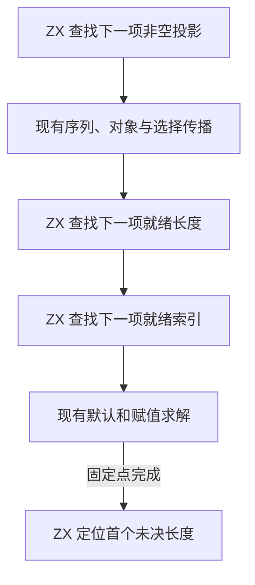

# RX 延迟投影自举

## Intent · 意图

将 RX 固定点中延迟非空、长度和索引投影的选择迁入 ZX。保持处理顺序、等待条件、推导结果和首个诊断位置。

## Data · 证据

旧实现逐项解析当前根。非空投影取一层可空负载，最终阶段才可从已知结果反推源类型。长度等待开放节点，索引同时等待未确定的序列，并跳过已解析的投影。图合并可能改变后续投影的就绪状态。

ZX 扫描从原位置继续，借用投影目标、状态、节点形状和类型表列。只返回首个可应用的投影或最终仍待定的长度位置。原父列执行路径减半。宿主执行本次登记或合并后，下一次扫描读取更新的图。

## Edges · 边界

非空复用现有 ZX 可空遍历。索引仍用已有 RX 规则区分列表、元组和字符串。Zig 过渡宿主仍负责固定点阶段调度、应用图约束、登记类型和附加诊断位置。初始 seed 保留等价扫描。

## Answer · 交付与验收

Native seed 和固定 Source stage 3 生成的规则各通过 12,000 组图对照。每套均覆盖 396,289 次长度和索引选择，以及 432,407 次非空合并、80,596 次声明类型登记和 26,101 次源类型反推。选择、位置、负载与父列内容一致。两套均使用零容量分配器，父列保持原地址。

RX 类型推导、并行推导、RX 文本、混合库和模块记录共通过 51 个构建步骤及 375 项既有回归。

安装版对照 39 个项目，生成 Zig 与拒绝诊断逐字节一致。覆盖长度歧义、索引默认后取得长度、字符串约束和非空反推。两版交替执行八轮，每轮无缓存生成 12 次并舍弃首轮。重复索引、非空收窄和延迟长度三组的 CPU 中位数分别为 0.1978 → 0.1981、0.5182 → 0.5189、0.1126 → 0.1126 秒。

### 冷构建

沿用 Zig 0.17.0、ReleaseSmall、12 核、四分区及构建种子 `0x3b41c83f`。关闭常驻生成，显式本地与全局构建缓存从空开始。Native seed 引导构建，安装版执行 Source 分析与生成。两批均通过 70 个构建步骤。

| 指标                             | 固定历史基线 | 上一提交 |    本批 |
| -------------------------------- | -----------: | -------: | ------: |
| 构建墙钟 / s（`time -l`）        |            — |   116.81 |  116.71 |
| 进程树采样墙钟 / s               |      129.740 |  116.991 | 116.809 |
| CPU / s                          |       216.03 |   208.17 |  207.52 |
| 进程树峰值 RSS / MB              |      2,247.3 |  2,333.7 | 2,294.9 |
| 单进程峰值 RSS / MB（`time -l`） |      2,075.0 |  2,121.2 | 2,115.0 |

较上批墙钟少 0.10 秒，CPU 少 0.65 秒，进程树峰值下降 38.7 MB，单进程峰值下降 6.2 MB。前三个分区对象逐字节一致，第四个增加 2,856 字节。相对固定历史基线，采样墙钟少 12.93 秒，CPU 少 8.51 秒，树峰值高 47.6 MB。CPU 较近期 206.33 秒样本高 1.19 秒。采样与分区哈希位于 `.zig-cache/cold-build-analysis/ownership-research/partition-reference/cold-rx-deferred-projections/`。
