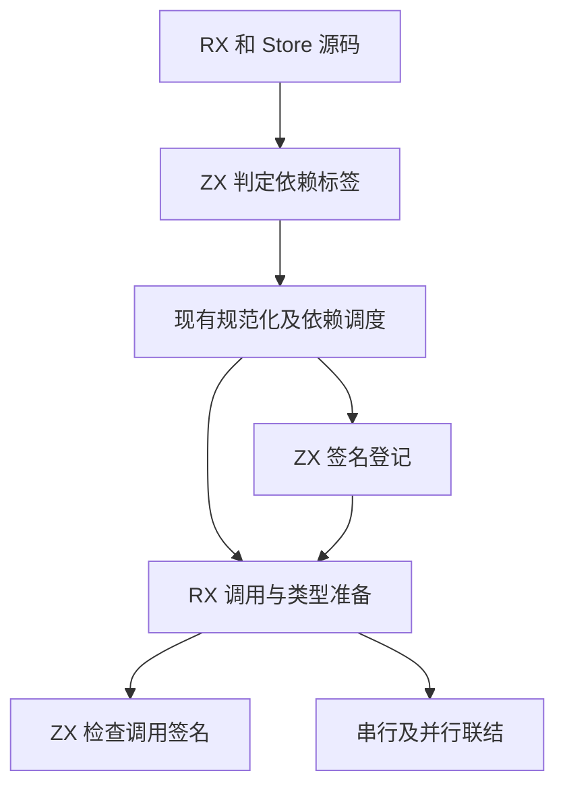
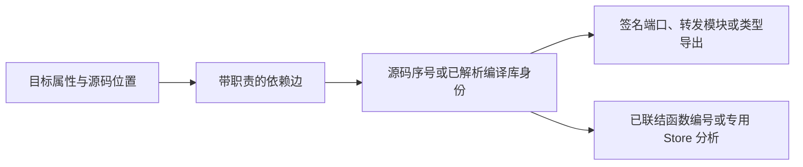

# RX 引用与调用联结自举

## Intent

让语义依赖图登记的 RX 目标贯通类型准备、推导及联结。将标签依赖分类、调用签名选择与诊断路线迁入 ZX，让 `Type` 和 `Call` 共用依赖图中的目标。

## Data

源码依赖图已记录规范化的源码序号或编译库目标。旧准备阶段再按路径寻找 RX 注册项和 ZX 签名。串行联结和并行准备又各自解析调用目标。记录同一个调用的依赖边可以复用已有目标，并保留拓扑调度的身份与诊断位置。

## Edges

- 依赖边仍按 XML 文档顺序登记。准备阶段按职责消费原有边，包含嵌套分支、重复调用和模块快捷入口。
- 依赖图保留 ZX 转发模块的原始目标。约束收集读取转发后的 RX 端口，最终联结读取原目标对应的函数。
- 准备结果保存依赖边引用及端口或 RX 序号。编译库经现有 IR 校验后只取约束求解所需的端口。联结从已登记的库目标取得实际函数。
- 依赖边和签名索引由同一次分析持有。watch 复用分析帧时一起借用，源码图重建时重新取得目标。
- 保留包作用域、编译库与原生接口边界、Store 授权及现有诊断顺序。
- Zig 继续负责路径及包注册表访问、编译库装载和 IR 联结。ZX 负责标签分类、端口路线和限定名称。

## Answer

最终实现通过 133 个构建步骤及本轮执行的 252 项 Zig 测试。CLI 回归覆盖混合库、Store 路径、磁盘项目、依赖修改后的重新构建及错误恢复。规则由固定的 Source stage 3 生成。

两个安装版对照 51 个项目，生成 Zig 和诊断逐字节一致。两组 192 子模块项目按版本交替执行六轮，每轮运行四次无缓存生成并舍弃首轮。峰值 RSS 使用另外五轮单次执行的系统中位数。

| 项目     |        墙钟 / s |         CPU / s | 单进程峰值 RSS / MB |
| -------- | --------------: | --------------: | ------------------: |
| 隐式端口 | 0.7413 → 0.6861 | 0.8275 → 0.7722 |       166.4 → 167.7 |
| 显式端口 | 1.0562 → 0.9999 | 1.1421 → 1.0856 |       319.5 → 301.3 |

### 冷构建

沿用 Zig 0.17.0、ReleaseSmall、12 核、四分区和构建种子 `0x3b41c83f`。关闭常驻生成，本地与全局构建缓存从空开始。Native seed 引导工具构建，安装版执行 Source 分析与生成。

| 指标                             | 固定历史基线 | 上一阶段 |  本阶段 |
| -------------------------------- | -----------: | -------: | ------: |
| 构建墙钟 / s（`time -l`）        |            — |   117.20 |  116.70 |
| 进程树采样墙钟 / s               |      129.740 |  117.285 | 116.820 |
| CPU / s                          |       216.03 |   209.14 |  209.51 |
| 进程树峰值 RSS / MB              |      2,247.3 |  2,327.7 | 2,353.6 |
| 单进程峰值 RSS / MB（`time -l`） |      2,075.0 |  2,122.0 | 2,117.7 |

冷构建通过 70 步。相对上一阶段，墙钟少 0.50 秒，CPU 多 0.37 秒，树峰值多 25.9 MB。相对固定历史基线，采样墙钟少 12.92 秒，CPU 少 6.52 秒，树峰值多 106.3 MB。CPU 较近期 206.33 秒样本高 3.18 秒，越过累计观察线。

本阶段四个分区的采样 CPU 合计由 78.83 降至 77.94 秒，工具链打包器的编译进程由 1.42 增至 2.63 秒。树峰值仍位于四个分区与 RX 检查并发时，其中分区 1 和 2 在该采样点分别多占 25.9 MB 和 10.3 MB，两个目标文件均逐字节一致。分区 0 也逐字节一致，分区 3 增加 936 字节。

回归与项目对照日志位于 `.zig-cache/cold-build-analysis/ownership-research/rx-reference-linking/`。冷构建采样与对象哈希位于同级 `partition-reference/cold-rx-reference-linking/`。
