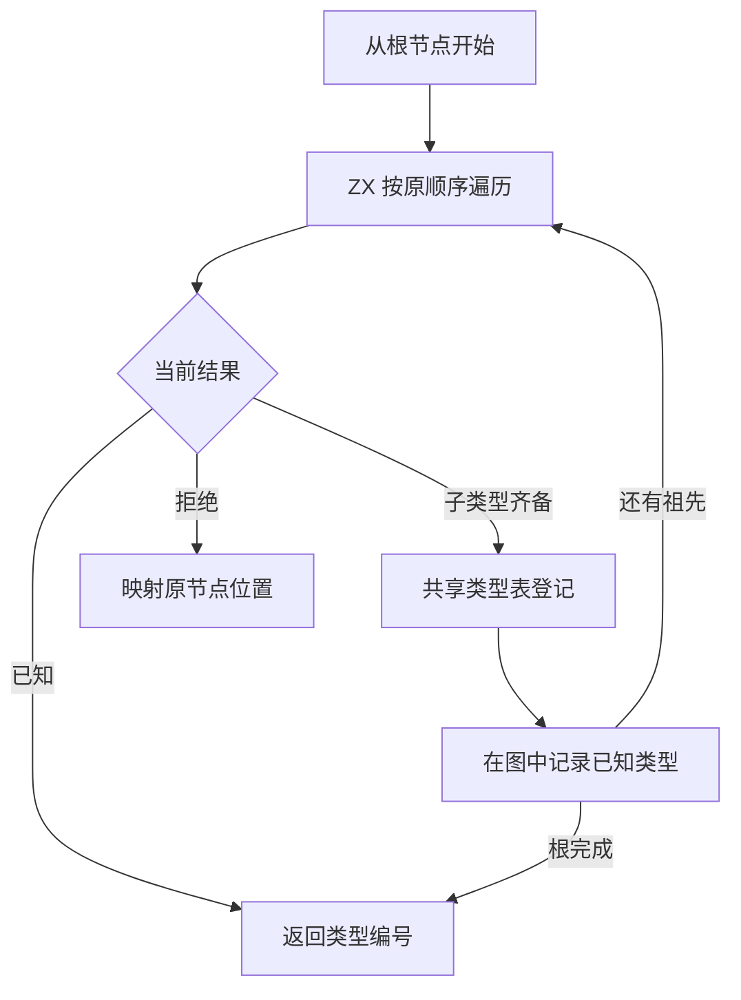

# RX 推导类型收口自举

## Intent · 意图

将 RX 推导图的类型收口迁入 ZX，保持子类型登记顺序、数字默认、深度限制和首个诊断。

## Data · 证据

旧实现按字段顺序递归，处理完子节点才登记当前节点。遍历过程中已登记的节点立即变为已知类型。重新从根搜索下一项会反复遍历已经处理的路径。ZX 遍历因此持有当前路径和待登记的子类型，登记后从原位置继续。

图形状、参数、子节点和数值约束直接借用现有列。父列原位压缩。临时子类型编号按遍历顺序追加，父节点完成时复用当前缓冲区的尾部。图中常见的已知类型继续直接读取。

## Edges · 边界

ZX 负责图遍历、容器请求、数字默认和拒绝原因。Zig 过渡宿主继续通过既有共享类型表接口登记类型、写入已知类型、关联诊断位置。初始 seed 保留递归实现。完整收口还依赖共享类型表存储和图写入的迁移。

## Answer · 交付与验收

Native seed 和固定 Source stage 3 分别生成遍历器。两套各通过 60,003 次对照，包括 26,709 次类型登记和 13,150 次诊断。核对登记顺序、子类型编号、首个拒绝节点、原位父列、已知类型和深度边界。最长路径的固定缓冲区占用为 8,272 字节。

RX 类型推导、并行推导、RX 文本、混合库和模块记录共通过 51 个构建步骤及 375 项既有回归。

安装版对照 34 个项目，生成 Zig 与拒绝诊断逐字节一致。按版本交替八轮，每轮无缓存生成 12 次并舍弃首轮。192 个数字字段、48 个嵌套对象和 20 层索引的 CPU 中位数分别为 0.2298 → 0.2304、0.3524 → 0.3532、0.0786 → 0.0787 秒。

### 冷构建

沿用 Zig 0.17.0、ReleaseSmall、12 核、四分区及构建种子 `0x3b41c83f`，关闭常驻生成，显式本地与全局构建缓存从空开始。Native seed 引导构建，安装版执行 Source 分析与生成。候选与上一批记录均通过 70 个构建步骤。

与上一批 115.47 秒的样本相比，候选墙钟增加 1.34 秒。采样中，生成器开始前已出现约 1.22 秒的差值，剩余构建时间差约 0.12 秒。候选 CPU 增加 0.03 秒。保留相同候选产物，补测上一提交。

| 指标                             | 固定历史基线 | 上一提交配对基线 |    本批 |
| -------------------------------- | -----------: | ---------------: | ------: |
| 构建墙钟 / s（`time -l`）        |            — |           117.92 |  116.81 |
| 进程树采样墙钟 / s               |      129.740 |          117.962 | 116.991 |
| CPU / s                          |       216.03 |           208.08 |  208.17 |
| 进程树峰值 RSS / MB              |      2,247.3 |          2,311.5 | 2,333.7 |
| 单进程峰值 RSS / MB（`time -l`） |      2,075.0 |          2,107.9 | 2,121.2 |

配对墙钟少 1.11 秒，CPU 增加 0.09 秒。树峰值增加 22.2 MB，发生在四个分区与 Zig 检查并发时。上一提交的树峰值出现在前三个分区同时生成时。前三个分区的对象逐字节一致，第四个增加 3,776 字节。相对固定历史基线，采样墙钟少 12.75 秒，CPU 少 7.86 秒，树峰值高 86.4 MB。CPU 较近期 206.33 秒样本高 1.84 秒。采样、安装版和分区哈希位于 `.zig-cache/cold-build-analysis/ownership-research/partition-reference/cold-rx-type-resolution*`。
