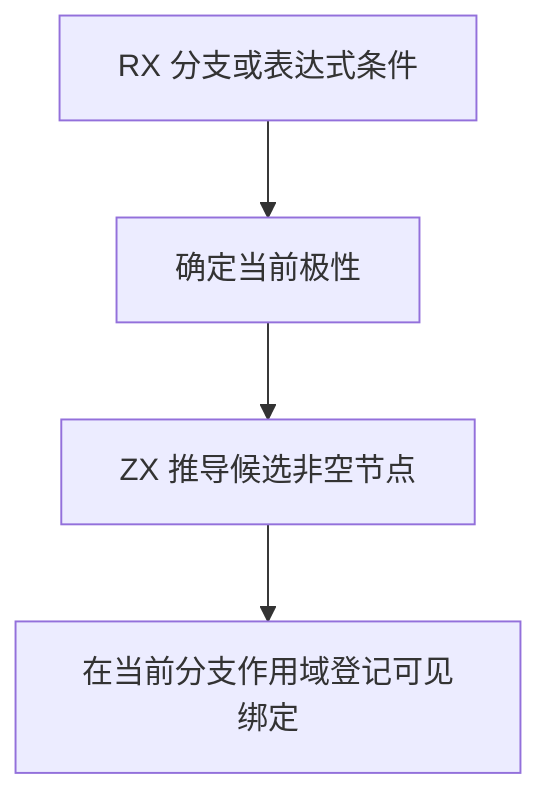

# RX 条件收窄自举

## Intent · 意图

迁移 RX 在布尔分支和表达式中的非空事实推导，保持短路极性、比较方向、事实顺序及作用域。类型推导和 IR 降低分别复用已解析的 Switch 条件。

## Data · 证据

索引解析器已提供稳定的表达式编号、操作符及有序子节点。原规则在 AND 为真、OR 为假时访问两侧，在取反时翻转极性，并从与 null 的有效比较中提取另一侧。Switch 条件此前在每个可收窄分支重新解析，普通 Case 值也在识别布尔字面量时重复解析。

## Edges · 边界

ZX 直接借用表达式节点，返回候选编号。首个编号内联，后续编号仅在同一次推导中短期保留。宿主继续管理当前可见的绑定、事实作用域和源位置。Default 可出现在显式 Case 之前，推导其极性时保留原有 Case 检查顺序。初始 seed 的原生 AST 保留原遍历。

## Answer · 交付与验收

检查解析树借用、短路极性、分支作用域和诊断位置。比较安装版输出及受影响条件项目的性能，并检查完整冷构建。

- 固定的 Source stage 3 与 Native seed 分别生成规则。两个产物各通过 32,000 次极性对照，覆盖取反、短路、左右 null 比较和事实顺序。零条或一条事实通过零容量分配器检查。256 条事实的深链使用 4,128 字节，逐项与原遍历一致。
- RX 推导、RX 文本、混合库与模块记录共 48 个构建步骤通过，重新执行 138 项测试，其余结果复用同输入缓存。安装版对照 11 个成功项目和 2 个拒绝项目，Zig 输出或诊断逐字节一致。
- 安装版交替运行八轮，每轮生成 16 次且关闭缓存。舍弃首轮后，36 个双事实条件的墙钟中位数由 0.5854 秒降至 0.5451 秒，CPU 由 0.5924 秒降至 0.5530 秒。60 个单事实条件的墙钟由 0.7554 秒降至 0.7165 秒，CPU 由 0.7629 秒降至 0.7239 秒。

### 冷构建

沿用 Zig 0.17.0、ReleaseSmall、12 核、四分区、种子 `0x3b41c83f` 及关闭常驻生成的配置。两次复用同一源码目录及其源码缓存，显式本地与全局构建缓存各自从空开始。完整构建由 Native seed 引导，安装版使用 Source 分析与生成。两次均通过 70 步。

| 指标                             | 固定历史基线 | 上批同目录复测 |    本批 |
| -------------------------------- | -----------: | -------------: | ------: |
| 构建墙钟 / s（`time -l`）        |            — |         117.12 |  117.13 |
| 进程树采样墙钟 / s               |      129.740 |        117.146 | 117.192 |
| CPU / s                          |       216.03 |         208.48 |  208.10 |
| 进程树峰值 RSS / MB              |      2,247.3 |        2,301.4 | 2,333.8 |
| 单进程峰值 RSS / MB（`time -l`） |      2,075.0 |        2,112.0 | 2,105.7 |

上批复测的四个分区对象与其 133 秒历史样本完全相同。候选保持前三个分区对象不变，第四个对象增加 1,864 字节。与同目录复测相比，构建墙钟增加 0.01 秒、CPU 减少 0.38 秒、单进程峰值下降 6.3 MB。进程树峰值增加 32.4 MB，峰值快照同时包含四个分区和一个 473 MB 的检查编译进程。上批的峰值发生在三个分区并行时。这两份峰值来自不同任务重叠，不能用差值估算规则的分配量。

本批相对固定历史基线采样墙钟减少 12.55 秒、CPU 减少 7.93 秒、进程树峰值增加 86.5 MB。相对近期 206.33 秒样本，CPU 增加 1.77 秒。运行日志与逐轮安装版数据保存在 `.zig-cache/cold-build-analysis/ownership-research/rx-condition-plan/`，完整构建采样和分区哈希位于同级 `partition-reference/cold-rx-condition-plan*`。
