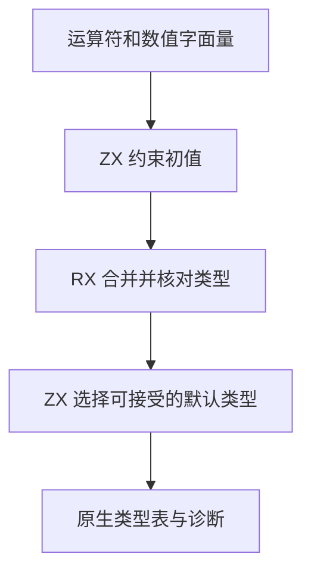

# RX 标量约束自举

## Intent · 意图

将 RX 运算符分类、数值字面量、约束交集和默认类型选择迁入 RX/ZX。保留表达式求值顺序、约束错误和类型表身份。

## Data · 证据

RX 和 ZX 对比较与逻辑运算分别分类。RX 数值节点创建后再调用通用限制入口登记已知非空的约束。标量集合按共享类型代码索引，可通过一个整数跨 ABI 传递。

## Edges · 边界

ZX 计算标量集合与类型选择，RX 编排限制的交集和形状校验。原生宿主继续登记节点、链接类型根、执行短路分析并映射诊断。生成入口只使用标量与借用的字面量字节，返回值使用固定栈缓冲区。

## Answer · 交付与验收

对照算术、比较、短路、可空合并、默认类型及失败诊断，测量安装版和固定配置冷构建。

### 规则与分配

Source 工具生成的六个入口通过 92,188 组对照，包括全部 2,048 种标量集合与 11 种默认类型的组合、字面量标记、所有二元运算符和随机约束合并。标量代码与宿主位图索引在编译期核对。各入口使用固定栈缓冲区，默认类型列表生成静态数据。

数值节点创建时直接登记允许集合和默认类型，保留原有的一次修订记录。短路和可空合并仍按原求值顺序执行，冲突先报告空交集，再报告标量形状或运算符约束。

四组集中回归的 48/48 构建步通过，其中执行 138 项 RX 推导测试，另外 132 项复用同输入的成功结果。安装版对照十二个成功项目和八个拒绝项目，生成 Zig 与诊断逐字节一致。新增对照覆盖数值字面量、取反、算术、比较、短路收窄和类型冲突。

### 性能

沿用 Zig 0.17.0、ReleaseSmall、12 核、四分区、固定种子 `0x3b41c83f`、空 local/global 缓存和同一源码目录，关闭常驻生成。冷构建由 Native seed 引导，安装版运行 Source 分析。70/70 步通过。

| 指标                   |      固定基线 |          上批 |          本批 |      较上批 |
| ---------------------- | ------------: | ------------: | ------------: | ----------: |
| 墙钟 / s               |       129.740 |       115.807 |       116.379 |      +0.572 |
| CPU / s                |        216.03 |        207.63 |        207.80 |       +0.17 |
| 进程树采样峰值 RSS / B | 2,247,294,976 | 2,308,227,072 | 2,259,025,920 | −49,201,152 |
| 单进程系统峰值 RSS / B | 2,075,033,600 | 2,111,799,296 | 2,115,256,320 |  +3,457,024 |

CPU 较近期 206.33 秒样本增加 1.47 秒，较固定基线减少 8.23 秒。进程树峰值较固定基线高约 11.7 MB。前三个分区对象逐字节一致，分区 3 增加 3,000 字节。

安装版以 Source 分析编译包含 64 个算术字段的模块。每轮禁用缓存连续生成 16 次，墙钟中位数 0.4066 → 0.4108 秒，CPU 0.4025 → 0.4064 秒，生成源码一致。三个库项目的 47 份产物也逐字节一致。

命令、日志与哈希位于 `.zig-cache/cold-build-analysis/ownership-research/rx-scalar/` 和同级 `partition-reference/cold-rx-scalar/`。
