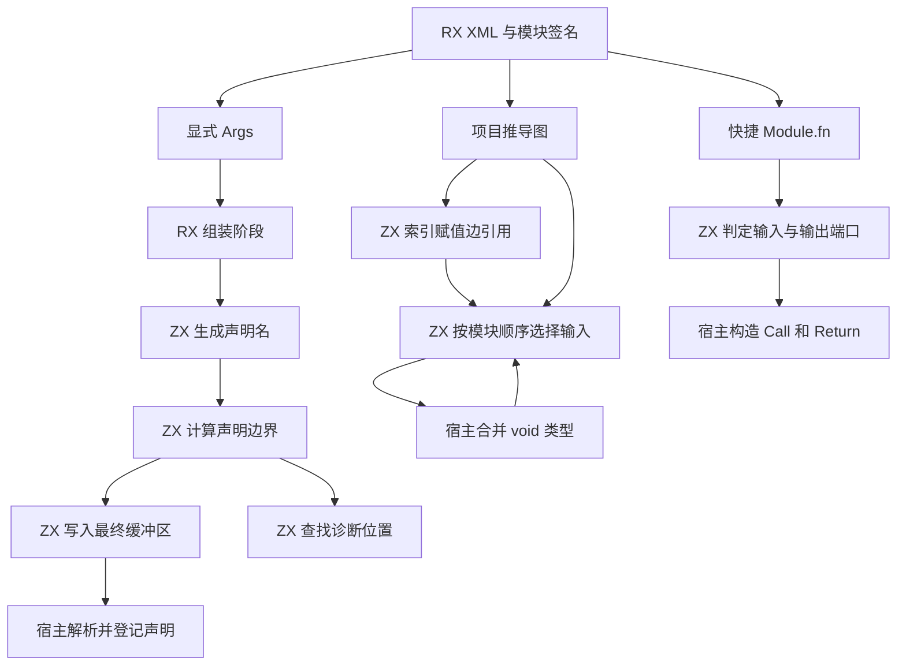
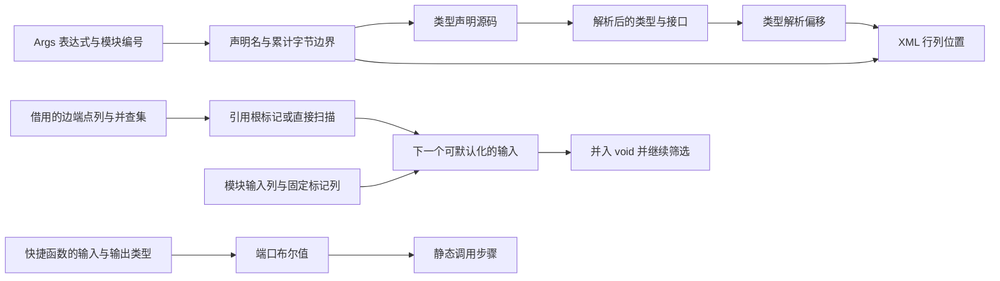

# RX 模块接口自举

## Intent

将 RX 模块接口的三个环节作为同一阶段迁移。显式 `Args` 组装供类型解析器读取的声明并保留 XML 诊断位置。隐式输入在赋值约束允许时默认化为 `void`。快捷 `Module.fn` 根据目标签名决定参数和返回绑定。

## Data

原实现逐模块扫描赋值边，检查未声明且未使用的输入是否仍被边引用。显式接口通过宿主构造类型源码，随后线性查找出错的声明。快捷模块的即时与延迟签名路径分别组装调用。

### 职责

### 数据流

## Edges

- 输入较少时直接扫描边并保留原来的短路和路径压缩顺序。预计重复扫描的端点数大于节点数时，先为端点的当前根建立一次性索引，再按模块顺序筛选。除并查集遍历外，扫描从最坏 `O(U × E)` 降至 `O(N + E + U)`，其中 `U` 为待处理输入数，`E` 为边数，`N` 为节点数。索引借用端点与父节点列，结束后释放标记。
- 成功默认化只会把未引用的输入根并入 `void` 的等价类。若该类原先被引用，保存原始 `void` 节点身份并重新求当前根，防止换根使引用失效。
- `Args` 根据原表达式的 UTF-8 字节长度精确规划，再用现有字节写入器直接写入最终缓冲区。诊断按累计边界二分定位，再映射到原始 XML 值。
- Zig 宿主仍负责 XML 属性读取、类型解析和登记、并查集约束合并及 IR 接入。初始 seed 继续保留原实现。
- RX 与 RX 分析入口共用已生成的绑定表元数据，避免按模块重新展开整张表，使构建脚本的编译期工作随绑定表增长可控。

## Answer

- Native 和 Source 生成路径各与原行为对照 12,000 组并查集图，覆盖 44,312 次默认化、180 组显式接口、673,897 个诊断字节偏移及四种快捷端口组合。直接扫描同时核对了完整父节点列，索引扫描核对了默认化选择和最终等价类。两条路径都检查了父节点存储地址。
- 集中回归通过 107 个构建步骤和 390 项测试，覆盖 RX 文本、推导、并行推导、XML 表达式、项目 CLI、混合库和模块记录。
- 两个安装版对照 51 个项目，生成 Zig 与诊断逐字节一致。覆盖 192 个子模块的两种宽项目、UTF-8 诊断、四种快捷端口组合，以及已有可空和延迟投影场景。
- 两个宽项目按版本交替六轮，每轮执行四次无缓存生成并舍弃首轮。隐式端口组墙钟中位数为 0.7417 → 0.7433 秒，CPU 为 0.8282 → 0.8287 秒。显式端口组墙钟为 1.0539 → 1.0589 秒，CPU 为 1.1407 → 1.1436 秒。

### 冷构建

使用 Zig 0.17.0、ReleaseSmall、12 核、四分区和构建种子 `0x3b41c83f`。关闭常驻生成，本地与全局构建缓存从空开始。Native seed 引导构建，安装版运行 Source 分析与生成。

| 指标                             | 固定历史基线 | 上一提交验收样本 | 上一提交配对复测 |  本阶段 |
| -------------------------------- | -----------: | ---------------: | ---------------: | ------: |
| 构建墙钟 / s（`time -l`）        |            — |           116.95 |           117.33 |  117.20 |
| 进程树采样墙钟 / s               |      129.740 |          117.030 |          117.449 | 117.285 |
| CPU / s                          |       216.03 |           207.22 |           208.58 |  209.14 |
| 进程树峰值 RSS / MB              |      2,247.3 |          2,335.8 |          2,292.0 | 2,327.7 |
| 单进程峰值 RSS / MB（`time -l`） |      2,075.0 |          2,126.0 |          2,111.4 | 2,122.0 |

本阶段和配对复测均通过 70 步。相对配对复测，墙钟减少 0.13 秒，CPU 增加 0.56 秒，树峰值增加 35.7 MB。相对固定历史基线，采样墙钟减少 12.46 秒，CPU 减少 6.89 秒，树峰值增加 80.4 MB。CPU 较近期最低的 206.33 秒样本高 2.81 秒，接近累计观察阈值。前三个分区对象逐字节一致，第四个增加 7,184 字节。

首次配对复测因磁盘空间不足终止，清理可再生成的旧构建缓存后完成复测。表格使用完整样本。日志与分区哈希位于 `.zig-cache/cold-build-analysis/ownership-research/partition-reference/cold-rx-module-interfaces*`。
