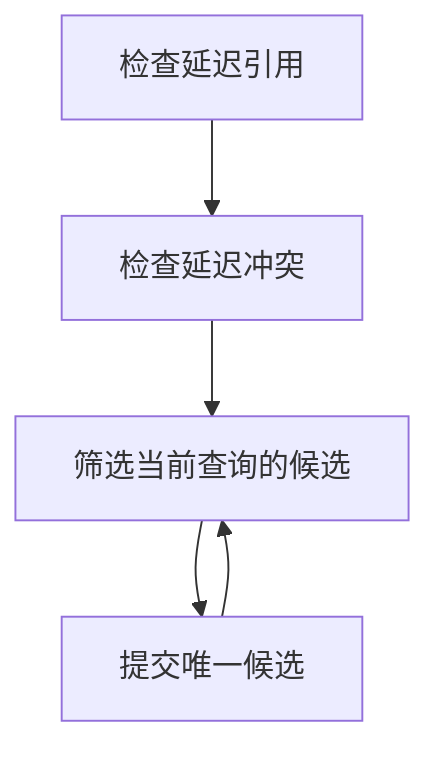
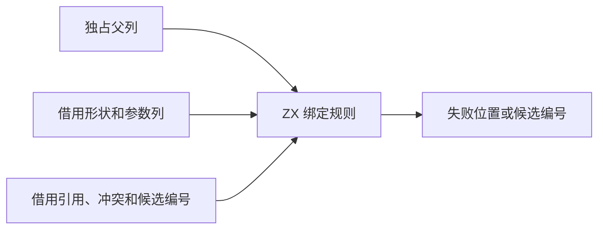

# RX 流绑定解析自举

## Intent · 意图

迁移 RX 流绑定的可用性、延迟引用、重叠和候选筛选规则。保留源位置、诊断顺序和逐条统一的语义。

## Data · 证据

原实现每轮依次检查引用、冲突及延迟查询。前两类检查只读取类型图，第三类逐条应用统一，后续查询可能读取更新后的代表。节点形状与类型编号已按列保存，父列支持原位路径减半，引用和冲突可直接借用编号列。旧查询在登记时复制已有候选缓冲。

## Edges · 边界

ZX 直接借用类型图和查询列，返回第一个失败位置或当前查询的有效候选。宿主持有诊断位置，按旧顺序提交统一。保留同根重复候选的多候选语义。冲突检查每端只读一次代表，父列的等价类及下一次检查结果保持一致。初始 Native seed 继续使用 Zig 规则。

## Answer · 交付与验收

分别核对立即准入、首个失败位置、零或多个候选、路径减半及分配行为。运行 RX 推导、作用域和项目回归，再用安装版对照生成产物、诊断和耗时。

固定的 Source stage 3 和 Native seed 各生成一套规则。两套分别通过 8,192 节点的父链及 12,000 组随机检查。零容量分配器覆盖节点可用性、首次缺失引用、立即及终局冲突、唯一及多个候选。原缓冲地址和独占标记均保持一致，引用和候选的路径减半结果逐项相同。冲突采用一次代表读取，复核了等价类和诊断结果。

RX 推导、并行推导、RX 文本、混合库与模块记录共通过 51 个构建步骤。本轮执行 243 项测试，其余步骤复用同输入成功结果。

安装版对照 11 个项目，包括两个有值子模块同名、void 与有值结果的两种登记顺序、并行重叠、全部候选为 void、延迟引用丢失、Task 作用域和 24 组延迟绑定。五份生成结果及六份诊断逐字节一致。24 组延迟绑定的项目按版本交替运行八轮，每轮关闭缓存生成八次。舍弃首轮后，墙钟中位数为 0.1989 → 0.1994 秒，CPU 中位数为 0.2638 → 0.2636 秒。

### 冷构建

沿用 Zig 0.17.0、ReleaseSmall、12 核、四分区和种子 `0x3b41c83f`，关闭常驻生成。各轮使用空的显式本地和全局构建缓存，复用同一个源码目录及其源码缓存。构建由 Native seed 引导，安装版使用 Source 分析和生成。四次构建均通过 70 步。

| 指标                             | 固定历史基线 | 上批历史 | 上批复测 | 本批首轮 | 本批复测 |
| -------------------------------- | -----------: | -------: | -------: | -------: | -------: |
| 构建墙钟 / s（`time -l`）        |            — |   116.47 |   116.10 |   117.62 |   117.00 |
| 进程树采样墙钟 / s               |      129.740 |  116.514 |  116.282 |  117.636 |  117.062 |
| CPU / s                          |       216.03 |   208.63 |   208.71 |   209.01 |   208.16 |
| 进程树峰值 RSS / MB              |      2,247.3 |  2,310.4 |  2,322.8 |  2,319.9 |  2,350.5 |
| 单进程峰值 RSS / MB（`time -l`） |      2,075.0 |  2,130.1 |  2,123.6 |  2,113.3 |  2,117.3 |

相对上批复测，候选首轮墙钟增加 1.52 秒。其构建驱动编译开始时已比上批晚约 1.35 秒，最终宿主编译耗时约 32.5 秒，与上批历史样本接近。候选隔离复测后，墙钟差为 0.90 秒，CPU 减少 0.55 秒，进程树峰值增加 27.7 MB，单进程峰值下降 6.3 MB。两次候选的进程树峰值相差 30.7 MB，峰值均为四个分区编译与检查任务重叠，检查进程的采样占用不同。

上批两次构建的四个分区对象逐字节一致，本批两次构建的四个分区对象也逐字节一致。本批只改变第四个分区，增加 4,744 字节。两个候选安装版均通过上述 11 个项目的产物和诊断对照。候选复测相对固定历史基线采样墙钟减少 12.68 秒，CPU 减少 7.87 秒，进程树峰值增加 103.3 MB。CPU 相对近期 206.33 秒样本增加 1.83 秒。日志保存在 `.zig-cache/cold-build-analysis/ownership-research/rx-binding-resolution/`，冷构建采样与分区哈希在同级 `partition-reference/cold-rx-binding-resolution*`。
