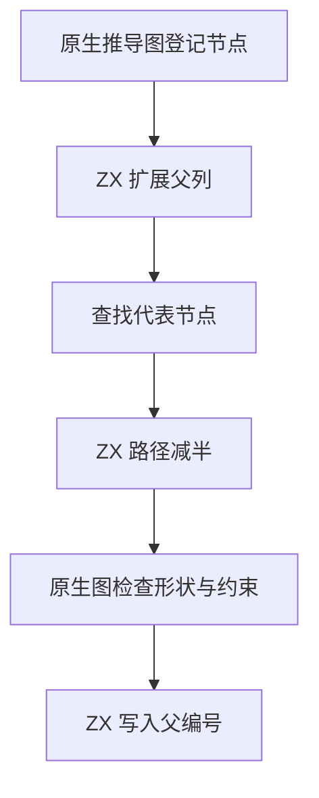

# RX 类型图父列自举

## Intent · 意图

将 RX 类型图的父列增长、根链接和路径减半迁入 ZX，继续使用原并查集代表、路径更新顺序和节点编号。

## Data · 证据

原实现把父编号与形状、诊断位置和标量约束混存在节点记录中。根查找仅需要父编号。Source 入口的状态 ABI 可跨调用交回同一份独占列表。预验证显示原地更新只需独占标记，增长则需要由生成代码建立的容量头。

## Edges · 边界

原生宿主继续登记节点元数据，ZX 管理对应的父列。宿主可直接读取已确定的根和只差一步的根，其他查找保留路径减半。根链接和压缩不改变缓冲长度，使用零容量分配器验证没有克隆。增长先于节点提交，源图上的旧编号与诊断位置不变。

## Answer · 交付与验收

对照随机并查集、长链和扩容边界，校验每次更新后的父列内容、指针身份与分配行为，再核对实际 RX 输出和固定配置构建。

### 规则与存储

用 Source stage 3 和 Native seed 分别生成三个操作。两套产物各通过 8,192 节点长链和 64,000 轮随机查询与链接，对照原路径减半后的父编号。父列增长发生 11 次，链接与压缩在零容量分配器下完成且指针保持相同。额外验证满容量后的分配失败保留原父列、长度和内容。

目标平台上原节点记录为 56 字节，拆分后元数据为 48 字节，父编号另占 4 字节。该尺寸不计缓冲容量及容量头。父列从第一次追加起持有生成代码创建的容量头，只有增长阶段可改变缓冲指针。集中回归 48/48 步和 270/270 项测试通过。

安装版对照 15 个字段访问项目和 12 个对象统一、选择与展开项目，生成结果或诊断逐字节一致。三个库项目的 47 份产物也逐字节一致。

安装版禁用缓存，每轮连续生成 16 次 256 字段对象，墙钟中位数 1.1712 → 1.1768 秒，CPU 1.1505 → 1.1556 秒。生成源码一致，单次编译峰值 RSS 中位数均为 41,943,040 字节。

### 完整构建

沿用 Zig 0.17.0、ReleaseSmall、12 核、四分区和固定种子 `0x3b41c83f`，关闭常驻生成。每轮使用空的显式本地与全局缓存目录，复用同一基准源码目录及其 Zig 源码缓存。构建由 Native seed 引导，安装版运行 Source 分析。下表中的构建均通过 70/70 步。

| 指标                   |      固定基线 |  上批历史样本 | 上批同目录复测 |          本批 |
| ---------------------- | ------------: | ------------: | -------------: | ------------: |
| 墙钟 / s               |       129.740 |       115.311 |        117.594 |       116.871 |
| CPU / s                |        216.03 |        207.65 |         208.41 |        208.47 |
| 进程树采样峰值 RSS / B | 2,247,294,976 | 2,296,381,440 |  2,335,834,112 | 2,300,772,352 |
| 单进程系统峰值 RSS / B | 2,075,033,600 | 2,118,139,904 |  2,133,573,632 | 2,121,121,792 |

首轮相对上批历史样本，墙钟增加 1.56 秒，CPU 增加 0.82 秒。采样中构建驱动 CPU 增加 0.63 秒，运行生成器的 CPU 减少 0.49 秒。按相同路径重新构建上批源码时，两次因磁盘空间不足终止。清理旧的可重建对象文件后，隔离复测完整通过，四个分区对象与上批历史样本一致。复测安装版也通过同一批项目的逐字节对照。

本批较上批同目录复测墙钟减少 0.72 秒，CPU 增加 0.06 秒，进程树和单进程峰值分别减少 35.1 MB 和 12.5 MB。本批较固定基线墙钟减少 12.87 秒，CPU 减少 7.56 秒，进程树峰值增加 53.5 MB。CPU 较近期 206.33 秒样本仍增加 2.14 秒。候选前三个分区对象与复测一致，第四个增加 1,808 字节。

命令、日志和哈希位于 `.zig-cache/cold-build-analysis/ownership-research/rx-graph-roots/` 和同级 `partition-reference/cold-rx-graph-roots*`。
