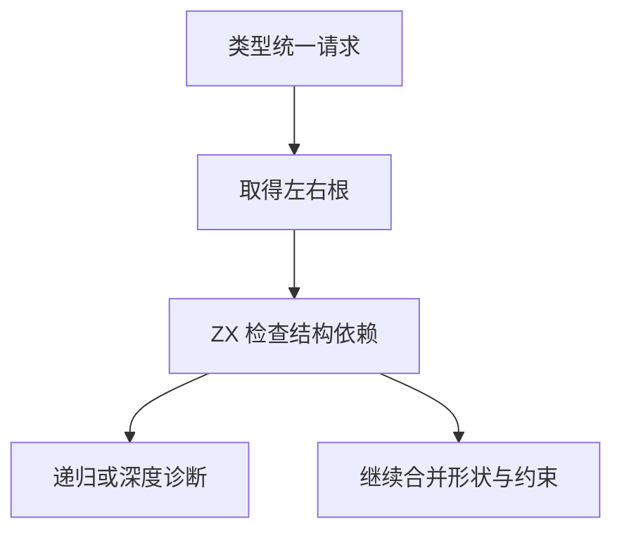

# RX 结构环检查自举

## Intent · 意图

将 RX 类型统一的结构环检查迁入 ZX，保持双向检查、字段顺序、路径减半与 256 层诊断顺序。

## Data · 证据

旧检查每次递归从原生节点读取形状及子节点。父列已有 ZX 管理的独占缓冲，对象字段和元组成员均有连续编号。将形状种类、单子节点及多成员视图存成列后，可直接交给生成规则。

## Edges · 边界

节点登记和统一结果仍由原生图提交。形状种类使用 ZX 模型，Source 借用节点列和已有子节点列。检查只更新父列的路径缓存，不改变图关系；初始 seed 使用原生遍历。

## Answer · 交付与验收

对照父列修改、结构循环与诊断优先级，检查布局和生成代码的分配行为，再验证实际 RX 生成和完整构建。

- 固定 256 层边界，检查左右方向及子节点顺序对诊断的影响。由 Source stage 3 和 Native seed 分别生成检查器，与原路径减半和深度优先遍历对照。两组均通过边界和 8,000 轮随机图，使用零容量分配器，检查结果、父列内容和缓冲地址一致。
- 验证对象成员列能恢复同一份名称和编号切片。256 项占 5,120 字节，描述符 16 字节，恢复时两个切片地址均保持原值。
- RX 推导、RX 文本、混合库和模块记录共 48 步、270 项回归通过。27 个安装版项目的 Zig 输出或诊断逐字节一致，覆盖递归类型拒绝、字段顺序、展开与投影。

### 冷构建

固定 Zig 0.17.0、ReleaseSmall、12 核、四分区和种子 `0x3b41c83f`，关闭常驻生成。两次均使用同一源码目录及其 Zig 源码缓存，显式本地和全局缓存目录各自从空开始。构建由 Native seed 引导，安装版使用 Source 分析和生成。两次均通过 70 步。

| 指标                             | 固定历史基线 | 上批历史样本 | 上批同目录复测 |    本批 |
| -------------------------------- | -----------: | -----------: | -------------: | ------: |
| 构建墙钟 / s（`time -l`）        |            — |       116.76 |         132.23 |  133.12 |
| 进程树采样墙钟 / s               |      129.740 |      116.871 |        132.294 | 133.347 |
| CPU / s                          |       216.03 |       208.47 |         224.92 |  224.43 |
| 进程树峰值 RSS / MB              |      2,247.3 |      2,300.8 |        2,331.8 | 2,303.7 |
| 单进程峰值 RSS / MB（`time -l`） |      2,075.0 |      2,121.1 |        2,104.1 | 2,107.6 |

上批复测的四个分区对象与上批历史产物逐字节一致，采样墙钟仍增加 15.42 秒，CPU 增加 16.45 秒。本批有三个分区保持相同，第四个分区对象增加 1,848 字节。按同目录复测比较，本批构建墙钟增加 0.89 秒，采样监控含退出检测开销增加 1.05 秒，CPU 减少 0.49 秒，进程树峰值减少 28.1 MB，单进程峰值增加 3.5 MB。固定历史基线仍保留，原始采样比它多 3.61 秒墙钟、8.40 秒 CPU 和 56.4 MB 进程树峰值。相同源码复测已观察到跨时段波动，本轮无法把该累计差异归因于代码。

### 安装版对照

256 字段 RX 项目交替运行八轮，每轮 16 次无缓存生成，输出完全一致。舍弃首轮后，墙钟中位数由 1.1578 秒降至 1.1516 秒，CPU 由 1.1532 秒降至 1.1477 秒。三个库项目的 47 个发布文件完全一致，三项目合计墙钟中位数由 0.0693 秒变为 0.0695 秒，CPU 由 0.0764 秒降至 0.0760 秒。
