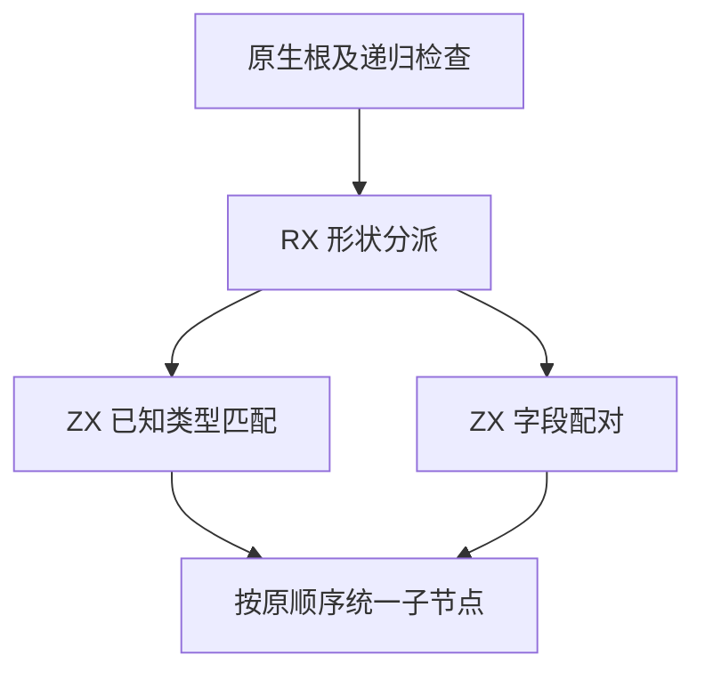
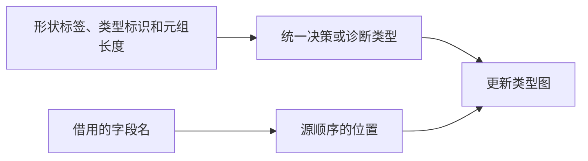

# RX 结构类型统一自举

## Intent · 意图

将 RX 结构统一中的形状分派、已知类型匹配和字段配对迁入 RX/ZX。保留递归顺序、首个诊断及类型图身份。

## Data · 证据

原统一规则首先处理未知形状，再匹配已知类型、序列和结构。结构对象按右侧字段顺序在原左侧字段中查找，字段全重叠时也复制左侧整组描述符。

## Edges · 边界

RX 按形状决定是否进入已知类型规则。ZX 执行形状、元组长度和名称匹配。宿主按原次序递归应用结果，并保留类型表、根链接和递归类型检查。对象合并只有新增字段才构造新字段列表，字段文本和节点继续共享。

## Answer · 交付与验收

对照原形状矩阵、字段匹配、错误顺序和生成产物。跟踪宽对象合并和固定配置冷构建的时间及内存。

### 规则与分配

Source 工具生成的决策在零字节分配器下通过 7,938 组形状对照和 16,000 组字段查找对照。涵盖两侧已知类型、元组长度、序列、重复字段名及 Unicode 名称。全包生成与独立生成可能采用不同的值入口形状，因此宿主固定走公开的输入 ABI。

对象统一只在存在新字段时分配最终描述符列表。左侧为空时直接共享右侧，右侧全重叠时继续共享左侧。已知字段匹配直接借用类型表列。递归类型检查继续使用原先的深度限制和遍历顺序，递归期间共用已知的目标根。

四组集中回归的 48/48 构建步通过，其中执行 138 项 RX 推导测试，另外 132 项复用前一轮同输入的成功结果。安装版对照九个成功项目和五个拒绝项目，生成 Zig 与诊断均逐字节一致。对照包含两个菱形顺序、字段全重叠、字段不重叠和递归输入类型诊断。

### 性能

沿用 Zig 0.17.0、ReleaseSmall、12 核、四分区、固定种子 `0x3b41c83f`、空 local/global 缓存和同一源码目录，关闭常驻生成。冷构建由 Native seed 引导，安装版运行 Source 分析。70/70 步通过。

| 指标                   |      固定基线 |          上批 |          本批 |      较上批 |
| ---------------------- | ------------: | ------------: | ------------: | ----------: |
| 墙钟 / s               |       129.740 |       116.538 |       115.807 |      −0.731 |
| CPU / s                |        216.03 |        207.31 |        207.63 |       +0.32 |
| 进程树采样峰值 RSS / B | 2,247,294,976 | 2,324,742,144 | 2,308,227,072 | −16,515,072 |
| 单进程系统峰值 RSS / B | 2,075,033,600 | 2,111,193,088 | 2,111,799,296 |    +606,208 |

CPU 较近期 206.33 秒样本增加 1.30 秒，较固定基线减少 8.40 秒。进程树峰值较固定基线仍高约 60.9 MB。前三个分区对象逐字节一致，分区 3 增加 2,784 字节。

两份安装版均以 Source 分析编译双展开的 64 字段对象。每轮禁用缓存连续生成 16 次，墙钟中位数 0.1088 → 0.1092 秒，CPU 0.1093 → 0.1101 秒，生成源码一致。三个库项目的 47 份产物也逐字节一致。

命令、日志与哈希位于 `.zig-cache/cold-build-analysis/ownership-research/rx-unification/` 和同级 `partition-reference/cold-rx-unification/`。
