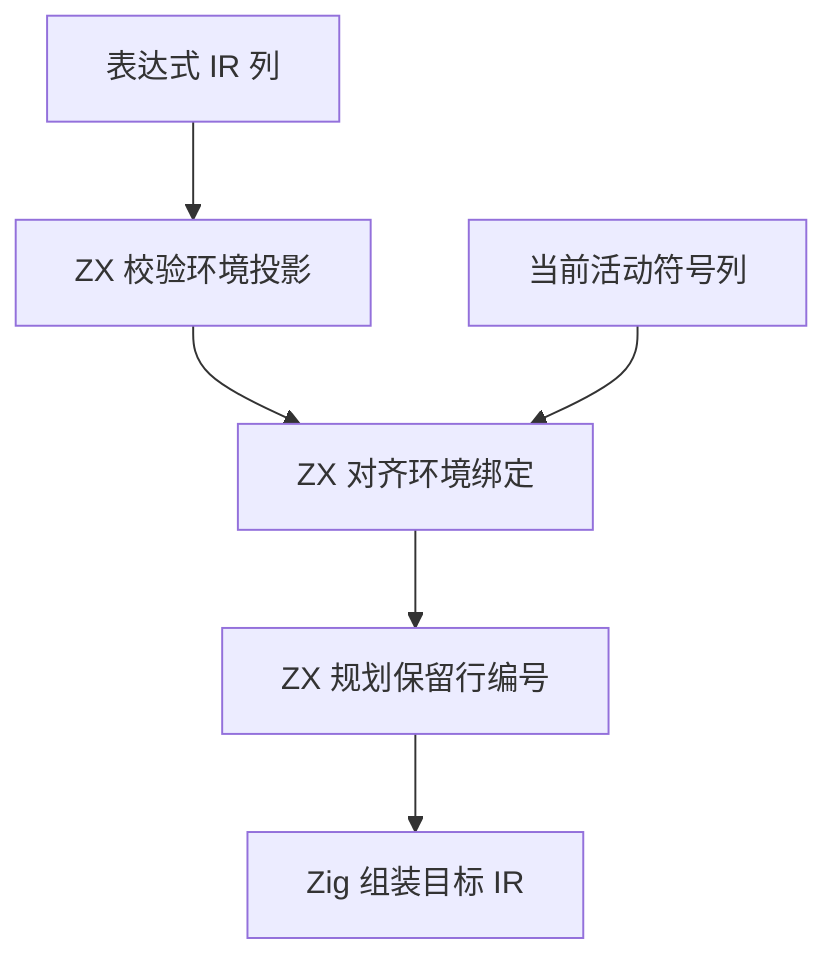
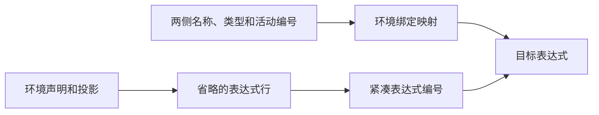

# RX 表达式联结规划自举

## Intent

让 RX/ZX 规划表达式联结的环境绑定与表达式编号。保留编号顺序、类型检查和诊断，减少宽环境的重复搜索及短命映射的内存占用。

## Data

属性表达式的控制块在最终 Return 前依次声明环境投影。符号 0 是环境本身，之后的绑定按传入顺序编号。降级后的 Task 只保留使用的外层绑定，因此目标活动列通常是源绑定列的有序子序列。旧联结逐绑定重扫目标符号，又逐局部符号重扫源声明。

## Edges

- 映射保留源表达式顺序，拒绝对未来表达式及未联结环境的引用。目标绑定排序不吻合时保留按名称匹配的规则。
- 每次联结借用两侧的 IR 列。环境名称按序匹配时只线性扫描，局部符号通过连续编号换算。
- 临时映射优先使用栈缓冲，超出时复用程序级 arena。表达式联结完成后重置映射，程序构建完成后释放 arena。
- Zig 宿主仍负责构造 IR 负载和持久字符串。Native seed 保留同样的映射规则。

## Answer

Native 和 Source stage 3 分别生成联结规划。直接执行两份产物，验证正常顺序、乱序、附加活动绑定、类型冲突和无效投影。成功路径只用两张映射各自的精确容量及分配头，编排内原地复用表达式编号列。

集中回归通过 91 个构建步骤、319 项 Zig 测试和 32 项 Task CLI 用例，覆盖表达式绑定、类型推导、并行 Task、真实项目、Store 路径及初始化和混合库运行。

两个安装版对照 45 个项目，23 份生成 Zig 和 22 份预期失败诊断逐字节一致。使用无编译缓存的 CLI 生成路径，按版本交替七轮，取后六轮的中位数。稀疏、密集和连续任务每轮生成两次。

| 项目                                 |        墙钟 / s |         CPU / s |
| ------------------------------------ | --------------: | --------------: |
| 稀疏环境（80 个绑定，24 个并行任务） | 0.1478 → 0.1275 | 0.1536 → 0.1335 |
| 密集环境（36 个绑定，12 个并行任务） | 0.1920 → 0.1875 | 0.1988 → 0.1942 |
| 384 个连续任务                       | 0.6262 → 0.6308 | 0.6252 → 0.6298 |
| 384 个整数分支                       | 0.1547 → 0.1514 | 0.1539 → 0.1508 |
| 256 个字符串分支                     | 0.1118 → 0.1121 | 0.1106 → 0.1082 |

### 冷构建

Zig 0.17.0、ReleaseSmall、12 核、四分区，使用固定构建种子 `0x3b41c83f`。关闭常驻生成，从空的本地和全局缓存开始。Native seed 引导工具本体，项目对照中的安装版执行 Source 分析与生成。

| 指标                             | 固定历史基线 | 上阶段记录 | 上阶段同目录复测 | 本阶段首次 | 本阶段复测 |
| -------------------------------- | -----------: | ---------: | ---------------: | ---------: | ---------: |
| 构建墙钟 / s（`time -l`）        |            — |     116.04 |           117.79 |     116.31 |     117.33 |
| 进程树采样墙钟 / s               |      129.740 |    116.141 |          117.821 |    116.500 |    117.487 |
| CPU / s                          |       216.03 |     208.13 |           208.94 |     209.50 |     208.77 |
| 进程树峰值 RSS / MB              |      2,247.3 |    2,314.9 |          2,354.2 |    2,321.6 |    2,315.6 |
| 单进程峰值 RSS / MB（`time -l`） |      2,075.0 |    2,121.8 |          2,118.9 |    2,113.4 |    2,110.5 |

两版各两次记录取均值，本阶段墙钟减少 0.10 秒，CPU 增加 0.60 秒，进程树峰值减少 15.9 MB。与固定历史基线相比，采样墙钟减少 12.75 秒，CPU 减少 6.90 秒，树峰值增加 71.3 MB。近期 CPU 低点为 206.33 秒，本阶段均值高 2.81 秒，首次样本高 3.17 秒，后续继续核对累计趋势。

三次新冷构建均通过 70 步。同版本两次冷构建的四个分区对象逐字节一致。两版之间前三个分区对象逐字节一致，包含 RX 联结的第四个对象增加 3,448 字节。第一次测得的 CPU 波动主要位于分区调度工具，四个 Zig 分区编译的采样 CPU 总量减少约 0.21 秒。

探针、回归和项目对照日志保存在 `.zig-cache/cold-build-analysis/ownership-research/rx-expression-link/`，冷构建采样及对象哈希保存在相邻的 `partition-reference/cold-rx-expression-link*`。
