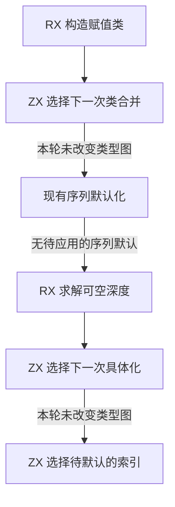
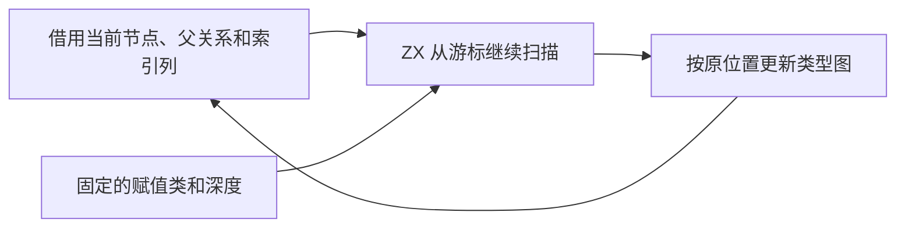

# RX 赋值应用与索引默认自举

## Intent · 意图

将赋值类合并、可空深度应用与待定索引默认化的候选选择迁入 ZX。保持图更新的顺序、候选的重新读取及诊断位置。

## Data · 证据

原实现按节点编号扫描。赋值类的代表在当前轮固定，节点形状和父关系会随合并变化。一次性生成候选列表会把这些事实冻结。ZX 因此只返回当前能执行的下一项。宿主提交更新后，下一次扫描从原位置继续并读取新列。

索引投影改用分列存储，目标、结果和已决状态直接借给 ZX。目标默认化仍选择首个未确定形状的索引。赋值具体化仍避开待定索引结果。扫描保留原位路径减半。

## Edges · 边界

赋值类构造与深度求解继续通过现有 RX 模块编排。ZX 执行各项有序扫描。Zig 过渡宿主仍负责登记声明类型、添加可空节点、合并类型图以及定位诊断。初始 seed 保留等价实现。

## Answer · 交付与验收

分别由固定 Source stage 3 与 Native seed 生成规则。对照下一项的位置和代表、同一轮修改后的继续位置、默认索引及父列的最终内容。用零容量分配器验证扫描和路径压缩，检查父列地址一致。

两套生成路径各通过 12,000 组有序对照，覆盖 98,875 次合并选择、13,511 次具体化选择和 9,583 次列表默认选择。每次选择与旧规则一致，输入父列地址及压缩后的每个父编号一致。两套均在零容量分配器下完成。常规生成接口将输入数组视为只读借用，此路径使用现有状态接口移交父列的独占描述符，保留其余输入的只读视图。

快路径优化前，RX 类型推导、并行推导、RX 文本、混合库和模块记录共 51 个构建步骤、375 项既有回归通过。优化后重跑两套定向对照与安装版项目对照。

最终安装版对照 31 个项目，生成 Zig 与拒绝诊断逐字节一致，覆盖列表默认、嵌套索引、索引结果的可空约束和索引冲突。两版交替执行八轮，每轮无缓存生成 12 次，舍弃首轮。64 个重复索引的 CPU 中位数为 0.1978 → 0.1972 秒，60 个重复收窄为 0.5186 → 0.5180 秒。

### 冷构建

沿用 Zig 0.17.0、ReleaseSmall、12 核、四分区及构建种子 `0x3b41c83f`，关闭常驻生成，显式本地与全局构建缓存从空开始。Native seed 引导构建，安装版执行 Source 分析与生成。

首次候选采样期间，缓存目录容量扫描与构建并发，墙钟 132.84 秒、CPU 226.21 秒。停止该扫描后，同一源码得到 118.59 秒、209.68 秒。隔离候选较上一提交配对样本的墙钟增加 1.55 秒，CPU 增加 1.43 秒。生成器启动之前的差值约 0.84 秒，三个字节一致分区的耗时也有波动。保留迁移，在两次候选扫描中对已知根直接应用形状过滤，对同一代表省去二次查找。最终源码重新通过两套 12,000 组对照。

配对基线和最终候选均通过 70 个构建步骤。

| 指标                             | 固定历史基线 | 上一提交配对基线 | 最终候选 |
| -------------------------------- | -----------: | ---------------: | -------: |
| 构建墙钟 / s（`time -l`）        |            — |           117.04 |   115.47 |
| 进程树采样墙钟 / s               |      129.740 |          117.142 |  115.487 |
| CPU / s                          |       216.03 |           208.25 |   208.14 |
| 进程树峰值 RSS / MB              |      2,247.3 |          2,339.2 |  2,319.8 |
| 单进程峰值 RSS / MB（`time -l`） |      2,075.0 |          2,128.9 |  2,123.9 |

最终候选较配对基线墙钟少 1.57 秒，CPU 少 0.11 秒，进程树峰值下降 19.3 MB，单进程峰值下降 5.0 MB。前三个分区对象逐字节一致，第四个增加 4,216 字节。相对固定历史基线，采样墙钟少 14.25 秒，CPU 少 7.89 秒，进程树峰值高 72.5 MB。CPU 较近期 206.33 秒样本高 1.81 秒。冷构建采样、分区哈希和安装版位于 `.zig-cache/cold-build-analysis/ownership-research/partition-reference/cold-rx-assignment-application-*`。
