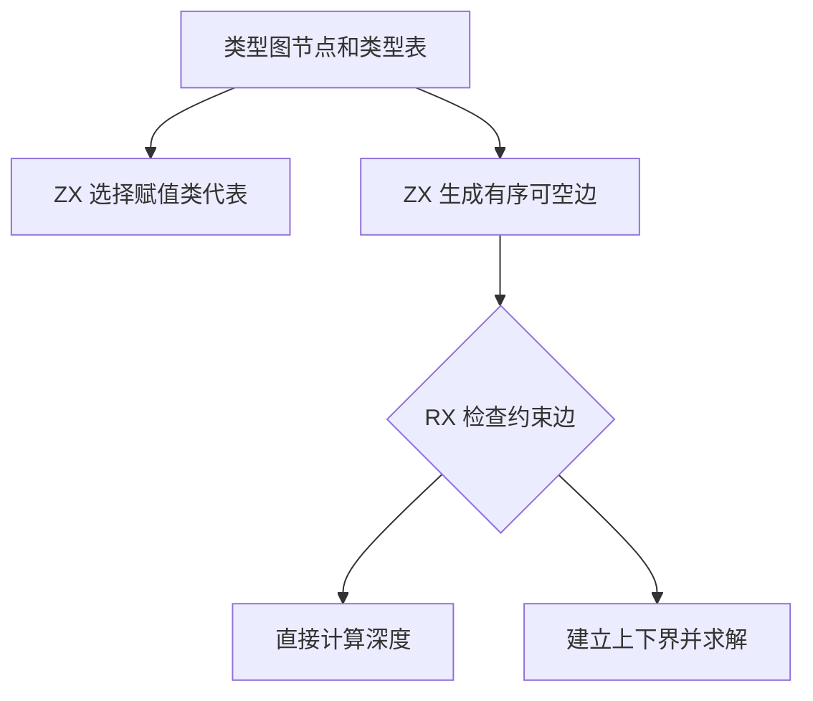
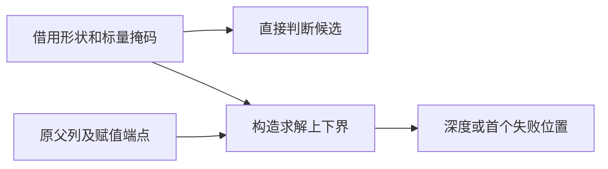

# RX 赋值求解输入自举

## Intent · 意图

将赋值类的代表候选、可空边和可空上下界的输入构造迁入 ZX，保留赋值顺序、首个失败位置和已声明类型的深度。

## Data · 证据

旧宿主按节点复制候选布尔值，并为深度求解生成事实列和深度列。求解器再复制深度作为下界。节点形状、参数和父编号已经按列保存。将可选标量约束独立保存后，类选择和深度求解可以直接读取原列。

## Edges · 边界

ZX 借用节点列、类型列和赋值边。可空边在原父列上执行路径减半，按父节点编号顺序发布。RX 根据是否存在约束边选择直接深度或上下界求解。Zig 宿主继续原位归一化原赋值边、登记新图节点并映射诊断位置。初始 seed 保留原求解实现。

## Answer · 交付与验收

对照赋值代表、可空边、深度和诊断位置，并检查父列是否原位更新。记录求解分配量、生成代码的下界转移、已有项目回归和冷构建性能。

旧实现与 Native、Source 两套生成路径产出的新实现通过同一批 12,000 组输入。代表、边顺序、深度及诊断摘要一致，父列原位更新且与旧路径结果一致。固定缓冲分配器的占用按用例累加，从 22,132,149 字节降到 18,121,288 字节，下降 18.1%。上下界交替增长的初版占用 25,936,240 字节。独立构造各列后，求解器接收原下界存储，消除了交替扩容留下的旧缓冲。此处统计的是微基准缓冲占用。

RX 类型推导、并行推导、RX 文本、混合库和模块记录共 51 个构建步骤、375 项既有测试通过。

安装版对照 26 个项目，生成 Zig 与拒绝诊断逐字节一致。48 个嵌套可空提示和 60 个重复收窄各做八轮交替对照，每轮无缓存生成 12 次并舍弃首轮。两组的 CPU 中位数分别为 0.6511 → 0.6511 秒和 0.5175 → 0.5185 秒。

### 冷构建

使用 Zig 0.17.0、ReleaseSmall、12 核、四分区及构建种子 `0x3b41c83f`，关闭常驻生成，显式本地与全局构建缓存从空开始。构建由 Native seed 引导，安装版执行 Source 分析与生成。两个版本均通过 70 个构建步骤。

| 指标                             | 固定历史基线 |    上批 |    本批 |
| -------------------------------- | -----------: | ------: | ------: |
| 构建墙钟 / s（`time -l`）        |            — |  116.75 |  117.54 |
| 进程树采样墙钟 / s               |      129.740 | 116.791 | 117.568 |
| CPU / s                          |       216.03 |  208.08 |  208.85 |
| 进程树峰值 RSS / MB              |      2,247.3 | 2,275.0 | 2,326.0 |
| 单进程峰值 RSS / MB（`time -l`） |      2,075.0 | 2,128.8 | 2,115.1 |

较上批墙钟增加 0.79 秒，CPU 增加 0.77 秒，树峰值增加 51.0 MB，单进程峰值下降 13.7 MB。树峰值发生在前三个分区并发生成对象期间，这三个对象与上批逐字节一致。第四个分区对象增加 4,072 字节。较固定历史基线，采样墙钟减少 12.17 秒，CPU 减少 7.18 秒，树峰值增加 78.7 MB。CPU 较近期 206.33 秒样本累计增加 2.52 秒。冷构建采样及对象哈希位于 `.zig-cache/cold-build-analysis/ownership-research/partition-reference/cold-rx-assignment-inputs/`。
