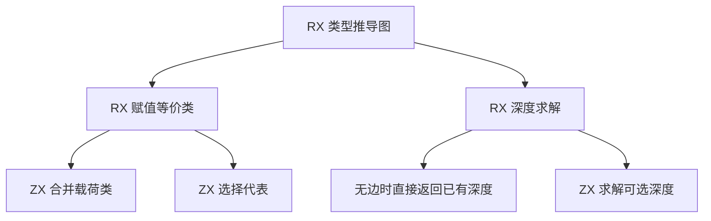

# RX 赋值约束求解自举

## Intent · 意图

将 RX 类型推导中赋值等价类、代表类型选择及可选深度求解迁入 RX/ZX。保留形状、代表选择顺序和诊断位置。

## Data · 证据

原等价类构建反复拆解相同节点的可选类型。原深度传播每轮重新沿类型图查找所有赋值端点和显式可选约束的根，而深度求解期间类型图保持不变。

ZX 使用按秩合并，并把等价类根压平，保留原节点遍历顺序下最后选中的有效代表。深度求解保持赋值边在前、显式可选边在后的顺序。每条边先更新期望端，再更新实际端，最后检查矛盾。

## Edges · 边界

继续使用现有原生类型表、统一操作和诊断映射。两个求解过程借用已投影的节点编号和边序列。推导迭代共用一份临时工作区，求解结果应用到类型图后可以复用容量，推导结束后释放。初始 Native seed 保留原算法。运行时不添加专用依赖。

## Answer · 交付与验收

验证合法的赋值、可选层级和集合推导，以及矛盾约束的错误顺序和位置。对照固定配置的构建性能与相同项目的生成结果。

### 对照与生成质量

使用已核对三阶段一致性的 Source 工具生成候选求解器。独立对照 24,000 组深度输入和 24,000 组等价类输入，覆盖空图、重复边、环、上限冲突、相同端点及多个候选代表。深度值、诊断类型与首个冲突边一致，等价类成员关系和代表选择一致。

第一版在一次循环更新里修改同一列的两个位置，生成 Zig 包含整列复制。改用正反两次松弛后，生成产物仅为初始化分配三列，传播及固定上下限都原地更新。无约束边时，RX 直接借用输入的深度列。

32,768 个节点和 32,767 条赋值边的独立求解样本使用 1,376,508 字节临时 arena 容量。该值不含宿主投影的输入列，也不代表进程 RSS。

Source 工具生成的 ReleaseSmall 编译器集中通过四组回归，包括 RX 推导、RX 文本、混合库和模块记录。48/48 构建步、270/270 项 Zig 测试以及两个混合库执行方向均通过。新的 RX 和 ZX 文件通过 lint 和格式检查。

### 冷构建与安装版

采用同一源码目录与工具链。Zig 0.17.0、ReleaseSmall、12 核、四分区、固定种子 `0x3b41c83f`、空 local/global 缓存，关闭常驻生成。构建工具由 Native seed 引导，安装版运行 Source 分析。两次候选构建均通过 70 步，四份分区对象逐字节相同。

| 指标                   |      固定基线 |          上批 |  本批隔离复测 |      较上批 |
| ---------------------- | ------------: | ------------: | ------------: | ----------: |
| 墙钟 / s               |       129.740 |       117.332 |       117.388 |      +0.056 |
| CPU / s                |        216.03 |        209.25 |        207.59 |       −1.66 |
| 进程树采样峰值 RSS / B | 2,247,294,976 | 2,300,575,744 | 2,283,847,680 | −16,728,064 |
| 单进程系统峰值 RSS / B | 2,075,033,600 | 2,112,765,952 | 2,111,504,384 |  −1,261,568 |

首轮候选的墙钟为 118.938 秒、CPU 为 212.04 秒，期间目录扫描与构建重叠，未改动的 `translate-c` 编译阶段也从约 9 秒增至约 11 秒。隔离复测中该阶段恢复到约 9 秒。对照上批，前三个分区对象完全一致，分区 3 增加 7,400 字节。隔离复测较近期 206.33 秒的样本增加 1.26 秒，较固定基线减少 8.44 秒。进程树峰值较固定基线仍高约 36.6 MB。

安装版在禁用缓存时发布源码闭包、原生依赖和 Store 三个项目，47 份产物逐字节一致。三项目发布每轮墙钟中位数为 0.0689 → 0.0693 秒，CPU 为 0.0763 → 0.0766 秒。Native seed 生成的候选深度求解器同样通过产物检查，传播阶段只写独占列。

对照命令、日志和哈希在 `.zig-cache/cold-build-analysis/ownership-research/rx-assignment-solver/` 和同级 `partition-reference/cold-rx-assignment-solver-confirm/`。
