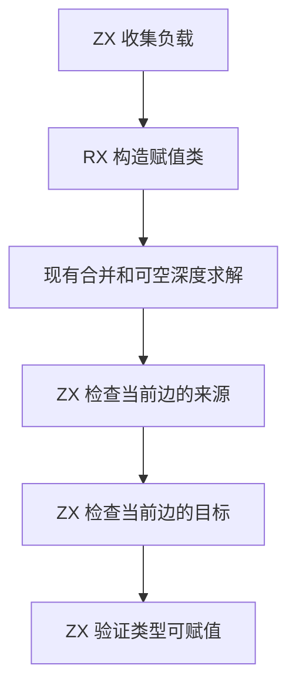

# RX 赋值负载与最终校验自举

## Intent · 意图

将 RX 赋值类的可空负载收集和最终赋值校验迁入 ZX。保持节点登记顺序、每条边的求值方向以及首个失败位置。

## Data · 证据

旧宿主对每个图节点单独调用可空遍历。只有遇到声明可空类型时需要登记新的图节点，登记可能延长待扫描范围。ZX 现在按图编号连续收集，遇到需要登记的子类型时保留当前位置和剩余深度。宿主登记后，从该节点继续。

原有节点与新登记节点各分配一段负载列。初始值是节点编号，负载就是自身时可保留该位置。原有节点的扫描已经沿可空链登记所有新增节点需要的子类型，因此第二段在第一段完成后分配，长度固定。赋值边只引用原有节点，代表选择和序列默认直接读取两段。最终校验直接读取已知的类型编号。若来源或目标仍需要收口，记录原边和已完成的来源，待登记后继续。

## Edges · 边界

现有 RX 模块继续编排赋值类构造和可空深度求解。ZX 执行可空遍历、负载收集、边扫描与类型接受判断。Zig 过渡宿主仍负责图节点登记、类型收口调用、合并及诊断位置。初始 seed 保留原逐项实现。

## Answer · 交付与验收

对照 Native seed 与 Source 生成路径。核对新增节点的登记序列、负载列、深度边界、原位父列，以及边校验的首个类型收口请求或诊断。

两套生成路径各通过 12,003 组图对照，覆盖 606,299 个节点、288,833 次声明子类型登记、548 次深度拒绝和 11,749 次边校验拒绝。负载和登记顺序一致，父列保持原地址。边校验扫描使用零容量分配器。

同一组图的固定缓冲分配器占用累计为旧实现 4,268,912 字节、单列初版 5,492,188 字节、最终分段版 3,093,432 字节。分段版比旧实现少 27.5%。这项数据只计负载列收集。

最终代码的 RX 类型推导、并行推导、RX 文本、混合库和模块记录共通过 51 个构建步骤及 375 项既有回归。

最终安装版对照 42 个项目，生成 Zig 与诊断逐字节一致，覆盖 32 层声明可空、可空值传给必填参数及浅层可空提升到深层。按版本交替八轮，每轮无缓存生成 12 次并舍弃首轮。宽对象、重复可空提示和深层可空输入的 CPU 中位数分别为 0.2313 → 0.2308、0.6529 → 0.6515、0.0490 → 0.0491 秒。

### 冷构建

沿用 Zig 0.17.0、ReleaseSmall、12 核、四分区及构建种子 `0x3b41c83f`。关闭常驻生成，显式本地与全局构建缓存从空开始。Native seed 引导构建，安装版执行 Source 分析与生成。

分段版首次采样为 117.36 秒、CPU 209.06 秒。上一提交的配对复测为 117.86 秒、CPU 208.98 秒。最终校验在 ZX 内部调用已有可空规则，移除独立生成入口后重测最终源码。

| 指标                             | 固定历史基线 | 上一提交配对基线 | 最终候选 |
| -------------------------------- | -----------: | ---------------: | -------: |
| 构建墙钟 / s（`time -l`）        |            — |           117.86 |   116.95 |
| 进程树采样墙钟 / s               |      129.740 |          118.034 |  117.030 |
| CPU / s                          |       216.03 |           208.98 |   207.22 |
| 进程树峰值 RSS / MB              |      2,247.3 |          2,334.6 |  2,335.8 |
| 单进程峰值 RSS / MB（`time -l`） |      2,075.0 |          2,118.3 |  2,126.0 |

两次构建均通过 70 步。最终候选较配对基线墙钟少 0.91 秒，CPU 少 1.76 秒，树峰值增加 1.2 MB。较上一批保留的 116.71 秒样本，墙钟增加 0.24 秒，CPU 减少 0.30 秒，树峰值增加 40.9 MB。前三个分区对象逐字节一致，第四个增加 3,200 字节。相对固定历史基线，采样墙钟少 12.71 秒，CPU 少 8.81 秒，树峰值高 88.5 MB。CPU 较近期 206.33 秒样本高 0.89 秒。日志、采样和分区哈希位于 `.zig-cache/cold-build-analysis/ownership-research/partition-reference/cold-rx-assignment-batch*`。
