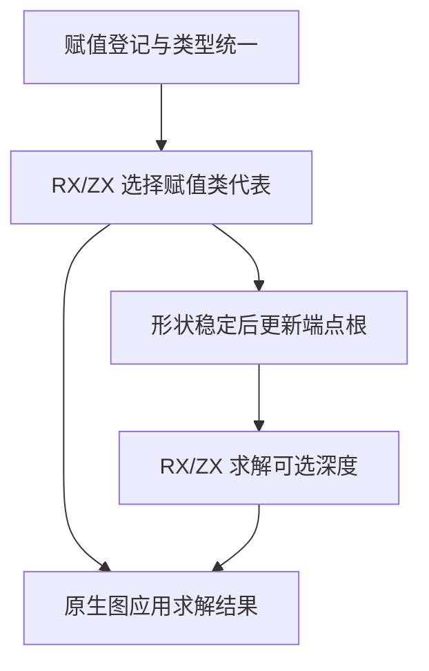
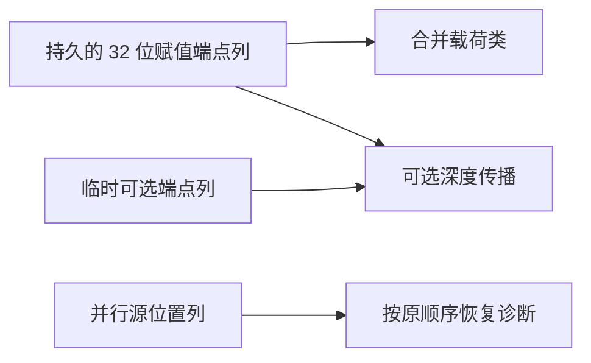

# RX 赋值边列存储自举

## Intent · 意图

让 RX 赋值类与可选深度求解直接消费同一份图边列，将赋值类的工作状态收窄到图编号宽度，消除每轮重复投影。

## Data · 证据

赋值边的原生记录原先要拆成两套临时列。赋值类将端点扩为 64 位，可选深度另建根端点与可选子边的拼接列。所有端点消费者通过并查集根解释节点身份，边的顺序和源位置由原图记录保留。

## Edges · 边界

图以原生列容器维护一次赋值登记。生成的赋值类与深度求解借用 32 位端点列，深度阶段另借用从当前图形状派生的可选边。原生宿主负责根编号更新、源位置和类型图变更。

## Answer · 交付与验收

核对共享端点列、赋值类代表和可选边冲突顺序，测量分配容量、实际 RX 生成和固定配置的完整构建。

赋值登记保存插入时的端点根。等价类直接通过载荷列解释边端点。图稳定后，深度求解入口原地更新已有端点列，另建派生的可选边，继续先处理赋值边，再按节点顺序处理可选边。源位置独立存储，冲突仍以原有边序号定位。

### 规则与工作区

使用固定 Source stage 3 生成两套求解器。24,000 组深度对照和 24,000 组等价类对照通过，覆盖重复边、循环、空图、首个冲突位置和代表选择。集中回归 48/48 步和 270/270 项测试通过。

生成的等价类按秩合并，使用 8 位秩和 32 位编号，在独占父编号列上压平根。生成代码中压平过程无克隆或新分配，代表选择借用已压平的列。32,768 个节点、32,511 条赋值边及 256 条可选边的独立样本中，赋值类 arena 容量由 3,637,842 降至 884,988 字节，深度工作区容量为 1,376,508 字节。两次调用都借用原输入，样本容量不含宿主原先用于转列的临时数组。

以相同样本连续运行 128 次两套求解器，墙钟中位数 0.1485 → 0.1536 秒，CPU 0.1477 → 0.1528 秒，深度与代表校验通过。

### 完整构建与安装版

沿用 Zig 0.17.0、ReleaseSmall、12 核、四分区和固定种子 `0x3b41c83f`，关闭常驻生成。显式本地和全局缓存目录为空，复用同一基准源码目录及其 Zig 源码缓存。构建由 Native seed 引导，安装版运行 Source 分析。70/70 步通过。

| 指标                   |      固定基线 |          上批 |          本批 |
| ---------------------- | ------------: | ------------: | ------------: |
| 墙钟 / s               |       129.740 |       116.991 |       115.789 |
| CPU / s                |        216.03 |        209.20 |        208.20 |
| 进程树采样峰值 RSS / B | 2,247,294,976 | 2,315,632,640 | 2,312,863,744 |
| 单进程系统峰值 RSS / B | 2,075,033,600 | 2,130,821,120 | 2,112,192,512 |

较上批墙钟减少 1.20 秒，CPU 减少 1.00 秒，进程树峰值减少 2.8 MB。CPU 较近期 206.33 秒样本增加 1.87 秒，较固定基线减少 7.83 秒。进程树峰值较固定基线仍高 65.6 MB。前三个分区对象逐字节一致，第四个减少 264 字节。

安装版对照九个生成结果、四个诊断和三个库项目的 47 份产物，全部逐字节一致。96 行嵌套列表禁用缓存，每轮生成 16 次，墙钟中位数 0.2786 → 0.2784 秒，CPU 0.2728 → 0.2732 秒。

命令、日志和哈希位于 `.zig-cache/cold-build-analysis/ownership-research/rx-assignment-columns/` 和同级 `partition-reference/cold-rx-assignment-columns/`。
