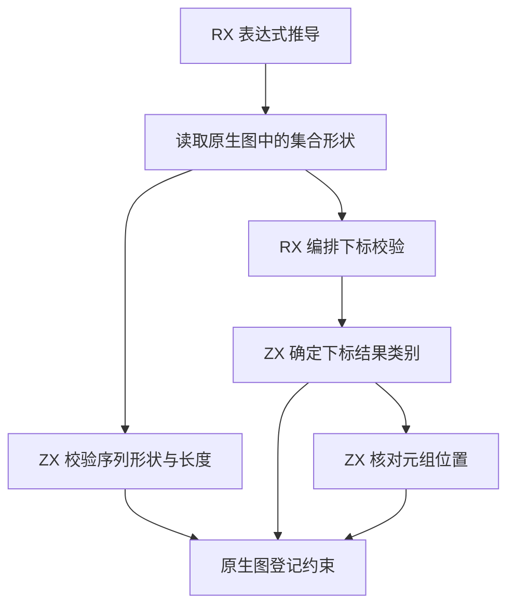
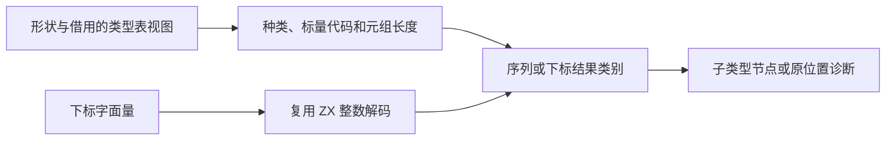

# RX 集合投影推导自举

## Intent · 意图

将 RX 序列字面量的形状与元组长度校验、集合下标类型选择和元组位置校验迁入 RX/ZX。保持诊断位置、错误顺序以及约束登记语义。

## Data · 证据

现有序列传播按元素重复读取同一个集合形状和已声明类型。元素约束登记只添加赋值边，形状在该轮传播中稳定。新建序列的节点在返回前仅用于登记预期类型，直到求解阶段才会解析成具体形状。整数解码已有 Source 实现，RX 下标仍在分配临时数组并剥离数字分隔符。

## Edges · 边界

原生图提供形状和已声明类型的借用视图，生成规则接收形状、长度和位置等标量。索引模块由 RX 在元组分支调用 ZX 位置校验。图节点、子类型借用、赋值边和默认列表的包含关系遍历仍由原生求解器维护。

## Answer · 交付与验收

集中核对列表、元组、字符串、待定形状和越界诊断，检查生成入口不分配，再对照实际 RX 生成和固定配置冷构建。

### 语义与生成

初始字面量节点在推导子元素前尚未暴露，预期类型只登记赋值边。求解传播时读取一次形状，列表只解析一次元素类型，元组逐位置读取既有借用视图。空序列与尚未确定的形状沿用旧规则，缺少下标字面量与下标越界继续指向下标本身。

固定的 Source stage 3 生成两组规则和已有整数解码器。以零字节分配器执行 35,393 组对照，覆盖全部形状、标量类型、长度组合、空下标及数字解码边界。集中回归 48/48 步通过，实际执行 138 项 RX 推导用例，另 132 项复用同输入的成功缓存。安装版的 19 个针对性项目中，9 个生成结果和 10 个诊断逐字节一致。

### 性能

沿用 Zig 0.17.0、ReleaseSmall、12 核、四分区、固定种子 `0x3b41c83f`、空本地及全局缓存和同一源码目录。关闭常驻生成，完整构建由 Native seed 引导，安装版运行 Source 分析。70/70 步通过。

| 指标                   |      固定基线 |          上批 |          本批 |      较上批 |
| ---------------------- | ------------: | ------------: | ------------: | ----------: |
| 墙钟 / s               |       129.740 |       116.379 |       116.879 |      +0.500 |
| CPU / s                |        216.03 |        207.80 |        207.71 |       −0.09 |
| 进程树采样峰值 RSS / B | 2,247,294,976 | 2,259,025,920 | 2,289,549,312 | +30,523,392 |
| 单进程系统峰值 RSS / B | 2,075,033,600 | 2,115,256,320 | 2,115,207,168 |     −49,152 |

CPU 较近期 206.33 秒样本增加 1.38 秒，较固定基线减少 8.32 秒。进程树峰值比固定基线高 42.3 MB，峰值时刻仍落在三个 Zig 分区进程并发生成对象的区间。

四个分区对象逐字节一致，新增规则由最终安装版的编译单元链接。三个库项目的 47 份产物逐字节一致。包含 64 个列表字段和 192 次下标读取的模块，每轮禁用缓存生成 16 次，墙钟中位数 0.8536 → 0.8608 秒，CPU 0.8355 → 0.8342 秒，生成源码一致。

命令、日志和哈希位于 `.zig-cache/cold-build-analysis/ownership-research/rx-sequences/` 和同级 `partition-reference/cold-rx-sequences/`。
