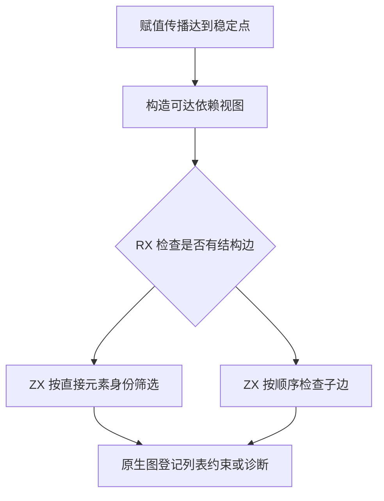

# RX 默认列表依赖自举

## Intent · 意图

将 RX 序列默认化所需的结构依赖遍历、候选顺序和递归诊断迁入 RX/ZX。保留赋值类归一化、深度上限及诊断位置。

## Data · 证据

旧实现为每个待定序列重新扫描所有待定序列的元素，并在每个递归步骤重算赋值类代表。赋值传播稳定后，同一轮的代表和节点形状保持不变。序列本身在结构遍历中是叶节点，列表、可空、元组和对象贡献有序子边。

## Edges · 边界

归一化视图仅记录待定序列和可达节点的身份与依赖边，使用已有求解工作区。Source 复用赋值类初始化时计算的有效载荷索引。原生宿主仍维护图和类型表，并在选定候选后提交原有列表约束。初始 seed 使用原递归规则。

## Answer · 交付与验收

对照候选位置、诊断顺序、递归及深度边界，检查生成代码的借用与分配，再测量真实 RX 项目和固定配置冷构建。

有子边时，遍历顺序与旧算法一致。每个候选即使已在一个元素中找到，仍需检查其他元素中的深度错误。无子边时，直接元素在紧凑编号中占据连续前缀，候选按编号判定，每个候选只检查一次。

结构分支在同一循环中推进候选与根元素，避免每个候选额外构造查找参数。平坦分支跳过有序元素表与邻接偏移表，直接复用身份前缀。选定结果后才修改原生类型图。

固定的 Source stage 3 生成规则入口。以零字节分配器核对 18,452 个选择结果，覆盖三节点有向图的全部 512 种边集、重复候选、重复元素、循环，以及深度 255 和 256 的边界。优化后四组集中回归 48/48 步通过，共执行 270 项测试。

安装版逐字节对照九个生成结果、四个诊断和三个库项目的 47 份产物。多模块递归用例仍在形成递归的序列处报告错误。

### 性能

沿用 Zig 0.17.0、ReleaseSmall、12 核、四分区和固定种子 `0x3b41c83f`，关闭常驻生成。每轮的本地和全局构建缓存目录为空，沿用同一基准源码目录及其 Zig 源码缓存。构建由 Native seed 引导，安装版运行 Source 分析。两轮均通过 70/70 步。

| 指标                   |      固定基线 |          上批 |          初版 |        优化后 |
| ---------------------- | ------------: | ------------: | ------------: | ------------: |
| 墙钟 / s               |       129.740 |       116.879 |       118.119 |       116.991 |
| CPU / s                |        216.03 |        207.71 |        209.02 |        209.20 |
| 进程树采样峰值 RSS / B | 2,247,294,976 | 2,289,549,312 | 2,339,864,576 | 2,315,632,640 |
| 单进程系统峰值 RSS / B | 2,075,033,600 | 2,115,207,168 | 2,116,157,440 | 2,130,821,120 |

优化后相对上批墙钟增加 0.112 秒，CPU 增加 1.49 秒，进程树峰值增加 26.1 MB。相对固定基线，墙钟减少 12.75 秒，CPU 减少 6.83 秒，进程树峰值增加 68.3 MB。CPU 相对近期 206.33 秒样本累计增加 2.87 秒，接近 3 秒警戒线。

采样中，生成器 CPU 为 6.69 → 6.26 秒，最终宿主编译为 33.62 → 33.97 秒，四个分区编译合计为 77.48 → 77.95 秒。前三个分区对象逐字节一致，第四个增加 1,608 字节。进程树峰值仍来自并发编译 Zig 分区，发生时间从 80.78 秒移至 62.99 秒。采样只反映各进程的末次观测，完整 CPU 以系统计时为准。

安装版禁用缓存，每轮连续生成 16 次。96 行嵌套列表的墙钟中位数为 0.2825 → 0.2758 秒，CPU 为 0.2790 → 0.2723 秒。64 个含列表字段的对象的墙钟中位数为 0.3459 → 0.3429 秒，CPU 为 0.3420 → 0.3389 秒。两组生成源码均一致。

命令、日志和哈希位于 `.zig-cache/cold-build-analysis/ownership-research/rx-list-default/`，以及同级 `partition-reference/cold-rx-list-default/` 和 `partition-reference/cold-rx-list-default-optimized/`。
