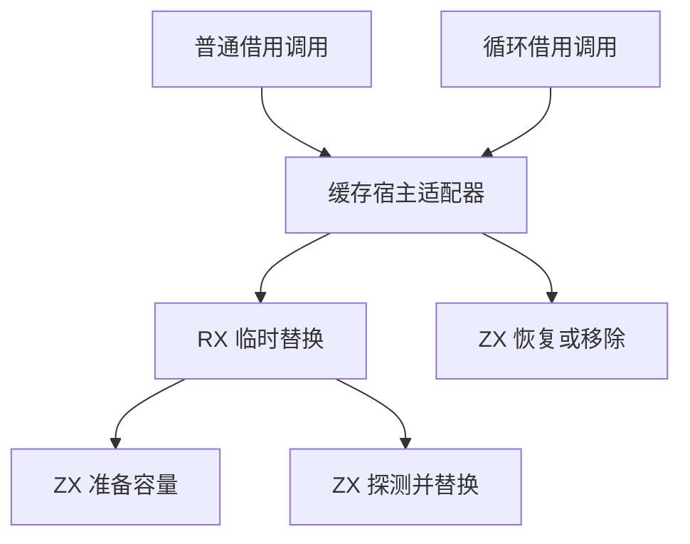

# 借用调用临时缓存自举

## Intent

将借用调用的临时缓存替换和恢复迁入 RX、ZX。普通借用调用与循环借用调用共用同一缓存协议，保持实参只求值一次、嵌套调用恢复原值，以及缓存条目的遍历顺序。

## Data

- 旧调用先读取旧值，再单独写入临时视图。成功进入后，在调用、结果转换和发射结束时恢复原值。原先没有条目时则删除临时条目。
- 旧缓存写入先按负载决定是否扩容，再探测插入位置。缓存布局可影响生成器遍历条目时的发射顺序，因此保留扩容条件、探测和遍历语义。
- 插入空位时，先写入值和键，最后写入可见的元数据标记。任何前置写入失败都不会发布半初始化条目。

## Edges

- RX 先为写入准备容量，再调用 ZX 对准备后的表探测一次，保存旧值并写入临时视图。普通写入复用相同的容量与位置更新原语。
- 恢复入口在 ZX 中按旧值是否存在选择写回或移除。扩容分配失败时，已存在键仍可使用原有的原位覆盖路径。
- Zig 宿主保留递归调用、布局转换和 `defer` 生命周期。缓存状态只在生成操作成功后回写。初始 seed 通过原生映射执行同一接口。

### 架构

### 数据流

## Answer

验收覆盖三阶段自编译、同输入生成产物对照、已有借用调用及缓存回归、生成器成本和完整冷构建。正式编译器的传递依赖仍需继续迁移。

### 自编译与生成器

以上一阶段的 Source stage 3 生成当前 stage 1，再依次生成 stage 2 和 stage 3。三轮均为 22/22 步。主组 8,892 个文件、顺序组 23 个、集合组 79 个、增长组 418 个、宿主组 108 个，三阶段逐字节一致。前后工具对相同输入生成的主组、增长组和包含缓存入口的集合组也完全一致。

前后工具均由 Source 自编译至 stage 3，运行时均使用 Source 分析与生成。使用相同的 385 入口主清单，空函数缓存每轮重新生成 4,112 个函数，取三轮交替测量的中位数。

| 三轮中位数          | 墙钟秒      | CPU 秒      | 单体峰值 RSS 字节         |
| ------------------- | ----------- | ----------- | ------------------------- |
| 缓存命中，前 → 后   | 1.54 → 1.53 | 5.28 → 5.27 | 851,132,416 → 851,836,928 |
| 空函数缓存，前 → 后 | 2.03 → 2.03 | 8.90 → 8.83 | 894,861,312 → 898,023,424 |

空函数缓存的单体峰值 RSS 中位数增加 3.2 MB。计时和逐文件校验在 `.zig-cache/cold-build-analysis/ownership-research/temporary-call-cache/`。

### 完整冷构建

Zig 0.17.0、ReleaseSmall、12 核、四分区、固定遍历种子 `0x3b41c83f`、本地 Zig 归档。关闭常驻生成器，使用独立空缓存并每 200 毫秒采样进程树。构建中工具本体、分析及生成来自 Zig seed，安装版 CLI 使用 Source。

| 对照                 | 墙钟秒  | CPU 秒 | 进程树峰值字节 | 单体最大 RSS 字节 |
| -------------------- | ------- | ------ | -------------- | ----------------- |
| 固定基线             | 129.740 | 216.03 | 2,247,294,976  | 2,075,033,600     |
| 上一阶段同工作区样本 | 116.609 | 206.08 | 2,267,037,696  | 2,116,993,024     |
| 本阶段样本           | 116.757 | 207.41 | 2,229,747,712  | 2,127,085,568     |

冷构建 70/70 步通过。相对上一阶段，墙钟增加 0.15 秒，CPU 增加 1.33 秒（0.65%），进程树峰值减少 37.3 MB，单体最大 RSS 增加 10.1 MB。相对固定基线，墙钟少 12.98 秒，CPU 少 8.62 秒，进程树峰值低 17.5 MB，单体最大 RSS 高 52.1 MB。

树峰在 80.67 秒出现，LLVM 分区 0、1、2 同时编译，三个目标对象逐字节相同。分区 3 的目标对象减少 88 字节，在树峰前已退出。按进程采样估计，主生成器 CPU 增加 0.65 秒，三个产物一致的分区合计增加 0.59 秒。采样会遗漏进程退出前的最后一段，完整 CPU 使用 `time` 统计。冷构建单体 RSS 的增幅尚未归因。日志与对象校验在 `partition-reference/cold-temporary-call-cache/`。

### 回归与自我复核

前后安装版 CLI 禁用缓存生成 34 个已有用例，Zig 文件逐字节一致，覆盖循环借用调用、嵌套借用视图、共享别名和作用域。RX、ZX 通过格式化与 lint，Zig 通过 `zig fmt --check`。

使用本阶段 Source stage 3 运行 `test-modular-loop`、`test-iterate-calls`、`test-loop-call-origins`、`test-borrowed-call-views`、`test-cached-ownership`、`test-module-generation` 与 `test-native-value-boundary`，336/336 步、584/584 项通过。增量回归覆盖函数体修改、被调用函数的值调用资格变化、同输入冷生成对照及恢复原源码。借用调用和缓存回归覆盖分配失败路径。

核对了生成的 Zig。命中时先准备保留的列，再写入值。插入时在写入键和值之后发布元数据。临时交换只有成功后才发布新的缓存状态，恢复沿用原映射的容量条件与原位覆盖退路。两条借用调用入口均在交换成功后登记恢复，并在调用、转换或发射失败时执行。
